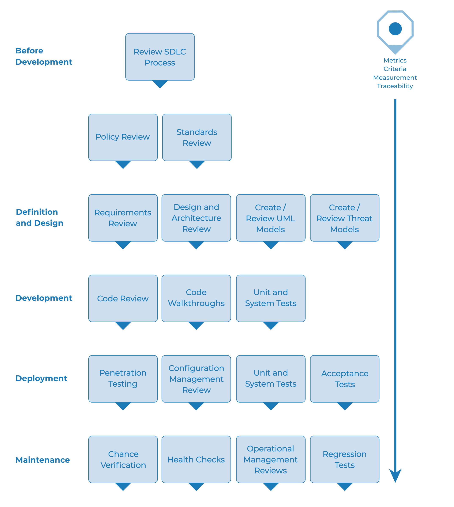

# Методология тестирования веб-безопасности

## Обзор

В этом разделе описана типовая методология тестирования, которую можно разработать внутри организации. Её можно рассматривать как опорную модель, объединяющую методы и задачи, подходящие для различных этапов жизненного цикла разработки программного обеспечения (SDLC). Компании и проектные команды могут использовать эту модель для создания собственной методологии тестирования и определения объёма услуг тестирования, заказываемых у поставщиков. Рассматривайте её как гибкий подход, который можно расширять и адаптировать к процессам разработки и культуре организации, а не как жёсткое предписание.

Этот раздел призван помочь организациям построить полноценный стратегический процесс тестирования и не ориентирован на консультантов и подрядчиков, которых обычно привлекают для решения более узких тактических задач тестирования.

Необходимо понимать, почему сквозная методология тестирования столь важна для оценки и повышения безопасности программного обеспечения. В книге *Writing Secure Code* Howard и LeBlanc отмечают, что выпуск бюллетеня безопасности обходится Microsoft как минимум в 100 000 долларов, а совокупные затраты её клиентов на установку исправлений безопасности значительно выше. Они также указывают, что на [сайте CyberCrime](https://www.justice.gov/criminal-ccips) правительства США подробно описаны недавние уголовные дела и убытки организаций. Как правило, эти убытки значительно превышают 100 000 долларов США.

При таких затратах неудивительно, что поставщики программного обеспечения отказываются от исключительной опоры на тестирование безопасности методом «чёрного ящика», которое возможно лишь для уже разработанных приложений, и сосредотачиваются на тестировании на ранних этапах разработки: при определении требований, проектировании и написании кода.

Многие специалисты по безопасности всё ещё рассматривают тестирование безопасности в рамках тестирования на проникновение. Как обсуждалось в предыдущей главе, хотя у тестирования на проникновение есть своя роль, в целом оно неэффективно для поиска ошибок и чрезмерно зависит от квалификации тестировщика. Его следует рассматривать лишь как метод проверки реализации или способ выявить проблемы в производственной среде. Чтобы повысить безопасность приложений, нужно повысить качество программного обеспечения с точки зрения безопасности. Это означает проверку безопасности на этапах определения требований, проектирования, разработки, развёртывания и сопровождения вместо дорогостоящей стратегии ожидания полного завершения кода.

Как отмечалось во введении, существует множество методологий разработки: Rational Unified Process, экстремальная и гибкая разработка, традиционные каскадные методологии. Цель этого руководства — не предложить конкретную методологию разработки и не дать специальные рекомендации для какой-либо одной из них. Вместо этого мы представляем обобщённую модель разработки, которую читателю следует применять с учётом процессов своей компании.

Эта методология тестирования включает мероприятия, которые следует проводить:

- до начала разработки;
- при определении требований и проектировании;
- в процессе разработки;
- при развёртывании;
- при сопровождении и эксплуатации.

## Этап 1. До начала разработки

### Этап 1.1. Определение SDLC

До начала разработки приложения необходимо определить подходящий жизненный цикл разработки программного обеспечения, в котором безопасность заложена на каждом этапе.

### Этап 1.2. Анализ политик и стандартов

Убедитесь, что существуют подходящие политики, стандарты и документация. Документация чрезвычайно важна: она предоставляет командам разработки рекомендации и политики, которым можно следовать. Люди могут поступать правильно, только если знают, что именно считается правильным.

Если приложение разрабатывается на Java, необходим стандарт безопасного программирования на Java. Если в приложении используется криптография, необходим стандарт её применения. Никакие политики и стандарты не могут охватить все ситуации, с которыми столкнётся команда разработки. Документирование распространённых и предсказуемых проблем позволяет сократить число решений, которые придётся принимать в процессе разработки.

### Этап 1.3. Разработка критериев измерений и метрик и обеспечение прослеживаемости

До начала разработки спланируйте программу измерений. Определение измеряемых критериев позволяет выявлять недостатки как процесса, так и продукта. Метрики необходимо определить до начала разработки, поскольку для сбора данных может потребоваться изменение процесса.

## Этап 2. При определении требований и проектировании

### Этап 2.1. Анализ требований безопасности

Требования безопасности определяют, как приложение работает с точки зрения безопасности. Эти требования необходимо проверять. В данном случае проверка означает проверку допущений, заложенных в требования, и поиск пробелов в их формулировках.

Например, если требование безопасности гласит, что пользователи должны быть зарегистрированы, прежде чем получат доступ к разделу сайта с аналитическими материалами, означает ли это, что пользователь должен быть зарегистрирован в системе, или он должен пройти аутентификацию? Убедитесь, что требования сформулированы максимально однозначно.

При поиске пробелов в требованиях рассмотрите такие механизмы безопасности, как:

- управление пользователями;
- аутентификация;
- авторизация;
- конфиденциальность данных;
- целостность;
- подотчётность;
- управление сеансами;
- безопасность передачи данных;
- разделение уровней системы;
- соблюдение законодательства и стандартов, включая требования к конфиденциальности, государственные и отраслевые стандарты.

### Этап 2.2. Анализ проектных решений и архитектуры

Проектные решения и архитектура приложений должны быть документированы. Документация может включать модели, текстовые документы и другие подобные материалы. Эти материалы необходимо проверять, чтобы убедиться, что проектные решения и архитектура обеспечивают надлежащий уровень безопасности, определённый требованиями.

Выявление недостатков безопасности на этапе проектирования не только позволяет обнаруживать их с наименьшими затратами, но и даёт одну из лучших возможностей для внесения изменений. Например, если выясняется, что проект предусматривает принятие решений об авторизации в нескольких местах, стоит рассмотреть создание централизованного компонента авторизации. Если приложение проверяет данные в нескольких местах, целесообразно разработать общую подсистему проверки: исправить проверку входных данных в одном месте гораздо дешевле, чем в сотнях мест.

При обнаружении недостатков следует сообщить о них системному архитектору для рассмотрения альтернативных подходов.

### Этап 2.3. Создание и анализ UML-моделей

После завершения проектных решений и архитектуры создайте модели на унифицированном языке моделирования (UML), описывающие работу приложения. В некоторых случаях такие модели уже могут существовать. Используйте их, чтобы согласовать с проектировщиками системы точное понимание того, как работает приложение. При обнаружении недостатков следует сообщить о них системному архитектору для рассмотрения альтернативных подходов.

### Этап 2.4. Создание и анализ моделей угроз

Опираясь на результаты анализа проектных решений и архитектуры, а также UML-модели, точно описывающие работу системы, выполните моделирование угроз. Разработайте реалистичные сценарии угроз. Проанализируйте проектные решения и архитектуру, чтобы убедиться, что для этих угроз приняты меры снижения риска, соответствующие риски приняты бизнесом либо переданы третьей стороне, например страховой компании. Если для выявленных угроз отсутствуют стратегии снижения риска, совместно с системным архитектором вернитесь к проектным решениям и архитектуре и внесите изменения.

## Этап 3. В процессе разработки

Теоретически разработка — это реализация проектных решений. Однако на практике многие проектные решения принимаются при написании кода. Часто это небольшие решения, которые были слишком подробными для включения в проектную документацию, либо вопросы, по которым политики или стандарты не содержали указаний. Если проектные решения и архитектура проработаны недостаточно, разработчику придётся принимать множество решений. При недостатке политик и стандартов таких решений будет ещё больше.

### Этап 3.1. Совместный разбор кода

Команде безопасности следует провести совместный разбор кода с разработчиками, а в некоторых случаях и с системными архитекторами. Это обзор кода на высоком уровне, в ходе которого разработчики могут объяснить логику и порядок выполнения реализованного кода. Он позволяет команде анализа кода получить общее представление о нём, а разработчикам — объяснить причины принятых решений.

Цель состоит не в анализе кода как таковом, а в понимании на высоком уровне порядка выполнения, организации и структуры кода приложения.

### Этап 3.2. Анализ кода

Получив хорошее представление о структуре кода и причинах принятых решений, тестировщик может исследовать сам код на наличие недостатков безопасности.

При статическом анализе код проверяют по набору контрольных списков, включающих:

- бизнес-требования к доступности, конфиденциальности и целостности;
- контрольные списки руководства OWASP или Top 10 для технических проблем безопасности в зависимости от глубины анализа;
- вопросы, характерные для используемого языка или фреймворка, например документ Scarlet для PHP или [контрольные списки Microsoft по безопасному программированию для ASP.NET](https://msdn.microsoft.com/en-us/library/ff648269.aspx);
- любые отраслевые требования, например Sarbanes-Oxley 404, COPPA, ISO/IEC 27002, APRA, HIPAA, рекомендации Visa для торговых предприятий или другие нормативные режимы.

По отдаче от вложенных ресурсов, преимущественно времени, статический анализ кода даёт значительно более качественные результаты, чем любой другой метод проверки безопасности, и меньше всего зависит от квалификации проверяющего. Однако он не является универсальным решением, и его применение необходимо тщательно продумывать в рамках комплексного тестирования.

Подробнее о контрольных списках OWASP см. в последнем издании [OWASP Top 10](https://owasp.org/www-project-top-ten/).

## Этап 4. При развёртывании

### Этап 4.1. Тестирование приложения на проникновение

После проверки требований, анализа проектных решений и анализа кода можно предположить, что все проблемы уже обнаружены. Будем надеяться, что это так, однако тестирование приложения на проникновение после развёртывания служит дополнительной проверкой того, что ничего не пропущено.

### Этап 4.2. Тестирование управления конфигурацией

Тестирование приложения на проникновение должно включать исследование того, как инфраструктура была развёрнута и защищена. Важно проверять любые, даже самые мелкие аспекты конфигурации, чтобы убедиться в отсутствии оставленных по умолчанию настроек, которые могут быть уязвимы для эксплуатации.

## Этап 5. При сопровождении и эксплуатации

### Этап 5.1. Анализ управления эксплуатацией

Необходимо установить процесс, подробно определяющий порядок управления эксплуатацией как приложения, так и инфраструктуры.

### Этап 5.2. Периодические проверки состояния

Следует ежемесячно или ежеквартально проверять состояние как приложения, так и инфраструктуры, чтобы убедиться в отсутствии новых рисков безопасности и сохранении уровня защищённости.

### Этап 5.3. Обеспечение проверки изменений

После того как каждое изменение согласовано, проверено в среде обеспечения качества и развёрнуто в производственной среде, крайне важно проверить, что оно не повлияло на уровень безопасности. Эту проверку следует включить в процесс управления изменениями.

## Типовой процесс тестирования в SDLC

На следующем рисунке показан типовой процесс тестирования в SDLC.

\
 *Рисунок 3-1. Типовой процесс тестирования в SDLC. До начала разработки: анализ процесса SDLC, политик и стандартов. Определение требований и проектирование: анализ требований, проектных решений и архитектуры, создание и анализ UML-моделей и моделей угроз. Разработка: анализ кода, совместные разборы кода, модульные и системные тесты. Развёртывание: тестирование на проникновение, анализ управления конфигурацией, модульные, системные и приёмочные тесты. Сопровождение: проверка изменений, проверки состояния, анализ управления эксплуатацией, регрессионные тесты. На всех этапах: метрики, критерии, измерения, прослеживаемость.*
