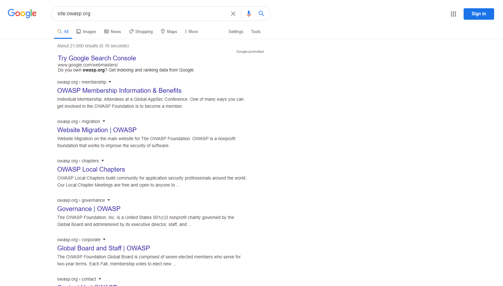
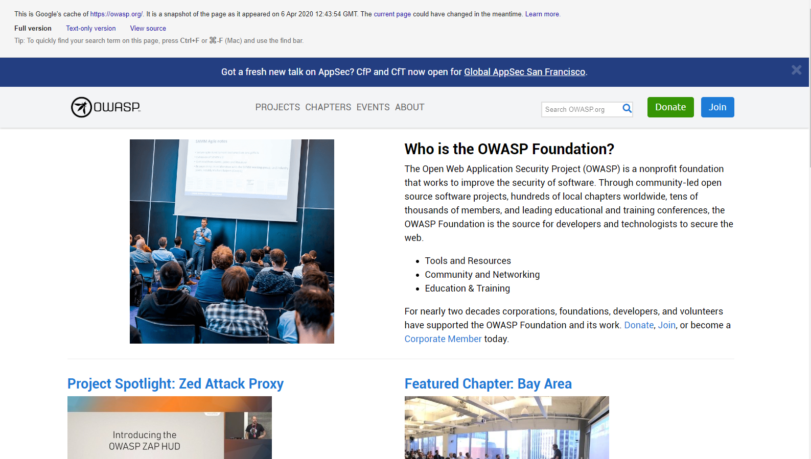

# Сбор информации и выявление утечек через поисковые системы

|ID          |
|------------|
|WSTG-INFO-01|

## Краткое описание

Для работы поисковых систем компьютерные программы, или `robots`, регулярно получают данные с миллиардов веб-страниц; этот процесс называется [обходом](https://en.wikipedia.org/wiki/Web_crawler). Такие программы находят веб-контент и функциональные возможности, переходя по ссылкам с других страниц или просматривая карты сайтов. Если на сайте используется специальный файл `robots.txt` с перечнем страниц, которые поисковые системы не должны загружать, перечисленные страницы будут проигнорированы. Это лишь общее описание; Google подробнее объясняет, [как работает поисковая система](https://support.google.com/webmasters/answer/70897?hl=en).

Тестировщики могут использовать поисковые системы для разведки сайтов и веб-приложений. Поиск и разведка с помощью поисковых систем включают прямые и косвенные методы: прямые связаны с поиском по индексам и соответствующему содержимому кешей, а косвенные — с получением конфиденциальных сведений о проектных решениях и конфигурации путём поиска на форумах, в группах новостей и на сайтах закупок.

Завершив обход, поисковый робот начинает индексировать веб-контент на основе тегов и связанных атрибутов, таких как `<TITLE>`, чтобы выдавать подходящие результаты поиска. Если файл `robots.txt` не обновляется в течение жизненного цикла сайта и в HTML не используются встроенные метатеги, запрещающие роботам индексировать содержимое, в индексы может попасть веб-контент, который владельцы не намеревались туда включать. Чтобы удалить такое содержимое, владельцы сайтов могут использовать упомянутый файл `robots.txt`, метатеги HTML, аутентификацию и инструменты поисковых систем.

## Цели тестирования

- Определить, какие конфиденциальные сведения о проектных решениях и конфигурации приложения, системы или организации раскрываются напрямую на сайте организации либо косвенно через сторонние сервисы.

## Методика тестирования

Используйте поисковую систему для поиска потенциально конфиденциальной информации. Она может включать:

- схемы и конфигурации сети;
- архивные публикации и электронные письма администраторов или других ключевых сотрудников;
- процедуры входа и форматы имён пользователей;
- имена пользователей, пароли и закрытые ключи;
- файлы конфигурации сторонних или облачных сервисов;
- содержимое сообщений об ошибках, раскрывающее информацию;
- версии сайтов для разработки, тестирования, пользовательского приёмочного тестирования (UAT) и предварительного развёртывания.

### Поисковые системы

Не ограничивайте тестирование одним поставщиком поисковых услуг: разные поисковые системы могут выдавать разные результаты. Результаты могут различаться в зависимости от времени последнего обхода содержимого и алгоритма определения релевантных страниц. Рассмотрите следующие поисковые системы, перечисленные в алфавитном порядке:

- [Baidu](https://www.baidu.com/) — [самая популярная](https://en.wikipedia.org/wiki/Web_search_engine#Market_share) поисковая система Китая.
- [Bing](https://www.bing.com/) — поисковая система, принадлежащая Microsoft и управляемая ею; занимает второе место [по популярности](https://en.wikipedia.org/wiki/Web_search_engine#Market_share) в мире. Поддерживает [ключевые слова расширенного поиска](http://help.bing.microsoft.com/#apex/18/en-US/10001/-1).
- [binsearch.info](https://binsearch.info/) — поисковая система для групп новостей Usenet с двоичными данными.
- [Common Crawl](https://commoncrawl.org/) — «открытое хранилище данных обхода веб-страниц, доступное любому для получения и анализа».
- [DuckDuckGo](https://duckduckgo.com/) — поисковая система, ориентированная на конфиденциальность и объединяющая результаты из множества [источников](https://help.duckduckgo.com/results/sources/). Поддерживает [синтаксис поиска](https://help.duckduckgo.com/duckduckgo-help-pages/results/syntax/).
- [Google](https://www.google.com/) — [самая популярная](https://en.wikipedia.org/wiki/Web_search_engine#Market_share) поисковая система в мире; использует систему ранжирования, чтобы выдавать наиболее релевантные результаты. Поддерживает [операторы поиска](https://support.google.com/websearch/answer/2466433).
- [Internet Archive Wayback Machine](https://archive.org/web/) — «создание цифровой библиотеки интернет-сайтов и других культурных материалов в цифровой форме».
- [Startpage](https://www.startpage.com/) — поисковая система, использующая результаты Google без сбора персональных данных с помощью средств отслеживания и журналов. Поддерживает [операторы поиска](https://support.startpage.com/index.php?/Knowledgebase/Article/View/989/0/advanced-search-which-search-operators-are-supported-by-startpagecom).
- [Shodan](https://www.shodan.io/) — сервис поиска подключённых к Интернету устройств и служб. Доступны ограниченный бесплатный тариф и платные подписки.

DuckDuckGo и Startpage обеспечивают пользователям несколько более высокую конфиденциальность, поскольку не используют средства отслеживания и не ведут журналы. Это может уменьшить утечку информации о тестировщике.

### Операторы поиска

Оператор поиска — это специальное ключевое слово или синтаксическая конструкция, расширяющая возможности обычных поисковых запросов и позволяющая получать более точные результаты. Обычно операторы имеют вид `operator:query`. Вот некоторые часто поддерживаемые операторы поиска:

- `site:` ограничивает поиск указанным доменом.
- `inurl:` возвращает только результаты с ключевым словом в URL.
- `intitle:` возвращает только результаты с ключевым словом в заголовке страницы.
- `intext:` или `inbody:` ищет ключевое слово только в теле страниц.
- `filetype:` отбирает только файлы определённого типа, например png или php.

Например, для поиска веб-контента owasp.org, проиндексированного типичной поисковой системой, используется следующий синтаксис:

```text
site:owasp.org
```

\
*Рисунок 4.1.1-1. Пример результатов поиска Google с оператором site. Интерфейс: «Все», «Картинки», «Новости», «Покупки», «Карты», «Ещё», «Настройки», «Инструменты», «Войти»; «Около 21 600 результатов (0,16 секунды)». «Попробуйте Google Search Console»; «Вы владеете owasp.org? Получайте данные Google об индексировании и ранжировании»; «Реклама Google». Результаты: «Информация об участии в OWASP и преимущества», «Индивидуальное участие. Участники конференции Global AppSec. Один из многих способов участия в OWASP Foundation — стать участником»; «Перенос сайта | OWASP», «Перенос сайта для главного сайта OWASP Foundation. OWASP — некоммерческий фонд, работающий над повышением безопасности программного обеспечения». Запрос и адреса сохранены.*

### Просмотр кешированного содержимого

Для поиска ранее проиндексированного содержимого используйте оператор `cache:`. Он полезен для просмотра содержимого, которое могло измениться после индексирования или больше недоступно. Не все поисковые системы предоставляют поиск по кешированному содержимому; на момент написания наиболее полезным источником был Google.

Для просмотра кешированной версии `owasp.org` используется следующий синтаксис:

```text
cache:owasp.org
```

\
*Рисунок 4.1.1-2. Пример результатов поиска Google с оператором cache. «Это кеш Google для сайта owasp.org. Снимок страницы по состоянию на 6 апреля 2020 года, 12:43:54 GMT. Текущая страница за это время могла измениться. Подробнее». «Полная версия», «Текстовая версия», «Исходный код»; «Совет: для быстрого поиска слова на странице нажмите Ctrl+F или ⌘-F (Mac) и воспользуйтесь строкой поиска». Баннер: «Есть новая тема доклада об AppSec? Приём заявок на доклады и обучения для Global AppSec San Francisco открыт». Меню: «Проекты», «Местные сообщества», «Мероприятия», «О нас», «Поиск по OWASP.org», «Пожертвовать», «Присоединиться». «Что такое OWASP Foundation?»; «Open Web Application Security Project (OWASP) — некоммерческий фонд, работающий над повышением безопасности программного обеспечения. Благодаря открытым программным проектам сообщества, сотням местных сообществ по всему миру, десяткам тысяч участников и ведущим образовательным конференциям и конференциям по обучению OWASP Foundation служит ресурсом для разработчиков и специалистов, обеспечивающих безопасность веба». «Инструменты и ресурсы», «Сообщество и профессиональные связи», «Образование и обучение». «Почти два десятилетия корпорации, фонды, разработчики и добровольцы поддерживают OWASP Foundation и его работу. Пожертвуйте, присоединитесь или станьте корпоративным участником сегодня». «Проект в центре внимания: Zed Attack Proxy», «Представляем OWASP ZAP HUD», «Местное сообщество в центре внимания: Bay Area».*

### Google hacking, или доркинг

Поиск с операторами в сочетании с изобретательностью тестировщика может быть очень эффективным методом обнаружения информации. Операторы можно объединять, чтобы находить определённые виды конфиденциальных файлов и сведений. Этот метод, называемый [Google hacking](https://en.wikipedia.org/wiki/Google_hacking), или доркингом, можно применять и в других поисковых системах, если они поддерживают соответствующие операторы.

База поисковых запросов для доркинга, например [Google Hacking Database](https://www.exploit-db.com/google-hacking-database), — полезный ресурс для поиска определённой информации. В этой базе, в частности, доступны следующие категории запросов:

- Точки опоры для дальнейшего проникновения
- Файлы с именами пользователей
- Конфиденциальные каталоги
- Определение веб-сервера
- Уязвимые файлы
- Уязвимые серверы
- Сообщения об ошибках
- Файлы с ценной информацией
- Файлы с паролями
- Конфиденциальная информация интернет-магазинов

Базы для других поисковых систем, например Bing и Shodan, доступны в таких ресурсах, как [проект Google Hacking Diggity](https://resources.bishopfox.com/resources/tools/google-hacking-diggity/) компании Bishop Fox.

## Рекомендации по устранению

Перед публикацией в Интернете тщательно оценивайте конфиденциальность сведений о проектных решениях и конфигурации.

Периодически пересматривайте степень конфиденциальности уже опубликованных в Интернете сведений о проектных решениях и конфигурации.
