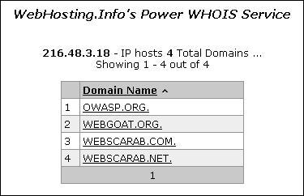

# Перечисление приложений на веб-сервере

|ID          |
|------------|
|WSTG-INFO-04|

## Краткое описание

Один из важнейших этапов проверки уязвимостей веб-приложений — выяснить, какие именно приложения размещены на веб-сервере. Для многих приложений известны уязвимости и способы атак, позволяющие получить удалённое управление или воспользоваться данными. Кроме того, приложения часто настроены неправильно или не обновляются, поскольку считается, что они используются только «внутри» и поэтому угроз нет.
С распространением виртуальных веб-серверов традиционное соответствие «один IP-адрес — один веб-сервер» во многом утрачивает прежнее значение. Нередко несколько сайтов или приложений имеют символьные имена, разрешающиеся в один IP-адрес. Это встречается как у хостинг-провайдеров, так и в обычных корпоративных средах.

Иногда специалистам по безопасности в качестве целей тестирования предоставляют набор IP-адресов. Можно утверждать, что такая постановка ближе к тестированию на проникновение, но в любом случае ожидается проверка всех веб-приложений, доступных через указанные цели. Проблема в том, что на заданном IP-адресе может работать HTTP-служба на порту 80, но при обращении по IP-адресу — единственным имеющимся у тестировщика сведениям — она сообщает: «По этому адресу веб-сервер не настроен» или нечто подобное. При этом система может «скрывать» несколько веб-приложений, связанных с не относящимися друг к другу символьными DNS-именами. Очевидно, полнота анализа сильно зависит от того, проверяет ли тестировщик все приложения или только те, о которых знает.

Иногда описание целей подробнее: тестировщику предоставляют список IP-адресов и соответствующих символьных имён. Однако и этот список может быть неполным: некоторые имена могут отсутствовать, причём заказчик может об этом даже не знать, особенно в крупных организациях.

На охват оценки влияют и веб-приложения, опубликованные по неочевидным URL, например `http://www.example.com/some-strange-URL`, на которые нигде нет ссылок. Такое бывает как по ошибке из-за неправильной конфигурации, так и намеренно, например для неафишируемых административных интерфейсов.

Для решения этих проблем необходимо обнаружить веб-приложения.

## Цели тестирования

- Перечислить находящиеся на веб-сервере приложения, входящие в область проверки.

## Методика тестирования

Обнаружение веб-приложений — процесс выявления веб-приложений в заданной инфраструктуре. Обычно её задают набором IP-адресов, возможно блоком сети, но это может быть набор символьных DNS-имён или сочетание адресов и имён. Эти сведения предоставляют до начала оценки, будь то классическое тестирование на проникновение или оценка конкретных приложений. В обоих случаях, если правила проведения работ не предписывают иное, например проверять только приложение по URL `http://www.example.com/`, следует стремиться к максимально полному охвату: выявить все приложения, доступные через заданную цель. Ниже рассмотрены несколько методов достижения этой цели.

> Некоторые из следующих методов применимы к веб-серверам, доступным из Интернета: веб-сервисы поиска DNS и обратного поиска по IP, а также поисковые системы. В примерах используются частные IP-адреса, такие как `192.168.1.100`; если не указано иное, они обозначают *произвольные* IP-адреса и служат только для анонимизации.

На число приложений, связанных с заданным DNS-именем или IP-адресом, влияют три фактора:

1. **Различные базовые URL**

    Очевидная точка входа в веб-приложение — `www.example.com`: под этой краткой записью подразумевается приложение, начинающееся по адресу `http://www.example.com/`; то же относится к https. Хотя это самый распространённый вариант, ничто не обязывает приложение начинаться с `/`.

    Например, с одним символьным именем могут быть связаны три веб-приложения: `http://www.example.com/url1` `http://www.example.com/url2` `http://www.example.com/url3`

    В таком случае URL `http://www.example.com/` не будет соответствовать содержательной странице, а три приложения окажутся **скрытыми**, если тестировщик не знает, как к ним обратиться, то есть не знает *url1*, *url2* или *url3*. Обычно нет необходимости публиковать приложения таким образом, если только владелец не хочет исключить стандартный способ доступа и готов сообщать пользователям точное расположение. Это не означает секретность приложений: их существование и расположение просто явно не объявлены.

2. **Нестандартные порты**

    Хотя веб-приложения обычно работают на портах 80 (http) и 443 (https), в этих номерах нет ничего особенного. Приложения могут использовать произвольные TCP-порты; для обращения к ним номер порта указывают так: `http[s]://www.example.com:port/`. Например, `http://www.example.com:20000/`.

3. **Виртуальные хосты**

    DNS позволяет связать один IP-адрес с одним или несколькими символьными именами. Например, IP-адрес `192.168.1.100` может соответствовать DNS-именам `www.example.com`, `helpdesk.example.com`, `webmail.example.com`. Необязательно, чтобы все имена относились к одному DNS-домену. Такое соответствие «один ко многим» позволяет выдавать разное содержимое с помощью так называемых виртуальных хостов. Сведения о том, к какому виртуальному хосту мы обращаемся, передаются в [заголовке Host](https://tools.ietf.org/html/rfc2616#section-14.23) HTTP 1.1.

    Помимо очевидного `www.example.com`, можно не заподозрить существование других веб-приложений, если не знать о `helpdesk.example.com` и `webmail.example.com`.

### Решение проблемы 1: нестандартные URL

Полностью установить наличие веб-приложений с нестандартными именами невозможно. Именно потому, что они нестандартны, фиксированных правил именования нет; однако ряд методов позволяет получить дополнительные сведения.

Во-первых, если веб-сервер настроен неправильно и разрешает просмотр каталогов, такие приложения можно заметить. В этом могут помочь сканеры уязвимостей.

Во-вторых, на эти приложения могут ссылаться другие веб-страницы, и поисковые системы могли уже обойти и проиндексировать их. Если тестировщики подозревают наличие таких **скрытых** приложений на `www.example.com`, они могут использовать оператор *site* и изучить результаты запроса `site: www.example.com`. Среди полученных URL может оказаться адрес неочевидного приложения.

Ещё один вариант — проверить URL, по которым могут находиться неафишируемые приложения. Например, веб-интерфейс почты может быть доступен по адресам `https://www.example.com/webmail`, `https://webmail.example.com/` или `https://mail.example.com/`. То же относится к административным интерфейсам: например, интерфейс управления Tomcat может быть опубликован по скрытому URL без каких-либо ссылок на него. Поэтому поиск по словарю, или «обоснованный подбор», может дать результаты. В этом могут помочь сканеры уязвимостей.

### Решение проблемы 2: нестандартные порты

Проверить наличие веб-приложений на нестандартных портах легко. Сканер портов, например nmap, умеет распознавать службы с помощью параметра `-sV` и выявлять http[s] на произвольных портах. Требуется полное сканирование всего пространства из 64 тысяч TCP-портов.

Например, следующая команда методом TCP connect выявляет все открытые порты IP-адреса `192.168.1.100` и пытается определить связанные с ними службы. Показаны только *основные* параметры: nmap поддерживает множество параметров, обсуждение которых выходит за рамки этого раздела.

`nmap –Pn –sT –sV –p0-65535 192.168.1.100`

Достаточно изучить вывод и найти http либо признаки служб, работающих через SSL; последние следует проверить, чтобы подтвердить использование https. Например, вывод предыдущей команды может выглядеть так:

```bash
Interesting ports on 192.168.1.100:
(The 65527 ports scanned but not shown below are in state: closed)
PORT      STATE SERVICE     VERSION
22/tcp    open  ssh         OpenSSH 3.5p1 (protocol 1.99)
80/tcp    open  http        Apache httpd 2.0.40 ((Red Hat Linux))
443/tcp   open  ssl         OpenSSL
901/tcp   open  http        Samba SWAT administration server
1241/tcp  open  ssl         Nessus security scanner
3690/tcp  open  unknown
8000/tcp  open  http-alt?
8080/tcp  open  http        Apache Tomcat/Coyote JSP engine 1.1
```

Из этого примера видно следующее:

- На порту 80 работает HTTP-сервер Apache.
- По всей видимости, на порту 443 работает HTTPS-сервер, но это нужно подтвердить, например открыв `https://192.168.1.100` в браузере.
- На порту 901 находится веб-интерфейс Samba SWAT.
- На порту 1241 работает не HTTPS, а демон Nessus через SSL.
- На порту 3690 работает неопределённая служба: nmap выдаёт её *характерные признаки*, здесь опущенные для ясности, и инструкции по отправке этих сведений для включения в базу признаков nmap, если вы знаете, что это за служба.
- На порту 8000 работает ещё одна неопределённая служба; возможно, это HTTP, поскольку HTTP-серверы нередко используют этот порт. Проверим:

```bash
$ telnet 192.168.10.100 8000
Trying 192.168.1.100...
Connected to 192.168.1.100.
Escape character is '^]'.
GET / HTTP/1.0

HTTP/1.0 200 OK
pragma: no-cache
Content-Type: text/html
Server: MX4J-HTTPD/1.0
expires: now
Cache-Control: no-cache

<html>
...
```

Это подтверждает, что перед нами действительно HTTP-сервер. Вместо этого тестировщики могли открыть URL в браузере либо использовать команды Perl GET или HEAD, имитирующие HTTP-взаимодействие, подобное приведённому выше; однако не все серверы поддерживают запросы HEAD.

- На порту 8080 работает Apache Tomcat.

Ту же задачу могут выполнять сканеры уязвимостей, но сначала убедитесь, что выбранный сканер умеет определять службы HTTP[S] на нестандартных портах. Например, Nessus распознаёт их на произвольных портах, если настроить сканирование всех портов, и, в отличие от nmap, выполняет ряд проверок известных уязвимостей веб-серверов, а также конфигурации SSL служб HTTPS. Как отмечалось ранее, Nessus может также обнаруживать популярные приложения и веб-интерфейсы, которые иначе могли бы остаться незамеченными, например интерфейс управления Tomcat.

### Решение проблемы 3: виртуальные хосты

Есть несколько методов определения DNS-имён, связанных с заданным IP-адресом `x.y.z.t`.

#### Передача зон DNS

Сегодня этот метод применим ограниченно, поскольку DNS-серверы в большинстве случаев не разрешают передачу зон. Однако попробовать может быть полезно. Сначала тестировщики должны определить серверы имён, обслуживающие `x.y.z.t`. Если для `x.y.z.t` известно символьное имя, допустим `www.example.com`, серверы имён можно определить с помощью `nslookup`, `host` или `dig`, запросив записи DNS NS.

Если для `x.y.z.t` не известно ни одного символьного имени, но описание цели содержит хотя бы одно имя, тестировщики могут применить тот же подход и обратиться к серверу имён этого имени в надежде, что он обслуживает и `x.y.z.t`. Например, если цель состоит из IP-адреса `x.y.z.t` и имени `mail.example.com`, определите серверы имён домена `example.com`.

Следующий пример показывает, как определить серверы имён для `www.owasp.org` с помощью команды `host`:

```bash
$ host -t ns www.owasp.org
www.owasp.org is an alias for owasp.org.
owasp.org name server ns1.secure.net.
owasp.org name server ns2.secure.net.
```

Теперь можно запросить передачу зоны у серверов имён домена `example.com`. Если тестировщику повезёт, он получит список DNS-записей этого домена. В нём будут очевидное `www.example.com` и менее очевидные `helpdesk.example.com` и `webmail.example.com`, а возможно, и другие имена. Проверьте все имена, полученные при передаче зоны, и рассмотрите все относящиеся к проверяемой цели.

Попытка запросить передачу зоны `owasp.org` у одного из её серверов имён:

```bash
$ host -l www.owasp.org ns1.secure.net
Using domain server:
Name: ns1.secure.net
Address: 192.220.124.10#53
Aliases:

Host www.owasp.org not found: 5(REFUSED)
; Transfer failed.
```

#### Обратные запросы DNS

Этот процесс похож на предыдущий, но опирается на обратные записи DNS (PTR). Вместо запроса передачи зоны задайте тип записи PTR и выполните запрос для заданного IP-адреса. Если повезёт, можно получить DNS-имя. Метод зависит от наличия соответствия между IP-адресом и символьным именем, которое не гарантируется.

#### Поиск DNS через веб-сервисы

Этот поиск похож на передачу зоны DNS, но использует веб-сервисы поиска DNS по именам. Один из них — [Netcraft Search DNS](https://searchdns.netcraft.com/?host). Тестировщик может запросить список имён выбранного домена, например `example.com`, а затем проверить, относятся ли полученные имена к исследуемой цели.

#### Сервисы обратного поиска по IP

Сервисы обратного поиска по IP похожи на обратные запросы DNS, но тестировщики обращаются к веб-приложению, а не к серверу имён. Таких сервисов несколько. Поскольку они обычно дают неполные и часто различающиеся результаты, для более полного анализа лучше использовать несколько сервисов.

[Domain Tools Reverse IP](https://www.domaintools.com/reverse-ip/) — требуется бесплатная регистрация

[Bing](https://bing.com), синтаксис: `ip:x.x.x.x`

[Webhosting Info](http://whois.webhosting.info/), синтаксис: `http://whois.webhosting.info/x.x.x.x`

[DNSstuff](https://www.dnsstuff.com/) — доступны различные сервисы

[Net Square](https://web.archive.org/web/20190515092354/http://www.net-square.com/mspawn.html) — множественные запросы по доменам и IP-адресам, требуется установка

Следующий пример показывает результат запроса к одному из перечисленных сервисов обратного поиска для `216.48.3.18` — IP-адреса www.owasp.org. Обнаружены три дополнительных неочевидных символьных имени, соответствующих тому же адресу.

\
*Рисунок 4.1.4-1. Сведения Whois об OWASP. «Сервис Power WHOIS WebHosting.Info»; «216.48.3.18 — всего на IP-адресе размещены 4 домена»; «Показаны 1–4 из 4»; «Доменное имя». Доменные имена и IP-адрес сохранены на изображении.*

#### Поиск с помощью Google

После сбора сведений предыдущими методами тестировщики могут использовать поисковые системы для уточнения и расширения анализа. Это может выявить дополнительные символьные имена, принадлежащие цели, или приложения, доступные по неочевидным URL.

Например, в рассмотренном выше случае с `www.owasp.org` тестировщик может искать в Google и других системах сведения, а значит и DNS-имена, связанные с недавно обнаруженными доменами `webgoat.org`, `webscarab.com` и `webscarab.net`.

Методы поиска в Google описаны в разделе [«Тестирование: поисковые пауки, роботы и краулеры»](01-Conduct_Search_Engine_Discovery_Reconnaissance_for_Information_Leakage.md).

## Инструменты

- Инструменты поиска DNS, такие как `nslookup`, `dig` и аналогичные.
- Поисковые системы: Google, Bing и другие крупные системы.
- Специализированный веб-сервис поиска сведений DNS: см. текст.
- [Nmap](https://nmap.org/)
- [Сканер уязвимостей Nessus](https://www.tenable.com/products/nessus)
- [Nikto](https://www.cirt.net/nikto2)
