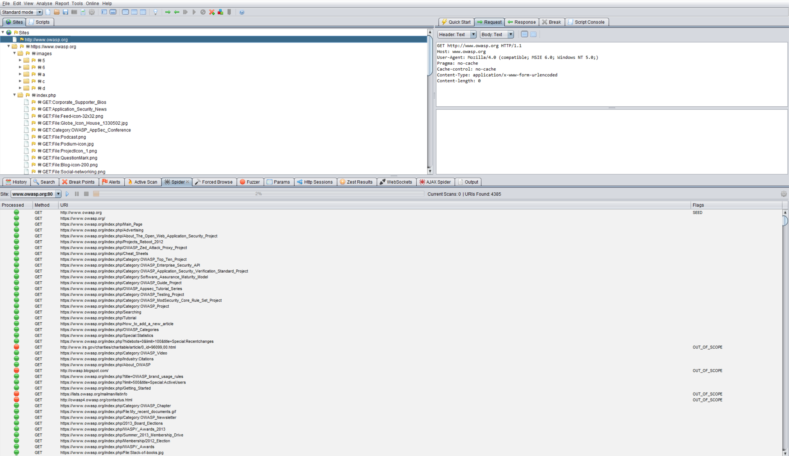

# Построение карты путей выполнения в приложении

|ID          |
|------------|
|WSTG-INFO-07|

## Краткое описание

Прежде чем начинать тестирование безопасности, крайне важно понять структуру приложения. Без тщательного понимания его устройства вряд ли удастся провести тщательное тестирование.

## Цели тестирования

- Составить карту целевого приложения и понять основные рабочие процессы.

## Методика тестирования

При тестировании методом «чёрного ящика» проверить всю кодовую базу чрезвычайно сложно. Дело не только в том, что тестировщик не видит путей выполнения кода в приложении: даже если бы он их видел, проверка всех путей потребовала бы очень много времени. Один из способов справиться с этим — документировать обнаруженные и проверенные пути выполнения кода.

Есть несколько подходов к тестированию и измерению покрытия кода:

- **Пути** — проверка каждого пути в приложении, включая комбинаторное тестирование и анализ граничных значений для каждого пути принятия решений. Этот подход обеспечивает тщательность, но число проверяемых путей экспоненциально растёт с каждым ветвлением.
- **Поток данных, или анализ помеченных данных (taint analysis)** — проверка присваивания переменных при внешнем взаимодействии, обычно со стороны пользователей. Основное внимание уделяется отслеживанию движения, преобразования и использования данных во всём приложении.
- **Гонки** — проверка нескольких одновременно работающих экземпляров приложения, изменяющих одни и те же данные.

Выбор метода и степень применения каждого метода следует согласовать с владельцем приложения. Можно использовать и более простые подходы: например, спросить владельца, какие функции или участки кода вызывают у него особые опасения и как можно достичь этих участков.

Чтобы показать владельцу приложения покрытие кода, тестировщик может начать с электронной таблицы и записать все ссылки, обнаруженные при ручном или автоматическом обходе приложения. Затем можно подробнее изучить точки принятия решений и выяснить, сколько значимых путей выполнения кода обнаружено. Их следует занести в таблицу с URL, текстовыми описаниями и снимками экрана обнаруженных путей.

### Анализ кода

При подходах «серого ящика» и «белого ящика» гораздо проще обеспечить достаточное для владельца приложения покрытие кода. Сведения, запрошенные тестировщиком и предоставленные ему, позволяют обеспечить выполнение минимальных требований к покрытию кода.

Многие современные инструменты динамического тестирования безопасности приложений (DAST) поддерживают использование агента на веб-сервере либо могут работать совместно со сторонним агентом для отслеживания подробных сведений о покрытии веб-приложения.

### Автоматический обход

Средство автоматического обхода служит для автоматического обнаружения новых ресурсов (URL) на определённом сайте. Оно начинает работу со списка начальных URL, который зависит от способа запуска. Инструментов обхода много; в следующем примере используется [Zed Attack Proxy (ZAP)](https://github.com/zaproxy/zaproxy):

\
*Рисунок 4.1.7-1. Окно Zed Attack Proxy. Элементы интерфейса: «Файл», «Правка», «Вид», «Анализ», «Отчёт», «Инструменты», «Онлайн», «Справка», «Стандартный режим»; «Сайты», «Скрипты»; «Быстрый запуск», «Запрос», «Ответ», «Прерывание», «Консоль скриптов»; «Заголовок: текст», «Тело: текст»; «История», «Поиск», «Точки останова», «Оповещения», «Активное сканирование», «Обход», «Принудительный просмотр», «Фаззер», «Параметры», «HTTP-сеансы», «Результаты Zest», «WebSockets», «AJAX-обход», «Вывод»; «Сайт», «Текущих сканирований: 0», «Найдено URI: 4385», «Обработано», «Метод», «Флаги»; SEED — «начальный адрес», OUT_OF_SCOPE — «вне области проверки». HTTP-запрос, имена ресурсов и URL сохранены на снимке.*

[ZAP](https://github.com/zaproxy/zaproxy) предоставляет разные варианты автоматического обхода, которые можно применять в зависимости от потребностей тестировщика:

- [Средство обхода Spider](https://www.zaproxy.org/docs/desktop/start/features/spider/)
- [Средство обхода AJAX Spider](https://www.zaproxy.org/docs/desktop/addons/ajax-spider/)
- [Поддержка OpenAPI](https://www.zaproxy.org/docs/desktop/addons/openapi-support/)

## Инструменты

- [Zed Attack Proxy (ZAP)](https://github.com/zaproxy/zaproxy)
- [Список программ для работы с электронными таблицами](https://en.wikipedia.org/wiki/List_of_spreadsheet_software)
- [Программы для построения диаграмм](https://en.wikipedia.org/wiki/List_of_concept-_and_mind-mapping_software)

## Источники

- [Покрытие кода](https://en.wikipedia.org/wiki/Code_coverage)
