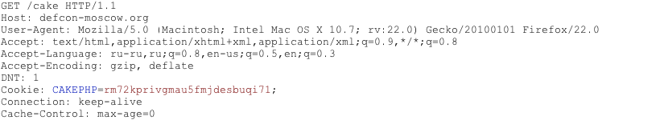
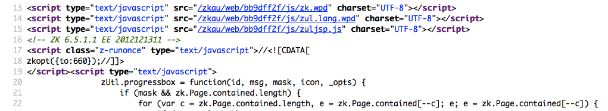
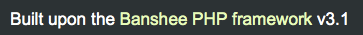
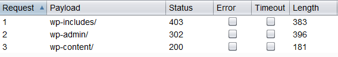
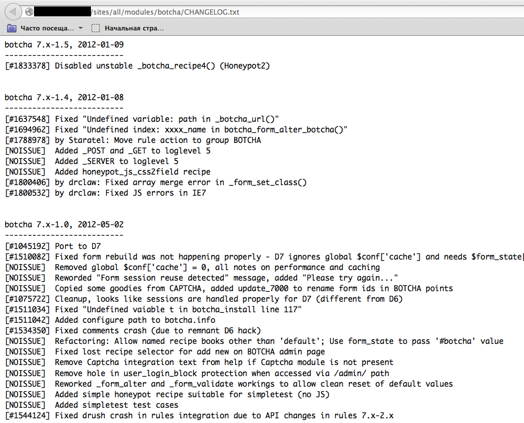
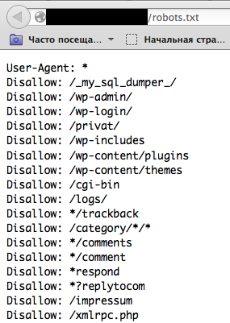
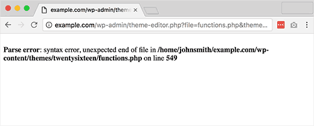
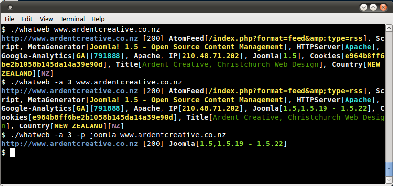
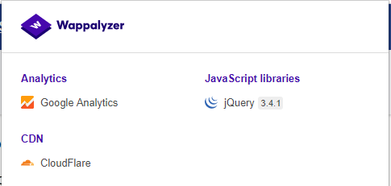

# Определение используемого веб-фреймворка

|ID          |
|------------|
|WSTG-INFO-08|

## Краткое описание

Ничто не ново под солнцем: почти любое веб-приложение, которое можно задумать, уже было разработано. В мире активно разрабатывается и развёртывается огромное число бесплатных проектов и проектов с открытым исходным кодом, поэтому при тестировании безопасности весьма вероятно встретить цель, полностью или частично зависящую от таких известных приложений или фреймворков, как WordPress, phpBB, Mediawiki и т. д. Знание проверяемых компонентов веб-приложения значительно помогает тестированию и резко сокращает необходимые усилия. У этих известных веб-приложений есть характерные HTML-заголовки, cookie-файлы и структуры каталогов, выявление которых позволяет распознать приложение. Большинство веб-фреймворков оставляет в этих местах несколько маркеров, помогающих злоумышленнику или тестировщику распознать их. По существу, так работают все автоматические инструменты: ищут маркер в заранее определённом месте, затем сравнивают его с базой известных сигнатур. Для большей точности обычно используют несколько маркеров.

## Цели тестирования

- Определить компоненты, используемые веб-приложениями.

## Методика тестирования

### Тестирование методом «чёрного ящика»

Для определения фреймворков или компонентов следует рассмотреть несколько типичных источников:

- HTTP-заголовки
- Cookie-файлы
- Исходный HTML-код
- Характерные файлы и каталоги
- Расширения файлов
- Сообщения об ошибках

#### HTTP-заголовки

Самый простой способ определения веб-фреймворка — посмотреть поле `X-Powered-By` в заголовке HTTP-ответа. Для распознавания цели подходит множество инструментов; самый простой — netcat.

Рассмотрим следующий HTTP-запрос и ответ:

```html
$ nc 127.0.0.1 80
HEAD / HTTP/1.0

HTTP/1.1 200 OK
Server: nginx/1.0.14
[...]
X-Powered-By: Mono
```

По полю `X-Powered-By` можно заключить, что веб-приложение, вероятно, использует фреймворк `Mono`. Однако этот простой и быстрый подход работает не в 100% случаев. Заголовок `X-Powered-By` легко отключить соответствующей настройкой. Кроме того, существуют способы скрытия HTTP-заголовков сайта; пример приведён в разделе [«Рекомендации по устранению»](#Remediation). В примере выше также видна конкретная версия `nginx`, используемая для выдачи содержимого.

Поэтому в том же примере тестировщик может не обнаружить заголовок `X-Powered-By` либо получить такой ответ:

```html
HTTP/1.1 200 OK
Server: nginx/1.0.14
Date: Sat, 07 Sep 2013 08:19:15 GMT
Content-Type: text/html;charset=ISO-8859-1
Connection: close
Vary: Accept-Encoding
X-Powered-By: Blood, sweat and tears
```

Иногда на определённый фреймворк указывают и другие HTTP-заголовки. В следующем примере из сведений HTTP-запроса видно, что заголовок `X-Powered-By` содержит версию PHP. Однако заголовок `X-Generator` указывает, что фактически используется фреймворк `Swiftlet`, что помогает специалисту по тестированию на проникновение расширить набор векторов атаки. При определении компонентов внимательно проверяйте каждый HTTP-заголовок на такие утечки.

```html
HTTP/1.1 200 OK
Server: nginx/1.4.1
Date: Sat, 07 Sep 2013 09:22:52 GMT
Content-Type: text/html
Connection: keep-alive
Vary: Accept-Encoding
X-Powered-By: PHP/5.4.16-1~dotdeb.1
Expires: Thu, 19 Nov 1981 08:52:00 GMT
Cache-Control: no-store, no-cache, must-revalidate, post-check=0, pre-check=0
Pragma: no-cache
X-Generator: Swiftlet
```

#### Cookie-файлы

Ещё один похожий и несколько более надёжный способ определения используемого веб-фреймворка — характерные для него cookie-файлы.

Рассмотрим следующий HTTP-запрос:

\
*Рисунок 4.1.8-7. HTTP-запрос Cakephp*

Cookie-файл `CAKEPHP` установлен автоматически и сообщает об используемом фреймворке. Список распространённых имён cookie-файлов приведён в разделе [«Cookie-файлы»](#Cookies). У этого механизма распознавания есть ограничения: имена cookie-файлов можно менять. Например, для выбранного фреймворка `CakePHP` это делается следующей настройкой, приведённой во фрагменте `core.php`:

```php
/**
* The name of CakePHP's session cookie.
*
* Note the guidelines for Session names states: "The session name references
* the session id in cookies and URLs. It should contain only alphanumeric
* characters."
* @link http://php.net/session_name
*/
Configure::write('Session.cookie', 'CAKEPHP');
```

Однако такие изменения вносят реже, чем изменения заголовка `X-Powered-By`, поэтому этот подход можно считать более надёжным.

#### Исходный HTML-код

Этот метод основан на поиске определённых шаблонов в исходном HTML-коде страницы. Нередко там можно найти множество сведений, помогающих распознать конкретный компонент. Один из распространённых маркеров — HTML-комментарии, прямо раскрывающие фреймворк. Ещё чаще встречаются характерные пути, например ссылки на каталоги CSS или JS определённого фреймворка. Наконец, на него могут указывать специфические переменные скриптов.

На приведённом ниже снимке экрана используемый фреймворк и его версию легко определить по указанным маркерам. Комментарий, характерные пути и переменные скриптов помогают злоумышленнику быстро распознать экземпляр фреймворка ZK.

\
*Рисунок 4.1.8-2. Пример исходного HTML-кода фреймворка ZK*

Часто такие сведения находятся в разделе `<head>` HTTP-ответов, в тегах `<meta>` или в конце страницы. Тем не менее анализировать следует ответы целиком: это может быть полезно и для других целей, например изучения других интересных комментариев и скрытых полей. Иногда веб-разработчики мало заботятся о сокрытии сведений об используемых фреймворках или компонентах. Внизу страницы всё ещё можно встретить нечто подобное:

\
*Рисунок 4.1.8-3. Нижняя часть страницы Banshee. «Построено на PHP-фреймворке Banshee v3.1».*

### Характерные файлы и каталоги

Существует ещё один подход, значительно помогающий злоумышленнику или тестировщику с высокой точностью распознавать приложения или компоненты. Каждый веб-компонент имеет собственную характерную структуру файлов и каталогов на сервере. Как отмечалось, специфический путь можно увидеть в исходном HTML-коде страницы, но иногда такие пути там явно не представлены, хотя на сервере существуют.

Для их обнаружения используется метод принудительного просмотра (forced browsing), или dirbusting. Он заключается в переборе известных имён каталогов и файлов на целевой системе и наблюдении за HTTP-ответами для перечисления содержимого сервера. Эти сведения можно использовать как для поиска стандартных файлов и атак на них, так и для распознавания веб-приложения. Способов перебора несколько; в следующем примере показана успешная атака перебором каталогов на цель с WordPress с помощью заданного списка и функции Intruder в Burp Suite.

\
*Рисунок 4.1.8-4. Перебор каталогов с помощью Burp. Столбцы: «Запрос», «Полезная нагрузка», «Код состояния», «Ошибка», «Тайм-аут», «Длина». Пути и значения ответов сохранены на изображении.*

Видно, что для некоторых характерных каталогов WordPress, например `/wp-includes/`, `/wp-admin/` и `/wp-content/`, HTTP-ответы имеют коды 403 (Forbidden), 302 (Found, перенаправление на `wp-login.php`) и 200 (OK) соответственно. Это хороший признак того, что цель использует WordPress. Аналогично можно перебирать каталоги плагинов разных приложений и определять их версии. На следующем снимке экрана показан типичный файл CHANGELOG плагина Drupal, сообщающий об используемом приложении и раскрывающий уязвимую версию плагина.

\
*Рисунок 4.1.8-5. Раскрытие сведений о Drupal Botcha. Видны версии botcha 7.x-1.5, 7.x-1.4 и 7.x-1.0 с датами и журналом изменений. Журнал версий, номера задач, имена функций и сообщения об исправлениях сохранены как исходный технический пример.*

Совет: прежде чем перебирать каталоги, проверьте файл `robots.txt`. Иногда он тоже содержит характерные для приложения каталоги и другие конфиденциальные сведения. Пример такого файла `robots.txt` приведён ниже.

\
*Рисунок 4.1.8-6. Раскрытие информации в robots.txt*

Характерные файлы и каталоги различаются у разных приложений. Если выявленное приложение или компонент имеет открытый исходный код, при тестировании на проникновение может быть полезно временно установить его, чтобы лучше понять представленную инфраструктуру или функциональность и то, какие файлы могут оставаться на сервере. Однако хорошие списки файлов уже существуют; один из примеров — [словари предсказуемых файлов и каталогов FuzzDB](https://github.com/fuzzdb-project/fuzzdb).

#### Расширения файлов

URL могут содержать расширения файлов, которые также помогают определить веб-платформу или технологию.

Например, вики OWASP использовала PHP:

```text
https://wiki.owasp.org/index.php?title=Fingerprint_Web_Application_Framework&action=edit&section=4
```

Ниже приведены некоторые распространённые расширения веб-файлов и соответствующие технологии:

- `.php` — PHP
- `.aspx` — Microsoft ASP.NET
- `.jsp` — Java Server Pages

#### Сообщения об ошибках

Как видно на следующем снимке экрана, указанный путь файловой системы свидетельствует об использовании WordPress (`wp-content`). Тестировщикам также следует учитывать, что WordPress основан на PHP (`functions.php`).

\
*Рисунок 4.1.8-7. Ошибка синтаксического разбора WordPress. «Ошибка разбора: синтаксическая ошибка, неожиданный конец файла»; далее указан путь /home/johnsmith/example.com/wp-content/themes/twentysixteen/functions.php и строка 549.*

## Распространённые идентификаторы

### Cookie-файлы

| Фреймворк    | Имя cookie-файла                       |
|--------------|-----------------------------------|
| Zope         | zope3                             |
| CakePHP      | cakephp                           |
| Kohana       | kohanasession                     |
| Laravel      | laravel_session                   |
| phpBB        | phpbb3_                           |
| WordPress    | wp-settings                       |
| 1C-Bitrix    | BITRIX_                           |
| AMPcms       | AMP                               |
| Django CMS   | django                            |
| DotNetNuke   | DotNetNukeAnonymous               |
| e107         | e107_tz                           |
| EPiServer    | EPiTrace, EPiServer               |
| Graffiti CMS | graffitibot                       |
| Hotaru CMS   | hotaru_mobile                     |
| ImpressCMS   | ICMSession                        |
| Indico       | MAKACSESSION                      |
| InstantCMS   | InstantCMS[logdate]               |
| Kentico CMS  | CMSPreferredCulture               |
| MODx         | SN4[12symb]                       |
| TYPO3        | fe_typo_user                      |
| Dynamicweb   | Dynamicweb                        |
| LEPTON       | lep[some_numeric_value]+sessionid |
| Wix          | Domain=.wix.com                   |
| VIVVO        | VivvoSessionId                    |

### Исходный HTML-код

| Приложение | Маркер                                                                        |
|-------------|--------------------------------------------------------------------------------|
| WordPress   | `<meta name="generator" content="WordPress 3.9.2" />`                          |
| phpBB       | `<body id="phpbb"`                                                             |
| Mediawiki   | `<meta name="generator" content="MediaWiki 1.21.9" />`                         |
| Joomla      | `<meta name="generator" content="Joomla! - Open Source Content Management" />` |
| Drupal      | `<meta name="Generator" content="Drupal 7 (http://drupal.org)" />`             |
| DotNetNuke  | `DNN Platform - [http://www.dnnsoftware.com](http://www.dnnsoftware.com)`      |

#### Общие маркеры

- `%framework_name%`
- `powered by`
- `built upon`
- `running`

#### Специфические маркеры

| Фреймворк         | Маркер                        |
|-------------------|--------------------------------|
| Adobe ColdFusion  | `<!-- START headerTags.cfm` |
| Microsoft ASP.NET | `__VIEWSTATE`                  |
| ZK                | `<!-- ZK`                   |
| Business Catalyst | `<!-- BC_OBNW -->`       |
| Indexhibit        | `ndxz-studio`                  |

## Рекомендации по устранению

Можно менять имена cookie-файлов через конфигурацию, скрывать или менять пути файлов и каталогов посредством перезаписи URL либо изменения исходного кода, удалять известные заголовки и т. д., однако всё это сводится к «безопасности через неясность». Владельцам и администраторам систем следует понимать, что такие меры задерживают лишь самых неподготовленных противников. Время и усилия могут принести больше пользы при повышении осведомлённости заинтересованных сторон и сопровождении решения.

## Инструменты

Ниже перечислены распространённые известные инструменты общего назначения. Существует также множество других утилит и средств определения конкретных фреймворков.

### WhatWeb

Сайт: [https://github.com/urbanadventurer/WhatWeb](https://github.com/urbanadventurer/WhatWeb)

На данный момент один из лучших инструментов определения технологий на рынке. Включён в стандартную сборку [Kali Linux](https://www.kali.org/). Язык: Ruby. Для определения используются совпадения по следующим признакам:

- Текстовые строки с учётом регистра
- Регулярные выражения
- Запросы Google Hack Database с ограниченным набором ключевых слов
- Хеши MD5
- Распознавание URL
- Шаблоны HTML-тегов
- Специальный код Ruby для пассивных и активных действий

Пример вывода показан ниже:

\
*Рисунок 4.1.8-8. Пример вывода Whatweb. Меню терминала: «Файл», «Правка», «Вид», «Терминал», «Справка». Команды, названия технологий, версии, заголовки, IP-адреса, хеши и поля результатов на снимке сохранены как технический вывод инструмента.*

### Wappalyzer

Сайт: [https://www.wappalyzer.com/](https://www.wappalyzer.com/)

Wapplyzer доступен в нескольких вариантах использования; вероятно, самые популярные — расширения Firefox и Chrome. Они работают только на сопоставлении регулярных выражений и требуют лишь загрузки страницы в браузере. Инструмент работает полностью на уровне браузера и показывает результаты в виде значков. Хотя иногда возникают ложные срабатывания, это очень удобно для немедленного определения технологий целевого сайта после открытия страницы.

Пример вывода плагина показан ниже.

\
*Рисунок 4.1.8-9. Вывод Wappalyzer для сайта OWASP. Категории: «Аналитика», «Библиотеки JavaScript», «Сеть доставки контента (CDN)». Названия Google Analytics, jQuery 3.4.1 и CloudFlare сохранены.*

## Источники

### Технические документы

- [Saumil Shah: «Введение в определение технологий по HTTP»](https://web.archive.org/web/20190526182734/https://net-square.com/httprint_paper.html)
- [Anant Shrivastava: «Определение веб-приложений»](https://anantshri.info/articles/web_app_finger_printing.html)
