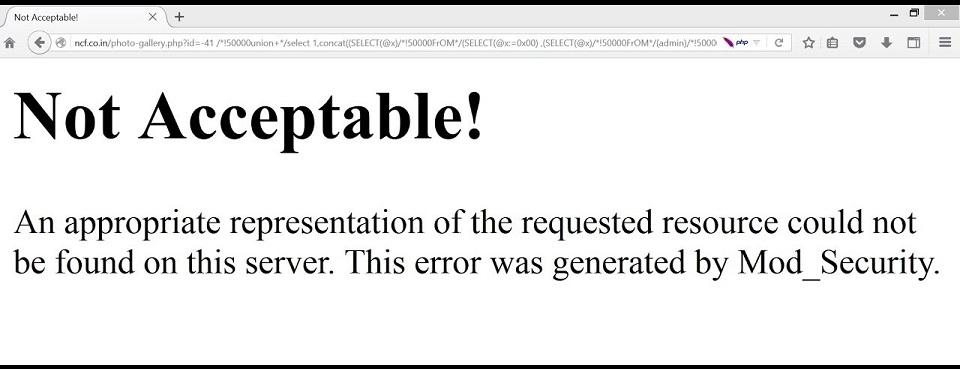

# Построение архитектурной карты приложения

|ID          |
|------------|
|WSTG-INFO-10|

## Краткое описание

Сложная взаимосвязанная и неоднородная веб-инфраструктура может включать сотни веб-приложений, поэтому управление конфигурацией и её анализ становятся обязательным этапом тестирования и развёртывания каждого приложения. Для подрыва безопасности всей инфраструктуры достаточно одной уязвимости; даже небольшие, на первый взгляд незначительные проблемы могут превратиться в серьёзные риски для другого приложения той же инфраструктуры.

Для решения этих проблем крайне важно тщательно изучить конфигурацию и известные проблемы безопасности. Прежде чем приступать к такому анализу, необходимо составить карту сети и архитектуры приложения. Следует определить различные элементы инфраструктуры, чтобы понять, как они взаимодействуют с веб-приложением и влияют на безопасность.

## Цели тестирования

- Составить карту исследуемого приложения на основе проведённого исследования.

## Методика тестирования

### Составление карты архитектуры приложения

Архитектуру приложения необходимо отобразить на карте, выполнив проверки для определения разных компонентов, из которых построено веб-приложение. В небольших конфигурациях, например простом PHP-приложении, может использоваться единственный сервер, обслуживающий PHP-приложение и, возможно, механизм аутентификации.

В более сложных конфигурациях, например системе интернет-банкинга, могут участвовать несколько серверов: обратный прокси, внешний веб-сервер, сервер приложений, сервер базы данных или LDAP-сервер. Каждый используется для своих задач; они могут даже находиться в разных сетях, разделённых межсетевыми экранами. Так создаются разные сетевые зоны: доступ к веб-серверу не обязательно даёт удалённому пользователю доступ к самому механизму аутентификации, а компрометацию отдельных элементов архитектуры можно изолировать, чтобы она не привела к компрометации всей архитектуры.

Получить сведения об архитектуре легко, если разработчики предоставляют их команде тестирования в документах или при опросах, но при тестировании на проникновение вслепую это может оказаться очень сложно.

В последнем случае тестировщик сначала предполагает простую конфигурацию с одним сервером. Затем он получает сведения из других проверок, выявляет различные элементы, пересматривает исходное предположение и расширяет карту архитектуры. Начать можно с простых вопросов: «Защищает ли веб-сервер межсетевой экран?». Ответ определяется по результатам сетевого сканирования веб-сервера и анализа того, фильтруются ли его сетевые порты на границе сети: ответы отсутствуют либо поступают ICMP-сообщения о недоступности; или сервер подключён к Интернету напрямую и возвращает пакеты RST для всех портов, не принимающих соединения. Анализ можно расширить, чтобы определить тип межсетевого экрана посредством проверок сетевых пакетов. Это межсетевой экран с отслеживанием состояния или фильтр списков доступа на маршрутизаторе? Как он настроен? Можно ли его обойти? Является ли он полноценным межсетевым экраном веб-приложений?

Обратный прокси перед веб-сервером можно обнаружить, проанализировав баннер сервера, который иногда прямо раскрывает его наличие. Другой способ — получать ответы веб-сервера на запросы и сравнивать их с ожидаемыми. Например, некоторые обратные прокси работают как системы предотвращения вторжений (IPS), блокируя известные атаки на веб-сервер. Если известно, что на запрос отсутствующей страницы веб-сервер отвечает сообщением 404, а для некоторых распространённых веб-атак, например выполняемых сканерами уязвимостей, возвращает другую ошибку, это может указывать на обратный прокси или межсетевой экран уровня приложений, фильтрующий запросы и выдающий иную страницу ошибки. Другой пример: веб-сервер сообщает набор доступных HTTP-методов, включая TRACE, но ожидаемые методы возвращают ошибки — вероятно, между клиентом и сервером есть компонент, который их блокирует.

Иногда даже система защиты выдаёт себя сама. Ниже приведён пример, в котором mod_security раскрывает своё присутствие:

\
*Рисунок 4.1.10-1. Пример страницы ошибки mod_security. Текст сообщения: «Неприемлемо! На этом сервере не найдено подходящее представление запрошенного ресурса. Эта ошибка создана Mod_Security».*

Обратные прокси могут также использоваться для кеширования, чтобы повысить производительность внутренних серверов приложений. Такие прокси можно выявить по заголовку сервера. Ещё один способ — измерить время выполнения запросов, которые сервер должен кешировать, и сравнить время обслуживания первого запроса с последующими.

Можно обнаружить и сетевые балансировщики нагрузки. Обычно они распределяют обращения к заданному TCP/IP-порту между несколькими серверами по различным алгоритмам: циклически, по нагрузке веб-сервера, числу запросов и т. д. Поэтому для выявления этого элемента архитектуры нужно исследовать несколько запросов и сравнивать результаты, определяя, попадают ли они на один веб-сервер или на разные. Например, можно опираться на заголовок Date, если часы серверов не синхронизированы. В некоторых случаях балансировка добавляет в заголовки сведения, по которым её легко распознать: например, cookie-файл с префиксом BIGipServer, добавляемый балансировщиками F5 BIG-IP.

Веб-серверы приложений обычно легко обнаружить. Запросы ряда ресурсов обрабатываются самим сервером приложений, а не веб-сервером, и заголовки ответа существенно различаются, в том числе имеют другие или дополнительные значения. Другой способ — выяснить, пытается ли веб-сервер устанавливать cookie-файлы, указывающие на сервер приложений, например JSESSIONID, используемый различными серверами J2EE, либо автоматически переписывать URL для отслеживания сеансов.

Однако внутренние системы аутентификации, например каталоги LDAP, реляционные базы данных или серверы RADIUS, не так просто сразу обнаружить извне, поскольку они скрыты самим приложением.

Использование внутренней базы данных можно определить простым просмотром приложения. Если оно содержит высокодинамичное содержимое, создаваемое «на лету», вероятно, приложение извлекает его из какой-либо базы данных. Иногда на наличие базы данных указывает способ запроса сведений: например, приложение интернет-магазина использует числовые идентификаторы (`id`) при просмотре разных товаров. Однако при тестировании приложения вслепую сведения об используемой базе данных обычно становятся доступны лишь при выявлении уязвимости, например неправильной обработки исключений или подверженности SQL-инъекции.
