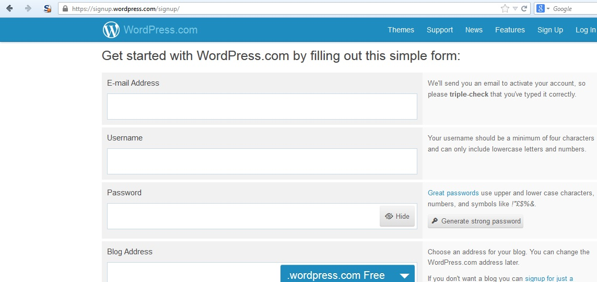
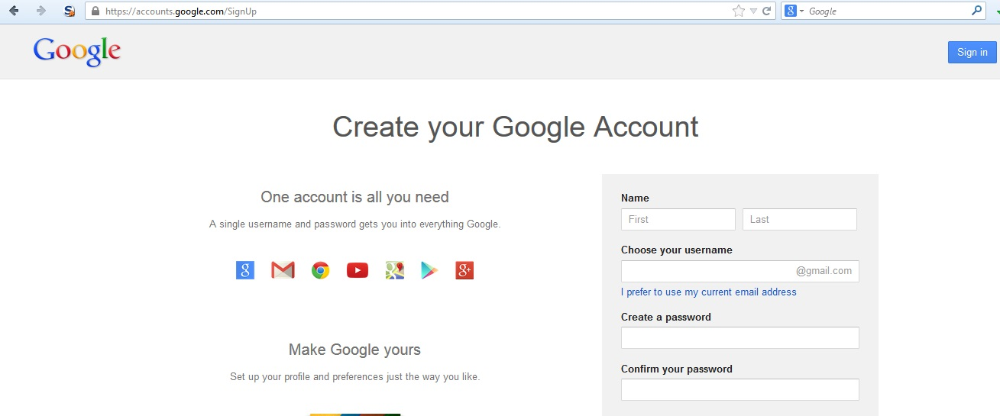

# Тестирование процесса регистрации пользователей

|ID          |
|------------|
|WSTG-IDNT-02|

## Краткое описание

Некоторые сайты предлагают процесс регистрации пользователей, полностью или частично автоматизирующий предоставление доступа к системе. Требования к идентификации для получения доступа варьируются от достоверного установления личности до полного отсутствия требований в зависимости от требований безопасности системы. Многие общедоступные приложения полностью автоматизируют регистрацию и предоставление доступа, поскольку размер пользовательской базы делает ручное управление невозможным. Однако во многих корпоративных приложениях доступ предоставляют вручную, поэтому данный сценарий тестирования может быть неприменим.

## Цели тестирования

- Убедиться, что требования к идентификации при регистрации пользователей соответствуют бизнес-требованиям и требованиям безопасности.
- Проверить процесс регистрации.

## Методика тестирования

Убедитесь, что требования к идентификации при регистрации пользователей соответствуют бизнес-требованиям и требованиям безопасности:

1. Может ли любой человек зарегистрироваться для получения доступа?
2. Проверяет ли человек заявки на регистрацию перед предоставлением доступа или доступ выдаётся автоматически при выполнении критериев?
3. Может ли один и тот же человек либо субъект с теми же идентификационными данными зарегистрироваться несколько раз?
4. Могут ли пользователи регистрироваться с разными ролями или разрешениями?
5. Какое подтверждение личности требуется для успешной регистрации?
6. Проверяются ли зарегистрированные идентификационные данные?

Проверьте процесс регистрации:

1. Легко ли подделать идентификационные данные?
2. Можно ли вмешаться в обмен идентификационными данными при регистрации?

### Пример

В приведённом ниже примере WordPress единственное требование к идентификации — адрес электронной почты, к которому у регистрирующегося есть доступ.

\
*Рисунок 4.3.2-1. Страница регистрации WordPress. «Начните работу с WordPress.com, заполнив простую форму». Поля: «Адрес электронной почты», «Имя пользователя», «Пароль», «Адрес блога»; кнопки «Скрыть», «Сгенерировать надёжный пароль»; тариф «Бесплатно». Подсказки: «Мы отправим письмо для активации учётной записи, поэтому ещё раз проверьте правильность адреса»; «Имя пользователя должно содержать не менее четырёх символов и только строчные буквы и цифры»; «Хорошие пароли используют прописные и строчные буквы, цифры и символы»; «Выберите адрес блога. Позже его можно изменить». Меню: «Темы», «Поддержка», «Новости», «Возможности», «Регистрация», «Вход».*

Для сравнения, в следующем примере Google требования к идентификации включают имя, дату рождения, страну, номер мобильного телефона, адрес электронной почты и ответ CAPTCHA. Хотя проверить можно только два из них — адрес электронной почты и мобильный номер, — требования строже, чем у WordPress.

\
*Рисунок 4.3.2-2. Страница регистрации Google. «Создайте аккаунт Google»; «Всё, что нужно, — один аккаунт»; «Одно имя пользователя и пароль дают доступ ко всем сервисам Google»; «Настройте Google под себя»; «Настройте профиль и параметры по своему вкусу». Видимые поля: «Имя», «Имя», «Фамилия», «Выберите имя пользователя», «Я предпочитаю использовать свой текущий адрес электронной почты», «Создайте пароль», «Подтвердите пароль»; кнопка «Войти».*

## Рекомендации по устранению

Внедрите требования к идентификации и проверке, соответствующие требованиям безопасности информации, которую защищают эти учётные данные.

## Инструменты

Для проверки этого механизма может быть полезен HTTP-прокси.

## Источники

[Проектирование регистрации пользователей](https://mashable.com/2011/06/09/user-registration-design/)
