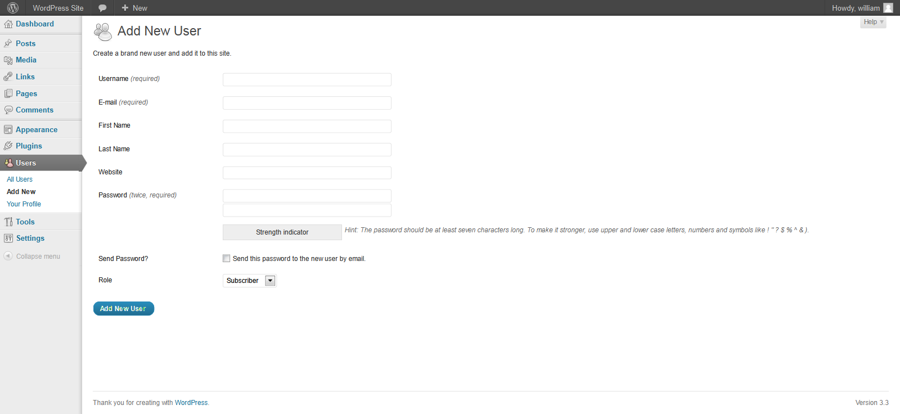
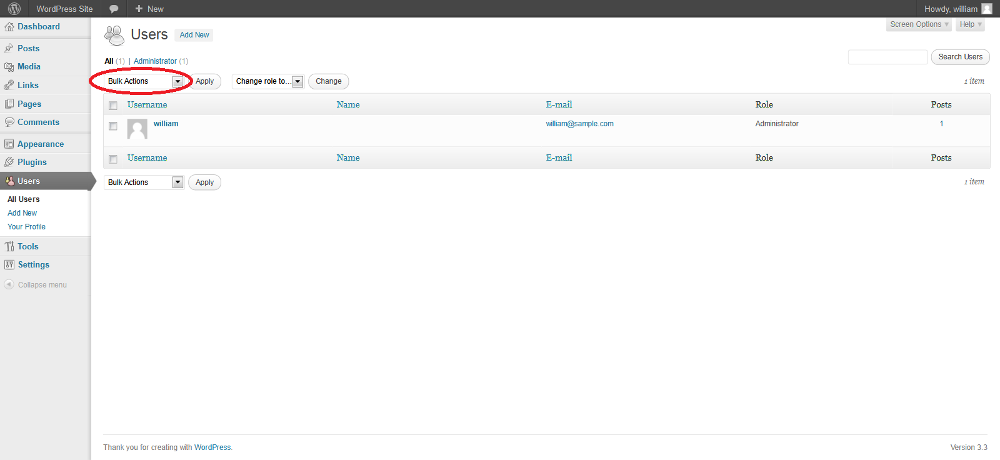

# Тестирование процесса подготовки учётных записей

|ID          |
|------------|
|WSTG-IDNT-03|

## Краткое описание

Подготовка учётных записей может дать злоумышленнику возможность создать действующую учётную запись без надлежащей процедуры идентификации и авторизации.

## Цели тестирования

- Проверить, какие учётные записи могут создавать другие учётные записи и какого типа.

## Методика тестирования

Определите, какие роли позволяют создавать пользователей и какие типы учётных записей они могут создавать.

- Выполняются ли проверка, рассмотрение и авторизация запросов на предоставление доступа?
- Выполняются ли проверка, рассмотрение и авторизация запросов на отзыв доступа?
- Может ли администратор создавать других администраторов или только обычных пользователей?
- Может ли администратор или другой пользователь создавать учётные записи с более высокими привилегиями, чем у него самого?
- Может ли администратор или пользователь отозвать собственный доступ?
- Как обрабатываются файлы или ресурсы, принадлежащие пользователю, доступ которого отозван? Удаляются ли они? Передаётся ли доступ к ним?

### Пример

В WordPress для создания пользователя требуются только имя и адрес электронной почты, как показано ниже:

\
*Рисунок 4.3.3-1. Добавление пользователя WordPress. «Добавить нового пользователя»; «Создайте нового пользователя и добавьте его на этот сайт». Поля: «Имя пользователя (обязательно)», «Электронная почта (обязательно)», «Имя», «Фамилия», «Сайт», «Пароль (дважды, обязательно)», «Индикатор надёжности», «Отправить пароль?», «Отправить этот пароль новому пользователю по электронной почте», «Роль», «Подписчик». Подсказка: «Пароль должен быть длиной не менее семи символов. Для повышения надёжности используйте прописные и строчные буквы, цифры и символы». Меню: «Панель управления», «Записи», «Медиафайлы», «Ссылки», «Страницы», «Комментарии», «Внешний вид», «Плагины», «Пользователи», «Все пользователи», «Добавить», «Ваш профиль», «Инструменты», «Настройки», «Свернуть меню»; «Помощь», «Привет, william», «Создать», «Спасибо за творчество с WordPress», «Версия 3.3».*

Для отзыва доступа администратор должен выбрать пользователей, затем пункт «Удалить» (Delete) в раскрывающемся меню, обведённом на рисунке, и применить действие. После этого появляется диалог с вопросом, что сделать с публикациями пользователя: удалить их или передать другому пользователю.

\
*Рисунок 4.3.3-2. Аутентификация и пользователи WordPress. «Пользователи», «Добавить», «Все (1)», «Администратор (1)», «Групповые действия», «Применить», «Изменить роль на…», «Изменить», «Поиск пользователей», «1 элемент». Столбцы: «Имя пользователя», «Имя», «Электронная почта», «Роль», «Записи»; роль — «Администратор». «Настройки экрана», «Помощь». Боковое меню совпадает с предыдущим рисунком; имя и адрес учётной записи сохранены на изображении.*

## Инструменты

Хотя наиболее тщательный и точный подход к этой проверке — ручное выполнение, инструменты HTTP-прокси также могут быть полезны.
