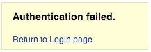
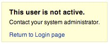

# Тестирование на перечисление учётных записей и подбор имён пользователей

|ID          |
|------------|
|WSTG-IDNT-04|

## Краткое описание

Цель этой проверки — установить, можно ли собрать набор действительных имён пользователей, взаимодействуя с механизмом аутентификации приложения. Проверка полезна для тестирования перебора, при котором тестировщик выясняет, можно ли подобрать пароль для известного действительного имени пользователя.

Веб-приложения часто раскрывают существование имени пользователя в системе из-за неправильной конфигурации или проектного решения. Например, при отправке неверных учётных данных иногда появляется сообщение о том, что имя пользователя существует либо введённый пароль неверен. Злоумышленник может использовать эти сведения для получения списка пользователей системы, а затем для атаки на веб-приложение: например, перебора или использования стандартных имён пользователей и паролей.

Тестировщику следует взаимодействовать с механизмом аутентификации приложения, чтобы понять, вызывают ли определённые запросы разные ответы. Проблема возникает, когда сведения, раскрываемые веб-приложением или веб-сервером при вводе действительного имени пользователя, отличаются от сведений при вводе недействительного.

В некоторых случаях сообщение раскрывает, вызвана ли ошибка в учётных данных неверным именем пользователя или неверным паролем. Иногда существующих пользователей можно перечислить, отправляя имя пользователя и пустой пароль.

## Цели тестирования

- Проанализировать процессы, связанные с идентификацией пользователей, *например* регистрацию, вход и т. д.
- По возможности перечислить пользователей посредством анализа ответов.

## Методика тестирования

При тестировании методом «чёрного ящика» тестировщик ничего не знает о конкретном приложении, именах пользователей, логике приложения, сообщениях об ошибках на странице входа и средствах восстановления пароля. Если приложение уязвимо, полученное сообщение прямо или косвенно раскрывает сведения, полезные для перечисления пользователей.

### Сообщение HTTP-ответа

#### Проверка действительных учётных данных

Запишите ответ сервера при отправке действительного идентификатора пользователя и правильного пароля.

> Используя веб-прокси, отметьте сведения, полученные при успешной аутентификации: HTTP-ответ 200, длину ответа.

#### Проверка действительного пользователя с неверным паролем

Теперь попробуйте ввести действительный идентификатор пользователя и неверный пароль и запишите сообщение об ошибке, выданное приложением.

> Браузер должен показать сообщение, подобное следующему:
>
> \
> *Рисунок 4.3.4-1. Ошибка аутентификации. «Аутентификация не удалась». «Вернуться на страницу входа».*
>
> В отличие от сообщений, раскрывающих существование пользователя, например:
>
> `Login for User foo: invalid password`
>
> Используя веб-прокси, отметьте сведения, полученные при этой неудачной попытке аутентификации: HTTP-ответ 200, длину ответа.

#### Проверка несуществующего имени пользователя

Теперь попробуйте ввести недействительный идентификатор пользователя и неверный пароль и запишите ответ сервера. Тестировщик должен быть уверен, что имя пользователя в приложении недействительно. Запишите сообщение об ошибке и ответ сервера.

> При вводе несуществующего идентификатора пользователя можно получить сообщение, подобное следующему:
>
> \
> *Рисунок 4.3.4-3. Этот пользователь неактивен. «Этот пользователь неактивен». «Обратитесь к системному администратору». «Вернуться на страницу входа».*
>
> либо такое сообщение:
>
> `Login failed for User foo: invalid Account`
>
> Как правило, на разные некорректные запросы приложение должно отвечать одинаковыми сообщениями об ошибке одинаковой длины. Если ответы различаются, тестировщику следует выяснить, какой признак создаёт различие между ними. Например:
>
> 1. Запрос клиента: действительный пользователь, неверный пароль
> 2. Ответ сервера: пароль неверен
> 3. Запрос клиента: неверный пользователь, неверный пароль
> 4. Ответ сервера: пользователь не распознан
>
> По этим ответам клиент понимает, что в первом запросе указано действительное имя пользователя. Затем он может отправлять приложению набор предполагаемых идентификаторов пользователей и наблюдать за ответами.
>
> По второму ответу сервера тестировщик аналогично понимает, что действительного имени пользователя у него нет. Продолжая такое взаимодействие и изучая ответы сервера, он может составить список действительных идентификаторов пользователей.

### Другие способы перечисления пользователей

Тестировщики могут перечислять пользователей несколькими способами, например:

#### Анализ кода ошибки на страницах входа

Некоторые веб-приложения выдают определённый код ошибки или сообщение, которые можно проанализировать.

#### Анализ URL и перенаправлений URL

Например:

- `http://www.foo.com/err.jsp?User=baduser&Error=0`
- `http://www.foo.com/err.jsp?User=gooduser&Error=2`

Как видно выше, после отправки веб-приложению идентификатора пользователя и пароля тестировщик видит в URL указание на возникшую ошибку. В первом случае введены неверные идентификатор и пароль, во втором — действительный идентификатор и неверный пароль. Так можно распознать действительный идентификатор пользователя.

#### Проверка URI

Иногда веб-сервер отвечает по-разному на запрос существующего и несуществующего каталога. Например, на некоторых порталах каждому пользователю соответствует каталог. При попытке доступа к существующему каталогу тестировщик может получить ошибку веб-сервера.

Некоторые распространённые ошибки веб-серверов:

- Код ошибки 403 Forbidden
- Код ошибки 404 Not found

Пример:

- `http://www.foo.com/account1` — ответ веб-сервера: 403 Forbidden
- `http://www.foo.com/account2` — ответ веб-сервера: 404 file Not Found

В первом случае пользователь существует, но тестировщик не может просмотреть страницу; во втором пользователь «account2» не существует. Собирая такие сведения, можно перечислять пользователей.

#### Анализ заголовков веб-страниц

Полезные сведения могут находиться в заголовке веб-страницы: конкретный код ошибки или сообщение, указывающее, связано ли затруднение с именем пользователя или паролем.

Например, пользователь не может пройти аутентификацию и получает веб-страницу с заголовком, подобным следующему:

- `Invalid user`
- `Invalid authentication`

#### Анализ сообщения от средства восстановления

При использовании средства восстановления, то есть функции забытого пароля, уязвимое приложение может вернуть сообщение, раскрывающее наличие или отсутствие имени пользователя.

Например, сообщения, подобные следующим:

- `Invalid username: email address is not valid or the specified user was not found.`
- `Valid username: Your password has been successfully sent to the email address you registered with.`

#### Дружественное сообщение об ошибке 404

При запросе пользователя в несуществующем каталоге код ошибки 404 возвращается не всегда. Вместо него может прийти «200 ok» с изображением; тогда по конкретному изображению можно предположить отсутствие пользователя. Эта логика применима и к другим ответам веб-сервера; главное — внимательно анализировать сообщения веб-сервера и веб-приложения.

#### Анализ времени ответа

Помимо содержимого ответов следует учитывать время их получения. Особенно это относится к запросам, вызывающим взаимодействие с внешним сервисом, например отправку письма для восстановления пароля: оно может добавить несколько сотен миллисекунд к времени ответа, что позволяет определить действительность запрошенного пользователя.

### Подбор пользователей

Иногда идентификаторы пользователей создаются по определённым правилам администратора или компании. Например, можно встретить идентификаторы, назначаемые последовательно:

```text
CN000100
CN000101
...
```

Иногда имена пользователей состоят из обозначения области REALM и порядкового номера:

- R1001 — пользователь 001 области REALM1
- R2001 — пользователь 001 области REALM2

В приведённом примере можно создать простые сценарии оболочки, формирующие идентификаторы пользователей и отправляющие запросы с помощью wget для автоматизации веб-запросов и выявления действительных идентификаторов. Для создания сценария также можно использовать Perl и curl.

Другие варианты: идентификаторы, связанные с номерами кредитных карт или вообще числами с определённой закономерностью; идентификаторы, связанные с настоящими именами. Например, если Freddie Mercury имеет идентификатор «fmercury», можно предположить, что идентификатор Roger Taylor — «rtaylor».

Имя пользователя можно также предположить по сведениям, полученным запросом LDAP или при сборе информации через Google, например для конкретного домена. Google помогает найти пользователей домена с помощью специальных запросов либо простого сценария оболочки или инструмента.

> При перечислении учётных записей есть риск их блокировки после заданного числа неудачных попыток в соответствии с политикой приложения. Кроме того, ваш IP-адрес иногда может быть заблокирован динамическими правилами межсетевого экрана приложений или системы предотвращения вторжений.

### Тестирование методом «серого ящика»

#### Проверка сообщений об ошибках аутентификации

Убедитесь, что приложение одинаково отвечает на каждый запрос клиента, приводящий к неудачной аутентификации. Для этой проблемы подходы «чёрного ящика» и «серого ящика» основаны на одной концепции: анализе сообщений или кодов ошибок веб-приложения.

> Приложение должно одинаково отвечать на каждую неудачную попытку аутентификации.
>
> Например: *Переданные учётные данные недействительны*

## Рекомендации по устранению

Убедитесь, что приложение возвращает единообразные общие сообщения об ошибках в ответ на неверное имя учётной записи, пароль или другие учётные данные, введённые при входе.

Убедитесь, что стандартные системные и тестовые учётные записи удалены до ввода системы в производственную эксплуатацию или предоставления доступа к ней из недоверенной сети.

## Инструменты

- [OWASP Zed Attack Proxy (ZAP)](https://www.zaproxy.org)
- [curl](https://curl.haxx.se/)
- [PERL](https://www.perl.org)

## Источники

- [Marco Mella: перечисление пользователей Sun Java Access & Identity Manager](https://securiteam.com/exploits/5ep0f0uquo/)
- [Уязвимости перечисления имён пользователей](https://www.gnucitizen.org/blog/username-enumeration-vulnerabilities/)
