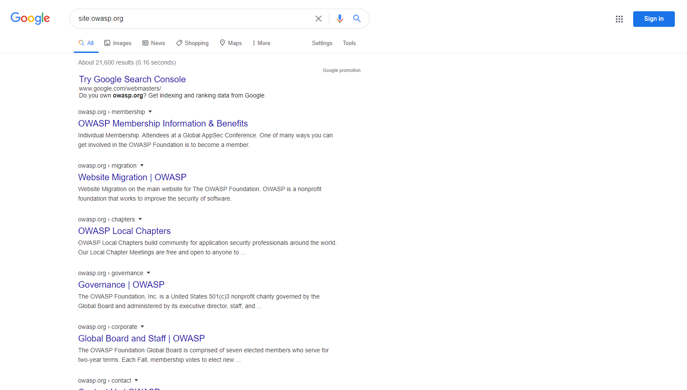

# Разведка через поисковые системы для выявления утечек информации

| ID |
| --- |
| WSTG-INFO-01 |

## Резюме

Для обеспечения работы поисковых систем специализированные программы (или «роботы» — `robots`) регулярно выгружают данные (этот процесс называется [краулингом](https://en.wikipedia.org/wiki/Web_crawler) `[crawling]`) с миллиардов страниц во всемирной паутине. Подобные программы находят веб-контент и функциональность, переходя по ссылкам с других страниц или анализируя карты сайтов (sitemaps). Если сайт использует специальный файл `robots.txt`, предписывающий поисковым роботам не скачивать определенные страницы, указанные в нем разделы будут проигнорированы. Это общее описание принципа работы — более глубокое техническое объяснение того, [как работает поисковая система](https://support.google.com/webmasters/answer/70897?hl=en), предлагает компания Google.

Тестировщики могут использовать поисковые системы для проведения разведки на сайтах и в веб-приложениях. Разведка и сбор информации через поисковые системы включают в себя прямые и косвенные методы: прямые методы связаны с поиском по индексам и содержимому кэша поисковиков, тогда как косвенные методы направлены на получение конфиденциальной информации о проектировании и конфигурации систем через поиск по форумам, группам новостей и тендерным площадкам.

После завершения обхода робот поисковой системы приступает к индексации веб-контента на основе HTML-тегов и связанных атрибутов (таких как `<TITLE>`), чтобы формировать релевантную поисковую выдачу. Если файл `robots.txt` не обновляется на протяжении жизненного цикла сайта, а в разметке страниц не используются метатеги, запрещающие индексацию роботами, в индексы могут попасть материалы, публикация которых владельцами не планировалась. Владельцы сайтов могут задействовать упомянутый файл `robots.txt`, метатеги HTML, механизмы аутентификации и инструменты панелей веб-мастеров поисковых систем для удаления подобного содержимого.

## Цели тестирования

- Определить, какая конфиденциальная информация о проектировании и конфигурации приложения, системы или организации раскрывается напрямую (на официальном сайте организации) или косвенно (через сторонние сервисы).

## Методика тестирования

Используйте поисковую систему для поиска потенциально конфиденциальных сведений. К ним могут относиться:

- схемы сети и файлы конфигурации инфраструктуры;
- архивные публикации и сообщения электронной почты администраторов или ключевых сотрудников;
- процедуры входа в систему и форматы имен пользователей;
- имена пользователей, пароли и закрытые криптографические ключи;
- конфигурационные файлы сторонних сервисов и облачных провайдеров;
- информативные диагностические сообщения об ошибках;
- непубличные версии приложений (среды разработки `[development]`, тестирования `[test]`, пользовательского приемочного тестирования [User Acceptance Testing, UAT] и промежуточные стенды `[staging]`).

### Поисковые системы

Не ограничивайте тестирование исключительно одним поисковым провайдером: различные поисковые системы могут выдавать существенно различающиеся результаты. Результаты поиска варьируются в зависимости от того, когда робот системы в последний раз сканировал контент, а также от алгоритмов ранжирования релевантных страниц. Рекомендуется использовать следующие поисковые системы (перечислены в алфавитном порядке):

- [Baidu](https://www.baidu.com/) — [самая популярная](https://en.wikipedia.org/wiki/Web_search_engine#Market_share) поисковая система в Китае.
- [Bing](https://www.bing.com/) — поисковая система, принадлежащая корпорации Microsoft и являющаяся второй по [популярности](https://en.wikipedia.org/wiki/Web_search_engine#Market_share) в мире. Поддерживает [расширенные ключевые слова поиска](https://help.bing.microsoft.com/#apex/18/en-US/10001/-1).
- [binsearch.info](https://binsearch.info/) — специализированная поисковая система по бинарным группам новостей Usenet.
- [Common Crawl](https://commoncrawl.org/) — открытый репозиторий данных веб-краулинга, доступный для анализа любому исследователю.
- [DuckDuckGo](https://duckduckgo.com/) — поисковая система с акцентом на конфиденциальность, агрегирующая результаты из множества различных [источников](https://help.duckduckgo.com/results/sources/). Поддерживает расширенный [синтаксис поиска](https://help.duckduckgo.com/duckduckgo-help-pages/results/syntax/).
- [Google](https://www.google.com/) — [самая популярная](https://en.wikipedia.org/wiki/Web_search_engine#Market_share) поисковая система в мире, использующая алгоритмы ранжирования для формирования максимально релевантной выдачи. Поддерживает обширный набор [поисковых операторов](https://support.google.com/websearch/answer/2466433).
- [Internet Archive Wayback Machine](https://archive.org/web/) — цифровой архив, сохраняющий исторические слепки интернет-сайтов и цифровых артефактов.
- [Censys](https://censys.com) — специализированная поисковая система для специалистов по безопасности, индексирующая подключенную к интернету инфраструктуру: серверы, цифровые сертификаты и открытые службы. Предоставляет бесплатный тариф для сообщества с ежемесячными лимитами и платные корпоративные тарифы.
- [Shodan](https://www.shodan.io/) — сервис поиска подключенных к сети интернет устройств и сетевых служб. Доступен как ограниченный бесплатный тариф, так и платные планы подписки.

### Операторы поиска

Поисковый оператор (search operator) — это специальное ключевое слово или синтаксическая конструкция, расширяющая возможности стандартных запросов и позволяющая получать более точечные результаты. Обычно они имеют вид `operator:query`. Ниже приведены наиболее распространенные операторы:

- `site:` — ограничивает поиск рамками указанного домена.
- `inurl:` — возвращает только те результаты, где ключевое слово содержится в URL-адресе.
- `intitle:` — ищет страницы, содержащие ключевое слово в заголовке (`<title>`).
- `intext:` или `inbody:` — выполняет поиск ключевого слова исключительно в теле веб-страниц.
- `filetype:` — фильтрует результаты по определенному расширению файла, например `.png` или `.php`.

Например, для поиска проиндексированного контента домена owasp.org синтаксис запроса выглядит следующим образом:

```text
site:owasp.org
```


*Figure 4.1.1-1: Google Site Operation Search Result Example*

#### Internet Archive Wayback Machine

Сервис [Internet Archive Wayback Machine](https://archive.org/web/) представляет собой наиболее полный инструмент для просмотра исторических слепков веб-страниц. Он содержит обширный архив веб-ресурсов начиная с 1996 года.

Для просмотра архивных версий сайта перейдите по адресу `https://web.archive.org/web/*/`, добавив целевой URL:

```text
https://web.archive.org/web/*/owasp.org
```

Откроется календарный интерфейс со всеми доступными снимками сайта по временной шкале.

#### Другие сервисы кэшированного контента

Дополнительные сервисы для просмотра кэшированных и архивных копий веб-страниц:

- [archive.ph](https://archive.ph) (также известен как archive.md) — сервис архивации по запросу, создающий постоянные статические слепки веб-страниц.
- [CachedView](https://cachedview.com/) — агрегатор кэшированных страниц из нескольких источников, включая исторические данные Google Cache, Wayback Machine и другие.

### Автоматизированный сбор URL из веб-архивов

Помимо ручного просмотра календаря Wayback Machine, тестировщики автоматизируют сбор исторических списков URL. Эти адреса нередко раскрывают забытые конечные точки (endpoints), устаревшие маршруты API, оставленные резервные копии и параметры, на которые больше нет прямых ссылок в актуальной версии приложения.

- [gau](https://github.com/lc/gau) — утилита агрегации известных URL из баз AlienVault OTX, Wayback Machine и Common Crawl.
- [waybackurls](https://github.com/tomnomnom/waybackurls) — извлекает все известные Wayback Machine адреса для указанного домена.
- [waymore](https://github.com/xnl-h4ck3r/waymore) — расширяет охват по базам Wayback Machine, Common Crawl, AlienVault OTX, URLScan и VirusTotal, а также умеет выгружать исторические тела ответов серверов.

Пример типового рабочего процесса:

```bash
gau example.com --verbose --threads 8 | tee gau.txt
```

```text
WARN[0000] error reading config: Config file /Users/whoever/.gau.toml not found, using default config
INFO[0000] fetching example.com                          page=0 provider=wayback
INFO[0000] fetching example.com                          page=0 provider=urlscan
INFO[0000] fetching example.com                          page=0 provider=otx
https://code.example.com/team/content.git@
https://code.example.com/team/content.git
https://example.com/smoke-slug
https://example.com/pay
https://app.example.com
...
```

```bash
waybackurls example.com | tee wayback.txt
```

```text
https://example.com/
https://example.com/robots.txt
https://example.com/sitemap.xml
https://example.com/old-api/v1/users
https://backup.example.com/db.sql
...
```

```bash
waymore -i example.com -mode U -o waymore.txt
```

```text
waymore v0.10 by Xnl-h4ck3r
[+] Getting URLs from Wayback Machine, Common Crawl, AlienVault OTX, URLScan and VirusTotal
https://example.com/
https://example.com/careers
https://staging.example.com/login
https://example.com/backup.zip
...
```

Утилита [unfurl](https://github.com/tomnomnom/unfurl) эффективна для извлечения отдельных компонентов (параметров, путей, доменов и т. д.) из объемных списков URL, собранных вышеперечисленными утилитами.

```bash
# Expand and clean URLs (optional)
cat gau.txt wayback.txt waymore.txt | unfurl --unique keys | sort -u > urls.txt
```

```text
db.sql
login
old-api
robots.txt
sitemap.xml
...
```

Полученный список URL можно отфильтровать по интересным расширениям файлов, параметрам или HTTP-статусам и затем передать в сканеры обнаружения контента или фаззеры уязвимостей. Всегда проверяйте, что обнаруженные хосты и пути остаются строго в границах разрешенного охвата (scope).

### Google Hacking или Google Dorking

Поиск с применением операторов в сочетании с творческим подходом исследователя превращается в мощный метод разведки. Комбинируя операторы между собой, можно точечно находить конфиденциальные файлы и скрытую информацию. Данная техника, известная как [Google hacking](https://en.wikipedia.org/wiki/Google_hacking) или доркинг (Dorking), применима и в других поисковых системах, поддерживающих соответствующий синтаксис операторов.

Базы готовых поисковых запросов («дорков»), такие как [Google Hacking Database (GHDB)](https://www.exploit-db.com/google-hacking-database), представляют собой ценный справочник для поиска конкретных типов уязвимой информации.
Генераторы запросов на базе ИИ, такие как [DorkGPT](https://www.dorkgpt.com), позволяют преобразовывать промпты на естественном языке в синтаксис дорков Google, снижая ручные затраты на составление сложных поисковых выражений.
Категории дорков, представленные в базе данных GHDB, включают:

- Точки первичного проникновения (Footholds)
- Файлы, содержащие имена пользователей
- Конфиденциальные директории (Sensitive Directories)
- Идентификация версий веб-серверов (Web Server Detection)
- Уязвимые файлы (Vulnerable Files)
- Уязвимые серверы (Vulnerable Servers)
- Диагностические сообщения об ошибках (Error Messages)
- Файлы, содержащие ценные данные (Files containing juicy info)
- Файлы, содержащие пароли (Files containing passwords)
- Конфиденциальные данные интернет-магазинов и платежных систем

## Инструменты корреляции OSINT

Помимо работы с отдельными поисковыми системами, тестировщики применяют специализированные платформы разведки на основе открытых источников (Open-Source Intelligence, OSINT) для корреляции и визуализации взаимосвязей между обнаруженными объектами:

[Maltego](https://maltego.com) — общепризнанная в индустрии платформа OSINT и графового анализа связей, позволяющая сопоставлять домены, IP-адреса, почтовые ящики и организации с помощью автоматизированных преобразований данных (transforms). Специалисты используют ее для визуализации поверхности атаки компании, последовательно раскручивая инфраструктурные цепочки от единичного объекта. Для некоммерческого применения доступна бесплатная версия Community Edition.

Современные утилиты OSINT, регулярно используемые в связке с поисковой разведкой:

- [theHarvester](https://github.com/laramies/theHarvester) — сбор email-адресов, поддоменов, виртуальных хостов и имен сотрудников.
- [Amass](https://github.com/owasp-amass/amass) (в пассивном режиме) — углубленное картирование поверхности атаки и инвентаризация внешних активов.
- [subfinder](https://github.com/projectdiscovery/subfinder) — высокоскоростной инструмент пассивного перечисления поддоменов.

## Рекомендации по устранению

Тщательно оценивайте степень конфиденциальности проектных решений и онфигурационных данных перед их публикацией в открытом доступе.

Периодически проводите аудит защищенности и чувствительности проектных и инфраструктурных данных компании, уже размещенных в сети интернет.
