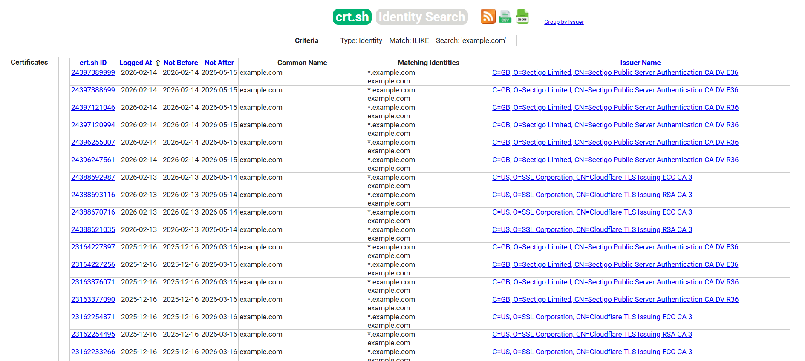

# Определение поверхности атаки

| ID |
| --- |
| WSTG-INFO-04 |

## Резюме

Определение поверхности атаки (attack surface) веб-приложения включает обнаружение всех приложений, доменов, виртуальных хостов (virtual hosts) и внешних доступных сервисов, связанных с целевой инфраструктурой. Этот процесс выходит за рамки простого выявления размещенных приложений и включает перечисление DNS (DNS enumeration), поиск поддоменов, анализ виртуальных хостов, нестандартных портов, а также проверку цифровых сертификатов и журналов прозрачности сертификатов (Certificate Transparency logs, CT logs).

С распространением виртуального хостинга и разделяемой инфраструктуры традиционное соотношение 1:1 между IP-адресом и веб-сервером практически исчезло. На одном IP-адресе может размещаться несколько приложений в различных доменах, средах развертывания или административных интерфейсах. Неспособность выявить эти активы может привести к неполноте оценки безопасности и пропуску критических уязвимостей.

Специалистам по безопасности иногда предоставляется набор IP-адресов в качестве цели для тестирования. Можно утверждать, что такой сценарий ближе к классическому тестированию на проникновение (penetration testing), однако в любом случае ожидается, что в ходе такой задачи будут протестированы все веб-приложения, доступные через указанную цель. Проблема заключается в том, что заданный IP-адрес обслуживает HTTP-сервис на порту 80, но если тестировщик обратится к нему по IP-адресу (поскольку это все, что ему известно), сервер вернет сообщение вида «No web server configured at this address» или аналогичное. При этом система может «скрывать» множество веб-приложений, привязанных к несвязанным символьным (DNS) именам. Очевидно, что полнота анализа критически зависит от того, проверит ли тестировщик все приложения или ограничится только теми, о которых ему известно изначально.

Иногда спецификация целей бывает более подробной. Тестировщику может быть предоставлен список IP-адресов и соответствующих им символьных имен. Тем не менее этот список может содержать неполную информацию, то есть опускать некоторые символьные имена, о существовании которых может не знать даже сам заказчик (что особенно характерно для крупных организаций).

Еще одна проблема, влияющая на область оценки (scope), связана с веб-приложениями, опубликованными по неочевидным URL-адресам (например, `https://www.example.com/some-strange-URL`), на которые нигде нет прямых ссылок. Это может происходить либо по ошибке (из-за некорректной конфигурации), либо намеренно (например, неафишируемые административные интерфейсы).

Для решения этих проблем необходимо проводить комплексную процедуру идентификации поверхности атаки.

## Цели тестирования

- Перечислить все веб-приложения, входящие в область оценки (scope).
- Идентифицировать DNS-имена, домены и виртуальные хосты, связанные с целью.
- Обнаружить дополнительные домены и поддомены с помощью методов пассивного и активного DNS-разведывания.
- Проанализировать цифровые сертификаты и журналы прозрачности сертификатов (Certificate Transparency) для выявления дополнительных имен хостов.

## Методика тестирования

Обнаружение веб-приложений — это процесс, направленный на идентификацию веб-приложений на заданной инфраструктуре. Последняя обычно задается как набор IP-адресов (возможно, диапазон сети / net block), но может состоять из набора символьных имен DNS или комбинации того и другого. Эта информация предоставляется до начала проведения оценки, будь то классический пентест или специализированный аудит безопасности веб-приложения. В обоих случаях, если правила взаимодействия (rules of engagement) не предписывают иное (например, тестировать только приложение, расположенное по адресу `https://www.example.com/`), оценка должна стремиться к максимальной полноте охвата, то есть выявлять все приложения, доступные через предоставленную цель. В следующих примерах рассматриваются некоторые методы, которые могут применяться для достижения этой цели.

> Некоторые из приведенных ниже методов относятся к общедоступным веб-серверам в сети Интернет, в частности DNS, веб-сервисы обратного поиска по IP и использование поисковых систем. В примерах используются частные IP-адреса (такие как `192.168.1.100`), которые, если не указано иное, представляют собой *обобщенные* IP-адреса и используются исключительно в целях анонимизации.

Существует три фактора, влияющих на то, сколько приложений связано с данным именем DNS (или IP-адресом):

1. **Различный базовый URL (Different Base URL)**

    Очевидной точкой входа для веб-приложения является `www.example.com`, то есть под этим сокращенным обозначением мы подразумеваем веб-приложение, начинающееся с `https://www.example.com/` (то же самое справедливо для HTTPS). Однако, хотя это наиболее распространенная ситуация, ничто не обязывает приложение начинаться с корневого пути `/`.

    Например, одно и то же символьное имя может быть связано с тремя веб-приложениями: `https://www.example.com/app1`, `https://www.example.com/app2`, `https://www.example.com/app3`.

    В этом случае URL `https://www.example.com/` может не содержать информативной страницы. Все три приложения останутся **скрытыми**, пока тестировщик явно не узнает, как к ним обратиться, то есть пока ему не станут известны пути *app1*, *app2* или *app3*. Обычно нет необходимости публиковать веб-приложения подобным образом, за исключением случаев, когда владелец не хочет, чтобы они были доступны стандартным путем, и готов сообщать пользователям их точное расположение. Это не означает, что эти приложения являются секретными, просто их существование и расположение явно не афишируются.

2. **Нестандартные порты (Non-standard Ports)**

    Хотя веб-приложения обычно функционируют на порту 80 (HTTP) и 443 (HTTPS), в этих номерах портов нет ничего строго фиксированного или обязательного. Веб-приложения могут быть привязаны к произвольным TCP-портам и доступны при указании номера порта следующим образом: `http[s]://www.example.com:port/`. Например, `https://www.example.com:20000/`.

3. **Виртуальные хосты (Virtual Hosts)**

    Служба DNS позволяет связывать один IP-адрес с одним или несколькими символьными именами. Например, IP-адрес `192.168.1.100` может быть сопоставлен с DNS-именами `www.example.com`, `helpdesk.example.com`, `webmail.example.com`. При этом не требуется, чтобы все имена принадлежали одному и тому же домену DNS. Это отношение «1-ко-многим» может использоваться для выдачи различного контента с помощью так называемых виртуальных хостов. Информация, определяющая, к какому виртуальному хосту обращается клиент, передается в заголовке HTTP 1.1 [Host header](https://datatracker.ietf.org/doc/html/rfc9110#section-7.2).

    Можно даже не подозревать о существовании других веб-приложений, кроме очевидного `www.example.com`, не зная заранее о наличии `helpdesk.example.com` и `webmail.example.com`.

### Подходы к решению проблемы 1 — нестандартные URL

Не существует способа достоверно и на 100% подтвердить существование веб-приложений с нестандартными именами. Поскольку они нестандартны, нет единых критериев их именования, однако тестировщик может использовать ряд методов для получения дополнительной информации.

Во-первых, если веб-сервер настроен некорректно и допускает просмотр каталогов (directory browsing / directory listing), обнаружить такие приложения вполне возможно. Сканеры уязвимостей (vulnerability scanners) могут помочь в этом отношении.

Во-вторых, на эти приложения могут вести ссылки с других веб-страниц, и существует вероятность, что они были обойдены поисковыми роботами и проиндексированы поисковыми системами. Если тестировщики подозревают наличие таких **скрытых** приложений на `www.example.com`, они могут выполнить поиск с использованием оператора *site*, проанализировав результаты запроса `site: www.example.com`. Среди возвращенных URL-адресов может оказаться ссылка на такое неочевидное приложение.

Еще один вариант — проверка URL-адресов, которые являются вероятными кандидатами на роль неопубликованных приложений. Например, веб-интерфейс почты может быть доступен по таким адресам, как `https://www.example.com/webmail`, `https://webmail.example.com/` или `https://mail.example.com/`. То же относится и к административным интерфейсам, которые могут быть развернуты по скрытым путям (например, панель управления Tomcat) и при этом нигде не упоминаться. Таким образом, перебор по словарю (или «интеллектуальное угадывание») может принести результаты. Сканеры уязвимостей также могут оказаться полезными в этом направлении.

### Подходы к решению проблемы 2 — нестандартные порты

Проверить наличие веб-приложений на нестандартных портах достаточно просто. Сканер портов, такой как Nmap, способен выполнять распознавание служб с помощью опции `-sV` и выявлять сервисы http`[s]` на произвольных портах. Все, что требуется — выполнить полное сканирование всего адресного пространства из 64k TCP-портов.

Например, следующая команда с помощью TCP connect сканирования проверит все открытые порты на IP-адресе `192.168.1.100` и попытается определить, какие службы с ними связаны (показаны только *основные* параметры — Nmap обладает широким набором опций, рассмотрение которых выходит за рамки данного раздела):

`nmap -Pn -sT -sV -p0-65535 192.168.1.100`

Достаточно изучить вывод команды и найти записи HTTP или признаки сервисов, обернутых в TLS (которые затем следует дополнительно проверить, чтобы подтвердить, что это именно HTTPS). Например, вывод предыдущей команды может выглядеть следующим образом:

```bash
Interesting ports on 192.168.1.100:
(The 65527 ports scanned but not shown below are in state: closed)
PORT      STATE SERVICE     VERSION
22/tcp    open  ssh         OpenSSH 3.5p1 (protocol 1.99)
80/tcp    open  http        Apache httpd 2.0.40 ((Red Hat Linux))
443/tcp   open  ssl         OpenSSL
901/tcp   open  http        Samba SWAT administration server
1241/tcp  open  ssl         Nessus security scanner
3690/tcp  open  unknown
8000/tcp  open  http-alt?
8080/tcp  open  http        Apache Tomcat/Coyote JSP engine 1.1
```

Из этого примера видно, что:

- На порту 80 работает HTTP-сервер Apache.
- На порту 443 предположительно работает сервер HTTPS (но это требует подтверждения, например, путем открытия `https://192.168.1.100` в браузере).
- На порту 901 находится веб-интерфейс Samba SWAT.
- Сервис на порту 1241 представляет собой не HTTPS, а обернутый в TLS демон сканера Nessus.
- На порту 3690 работает неопределенная служба (Nmap возвращает ее сигнатуру (*fingerprint*), опущенную здесь для краткости, вместе с инструкциями по ее отправке для включения в базу данных отпечатков Nmap, если вам известно, какой сервис она представляет).
- Еще один неопределенный сервис обнаружен на порту 8000; возможно, это HTTP, так как веб-серверы нередко размещаются на этом порту. Давайте исследуем этот сервис:

```bash
$ ncat 192.168.10.100 8000
GET / HTTP/1.0

HTTP/1.0 200 OK
pragma: no-cache
Content-Type: text/html
Server: MX4J-HTTPD/1.0
expires: now
Cache-Control: no-cache

<html>
...
```

Это подтверждает, что сервис действительно является HTTP-сервером. В качестве альтернативы тестировщики могли бы открыть этот URL в веб-браузере или воспользоваться perl-командами GET или HEAD, которые имитируют HTTP-взаимодействие, подобное приведенному выше (однако запросы HEAD могут поддерживаться не всеми серверами).

- Apache Tomcat запущен на порту 8080.

Та же задача может быть решена сканерами уязвимостей, однако предварительно следует убедиться, что выбранный сканер способен распознавать службы HTTP`[S]`, работающие на нестандартных портах. Например, Nessus способен определять их на произвольных портах (при условии, что ему задано сканирование всех портов) и, по сравнению с Nmap, предоставит ряд проверок на известные уязвимости веб-серверов, а также на конфигурацию TLS/SSL для сервисов HTTPS. Как отмечалось ранее, Nessus также умеет выявлять популярные приложения или веб-интерфейсы, которые иначе могли бы остаться незамеченными (например, административный интерфейс Tomcat).

Полное сканирование 65535 портов с помощью Nmap с распознаванием служб может выполняться медленно на большом количестве хостов. [naabu](https://github.com/projectdiscovery/naabu) — это быстрый сканер портов, который можно использовать для оперативного обнаружения открытых портов в большом списке хостов с последующей передачей результатов напрямую в Nmap для распознавания сервисов только на найденных открытых портах:

```bash
naabu -p - -rate 2000 -c 50 -retries 2 -warm-up-time 1 -silent -host 192.168.1.100 -nmap-cli 'nmap -sV -oX scan.xml'
```

Такая связка сначала сканирует все порты с помощью naabu, а затем запускает более медленное сканирование Nmap по распознаванию служб исключительно для тех портов, которые naabu нашел открытыми, что существенно сокращает общее время сканирования.

### Подходы к решению проблемы 3 — виртуальные хосты

Существует ряд методов, позволяющих определить DNS-имена, связанные с заданным IP-адресом `x.y.z.t`.

#### Перечисление записей DNS

Перечисление DNS (DNS enumeration) направлено на выявление доменов, поддоменов и связанных с ними DNS-записей целевой организации для расширения области оценки. Перечисление DNS играет ключевую роль в выявлении дополнительных виртуальных хостов, привязанных к одному и тому же IP-адресу. Это может раскрыть системы разработки (development), тестовые окружения (staging), устаревшие сервисы или интерфейсы администрирования.

Для этого могут применяться как пассивные, так и активные методы.

#### Пассивное перечисление DNS

Пассивные методы не взаимодействуют напрямую с целевой инфраструктурой, а опираются на общедоступные источники данных. Примеры включают:

- Общедоступные DNS-записи (A, AAAA, MX, TXT, NS)
- Обратные DNS-запросы (PTR-записи)
- Поисковые системы
- Базы данных Passive DNS
- Журналы Certificate Transparency

Пассивные методы предпочтительны на ранних этапах разведки во избежание обнаружения системами мониторинга цели.

Сервис [Chaos](https://chaos.projectdiscovery.io/) и его клиент [chaos-client](https://github.com/projectdiscovery/chaos-client) предоставляют доступ к курируемому набору данных поддоменов, предварительно собранных ProjectDiscovery преимущественно из открытых программ Bug Bounty. Это может послужить полезным и быстрым дополнением к пассивному перечислению DNS для доменов, уже включенных в базу данных, однако требует API-ключа, охватывает только домены из своего набора данных и не должно рассматриваться как замена активным инструментам, таким как `subfinder` или `amass`, при работе с произвольными целевыми объектами.

#### Активное перечисление DNS

Активные методы напрямую отправляют запросы к DNS-инфраструктуре цели и могут приводить к фиксации событий в логах целевых систем. К ним относятся:

- Брутфорс поддоменов (Subdomain brute forcing)
- Попытки передачи зоны DNS (DNS zone transfer)
- Перечисление DNS-записей с использованием специализированных утилит

К распространенным инструментам перечисления DNS относятся:

- `amass`
- `subfinder`
- `dnsrecon`
- `fierce`
- `dig`
- `nslookup`

Пример использования `dig`:

```bash
dig example.com ANY
```

```text
; <<>> DiG 9.10.6 <<>> example.com ANY
;; QUESTION SECTION:
;example.com.                  IN      ANY

;; ANSWER SECTION:
example.com.            86400   IN      A       93.184.216.34
example.com.            86400   IN      MX      10 mail.example.com.
example.com.            86400   IN      NS      ns1.secure.net.
example.com.            86400   IN      NS      ns2.secure.net.
example.com.            86400   IN      TXT     "v=spf1 -all"
```

Пример использования `subfinder`:

```bash
subfinder -d example.com -silent
```

```text
www.example.com
dev.example.com
staging.example.com
mail.example.com
api.example.com
```

#### Перебор комбинаций поддоменов (Subdomain Permutation)

После сбора начального набора поддоменов методы перестановок (или модификации / alterations) позволяют генерировать дополнительных кандидатов путем объединения известных меток с распространенными префиксами/суффиксами или применения мутаций (например, `dev-` → `staging-`, добавление цифр и т. д.). Для этой цели обычно используются такие инструменты, как [altdns](https://github.com/infosec-au/altdns), [dnsgen](https://github.com/ProjectAnte/dnsgen) или [gotator](https://github.com/Josue87/gotator). Сгенерированные кандидаты затем должны быть разрешены в IP-адреса (`dnsx` / [MassDNS](https://github.com/blechschmidt/massdns)) и проверены на доступность сервисов (`httpx`).

MassDNS — это высокоскоростной DNS-резолвер, полезный для быстрого разрешения больших списков кандидатов, сформированных утилитами перестановок или методом словарного брутфорса.

#### Передача зоны DNS (Zone Transfer)

В настоящее время данный метод имеет ограниченное применение, поскольку DNS-серверы повсеместно запрещают несанкционированную передачу зон (zone transfers). Тем не менее попытку выполнить стоит. Прежде всего, тестировщики должны определить серверы имен (name servers), обслуживающие адрес `x.y.z.t`. Если для `x.y.z.t` известно символьное имя (пусть это будет `www.example.com`), обслуживающие его серверы имен можно определить с помощью таких инструментов, как `nslookup`, `host` или `dig`, запросив записи DNS NS.

Если для `x.y.z.t` символьные имена неизвестны, но описание цели содержит хотя бы одно символьное имя, тестировщики могут попытаться применить тот же процесс и опросить сервер имен для этого домена (в надежде, что `x.y.z.t` также обслуживается этим же сервером имен). Например, если цель состоит из IP-адреса `x.y.z.t` и имени `mail.example.com`, определите серверы имен для домена `example.com`.

Следующий пример демонстрирует, как определить серверы имен для `www.owasp.org` с помощью команды `host`:

```bash
$ host -t ns www.owasp.org
www.owasp.org is an alias for owasp.org.
owasp.org name server ns1.secure.net.
owasp.org name server ns2.secure.net.
```

Теперь можно запросить передачу зоны у серверов имен домена `example.com`. Если тестировщику повезет, в ответе вернется список всех записей DNS для этого домена. Он будет включать как очевидный `www.example.com`, так и не столь очевидные `helpdesk.example.com` и `webmail.example.com` (а также, возможно, другие). Проверьте все имена, возвращенные в результате передачи зоны, и отберите те, которые относятся к оцениваемому целевому объекту.

Попытка запросить передачу зоны для `owasp.org` у одного из его серверов имен:

```bash
$ host -l www.owasp.org ns1.secure.net
Using domain server:
Name: ns1.secure.net
Address: 192.220.124.10#53
Aliases:

Host www.owasp.org not found: 5(REFUSED)
; Transfer failed.
```

#### Обратные DNS-запросы

Этот процесс аналогичен предыдущему, но опирается на обратные записи DNS (PTR). Вместо запроса передачи зоны попробуйте установить тип записи PTR и отправить запрос для заданного IP-адреса. Если тестировщикам повезет, в ответ придет запись с DNS-именем. Этот метод зависит от наличия сопоставлений IP-адресов с символьными именами, что не гарантируется.

#### DNS-поиск через веб-сервисы

Подобный поиск похож на передачу зон DNS, но опирается на веб-сервисы, позволяющие выполнять поиск по именам в DNS. Одним из таких сервисов является [Netcraft Search DNS](https://searchdns.netcraft.com/?host). Тестировщик может запросить список имен, принадлежащих выбранному домену, например `example.com`. Затем проверяется, имеют ли полученные имена отношение к исследуемой цели.

#### Сервисы обратного поиска по IP (Reverse-IP)

Сервисы Reverse-IP аналогичны обратным DNS-запросам, с той разницей, что тестировщики обращаются к веб-приложению вместо сервера имен. Доступно множество подобных сервисов. Поскольку они склонны возвращать неполные (и зачастую различающиеся) результаты, рекомендуется использовать несколько сервисов для более полного анализа:

- [MxToolbox Reverse IP](https://mxtoolbox.com/ReverseLookup.aspx)
- [ViewDNS.info Reverse IP](https://viewdns.info/reverseip/)
- [HackerTarget Reverse IP Lookup](https://hackertarget.com/reverse-ip-lookup/)

Поисковые системы интернет-активов, такие как [Shodan](https://www.shodan.io/), [Censys](https://censys.com) и [FOFA](https://fofa.info), индексируют подключенные к Интернету хосты и службы; поиск по ним можно осуществлять по IP-адресу, сертификату или содержимому баннеров для выявления других имен хостов и служб, размещенных на том же адресе. FOFA, в частности, обладает обширным покрытием инфраструктуры в Китае и Азиатско-Тихоокеанском регионе, что может дополнить данные Shodan и Censys. Например, поиск по IP в FOFA: `ip="192.168.1.100"`, или поиск по определенному заголовку или заголовку ответа: `title="Example App"`. Как и в случае с другими reverse-IP сервисами, здесь доступен бесплатный тариф с ограниченным количеством запросов, а также платные планы для более полного доступа.

#### Поиск в Google (Googling)

После сбора информации с помощью предыдущих методов тестировщики могут обратиться к поисковым системам для уточнения и расширения своего анализа. Это может предоставить свидетельства существования дополнительных символьных имен, принадлежащих цели, или приложений, доступных по неочевидным URL-адресам.

Например, возвращаясь к предыдущему примеру с `www.owasp.org`, тестировщик может выполнить поиск в Google и других поисковых системах для сбора информации (и, следовательно, DNS-имен), связанной с недавно обнаруженными доменами `webgoat.org`, `webscarab.com` и `webscarab.net`.

Методы поиска через Google подробно описаны в разделе [Conduct Search Engine Reconnaissance for Information Leakage](01.%20Conduct%20Search%20Engine%20Reconnaissance%20for%20Information%20Leakage.md).

#### Цифровые сертификаты

Если сервер принимает соединения по протоколу HTTPS, поля Common Name (CN) и Subject Alternate Name (SAN) в сертификате могут содержать одно или несколько имен хостов. Однако если веб-сервер не имеет доверенного сертификата или используются wildcard-сертификаты (с подстановочными знаками), это может не дать полезной информации.

Значения CN и SAN можно получить путем ручного просмотра сертификата или с помощью утилит, таких как OpenSSL:

```sh
openssl s_client -connect 93.184.216.34:443 </dev/null 2>/dev/null | openssl x509 -noout -text | grep -E 'DNS:|Subject:'

Subject: C = US, ST = California, L = Los Angeles, O = Internet Corporation for Assigned Names and Numbers, CN = www.example.org
DNS:www.example.org, DNS:example.com, DNS:example.edu, DNS:example.net, DNS:example.org, DNS:www.example.com, DNS:www.example.edu, DNS:www.example.net
```

#### Журналы Certificate Transparency

Журналы прозрачности сертификатов (Certificate Transparency, CT) представляют собой общедоступные реестры выпущенных сертификатов TLS. По этим журналам можно выполнять поиск для идентификации имен хостов и поддоменов, связанных с целевой организацией, включая staging-системы, интерфейсы администрирования, устаревшие системы или другие внешне доступные сервисы.

Изучение логов CT может выявить имена хостов, которые невозможно обнаружить исключительно с помощью передачи зон DNS, обратного поиска или запросов к поисковым системам. Тестировщикам следует извлечь обнаруженные имена хостов и проверить их работоспособность путем разрешения в DNS, чтобы определить, активны ли они и входят ли в согласованную область оценки.

При анализе данных журналов CT следует обращать внимание на:

- Имена хостов, указывающие на среды разработки, тестирования или предрелизной подготовки (dev, stage, test).
- Административные интерфейсы и панели управления.
- Выведенные из эксплуатации или устаревшие (legacy) системы, которые все еще могут оставаться доступными.
- Wildcard-сертификаты, которые могут указывать на наличие дополнительных необнаруженных поддоменов.

Информация, полученная из журналов CT, должна быть проверена на принадлежность и актуальность перед проведением дальнейшего тестирования.

Необходимо строго соблюдать границы области тестирования (scope), определенные в соглашении на проведение аудита.

Обнаруженные активы должны быть валидированы и задокументированы перед выполнением дальнейших тестовых активностей.

Один из распространенных подходов к отправке запросов к журналам CT — использование общедоступных поисковых порталов, агрегирующих данные сертификатов. Например, тестировщик может выполнить поиск сертификатов, выпущенных для `example.com`, и проанализировать перечисленные поддомены.

Например: `https://crt.sh/?q=%25.example.com`

> Примечание: Сервис [crt.sh](https://crt.sh) периодически испытывает перебои в работе или высокую задержку ответов. [Merklemap](https://www.merklemap.com/) и [Cert Spotter от SSLMate](https://sslmate.com/certspotter/) являются альтернативными поисковыми сервисами Certificate Transparency, которые полезно иметь в качестве резервных вариантов.

  

*Рисунок 4.1.4-1: Пример результатов поиска по логам Certificate Transparency.*

В результатах могут быть перечислены такие поддомены, как `dev.example.com`, `staging.example.com`, или другие имена хостов, на которые нет прямых ссылок с основного сайта. Обнаруженные имена хостов перед дальнейшим тестированием необходимо верифицировать через разрешение DNS.

### Пример современного рабочего процесса от пассивного к активному анализу

Типичный легковесный конвейер (pipeline), применяемый в современных аудитах безопасности:

```bash
# Passive subdomain discovery
subfinder -d example.com -silent | tee subs.txt
amass enum -passive -d example.com -o amass.txt

# Resolve and probe live hosts
cat subs.txt amass.txt | sort -u | dnsx -silent | httpx -silent -title -tech-detect -status-code -o live.txt

# Historical URLs (feed interesting hosts later)
cat live.txt | unfurl domains | sort -u | gau --subs | tee archive-urls.txt

# Screenshot live hosts for visual triage of a large host list
gowitness scan file -f live.txt
```

При большом количестве обнаруженных хостов создание скриншотов каждого из них обеспечивает быстрый способ визуального триажа (visual triage) результатов — например, для быстрого обнаружения страниц входа, панелей администрирования, стандартных страниц установки или страниц ошибок без необходимости открывать каждый хост вручную. [gowitness](https://github.com/sensepost/gowitness) — актуальный и активно поддерживаемый инструмент для этой задачи; `httpx` также поддерживает встроенный флаг `-screenshot` для аналогичных целей без добавления еще одной утилиты в цепочку.

Всегда соблюдайте границы области тестирования (scope), лимиты частоты запросов (rate limits) и правила проведения аудита. Проверяйте принадлежность вновь обнаруженных активов перед началом углубленного тестирования.

## Инструменты

- Инструменты поиска DNS, такие как `nslookup`, `dig` и `host`
- Инструменты для перечисления поддоменов и картирования поверхности атаки:
    - [Amass](https://github.com/owasp-amass/amass) (проект OWASP — пассивный и активный сбор, вывод в виде графа)
    - [subfinder](https://github.com/projectdiscovery/subfinder)
    - [Chaos](https://chaos.projectdiscovery.io/) / [chaos-client](https://github.com/projectdiscovery/chaos-client) (курируемый датасет поддоменов, требуется API-ключ)
    - [dnsx](https://github.com/projectdiscovery/dnsx)
    - [httpx](https://github.com/projectdiscovery/httpx) (зондирование «живых» хостов, определение технологий, заголовки)
    - [gowitness](https://github.com/sensepost/gowitness) (создание скриншотов для визуального триажа живых хостов)
    - `dnsrecon`, `fierce`
- Инструменты перестановок поддоменов (subdomain permutation): [altdns](https://github.com/infosec-au/altdns), [dnsgen](https://github.com/ProjectAnte/dnsgen), [gotator](https://github.com/Josue87/gotator)
- [MassDNS](https://github.com/blechschmidt/massdns) (высокоскоростной резолвер для списков слов и результатов перестановки)
- Поисковые системы (Google, Bing и другие основные поисковики)
- Сервисы обратного поиска по IP (Reverse IP lookup)
- Поисковые системы интернет-активов: [Shodan](https://www.shodan.io/), [Censys](https://censys.com), [FOFA](https://fofa.info)
- Поисковые порталы Certificate Transparency: [crt.sh](https://crt.sh), [Merklemap](https://www.merklemap.com/), [Cert Spotter от SSLMate](https://sslmate.com/certspotter/)
- Сборщики архивных и исторических URL: [gau](https://github.com/lc/gau), [waybackurls](https://github.com/tomnomnom/waybackurls), [waymore](https://github.com/xnl-h4ck3r/waymore)
- [Nmap](https://nmap.org/)
- [naabu](https://github.com/projectdiscovery/naabu) (быстрое сканирование портов, возможность передачи результатов в Nmap)
- [Nessus Vulnerability Scanner](https://www.tenable.com/products/nessus)
- [Nikto](https://github.com/sullo/nikto)
- Обнаружение контента / виртуальных хостов: [ffuf](https://github.com/ffuf/ffuf), [feroxbuster](https://github.com/epi052/feroxbuster), [gobuster](https://github.com/OJ/gobuster)
- Анализ исходного кода для поиска эндпоинтов (аудиты по методологии «белого» или «серого» ящика / white-box, gray-box): [OWASP Noir](https://github.com/owasp-noir/noir), [OWASP Attack Surface Detector](https://owasp.org/projects/attack-surface-detector)
