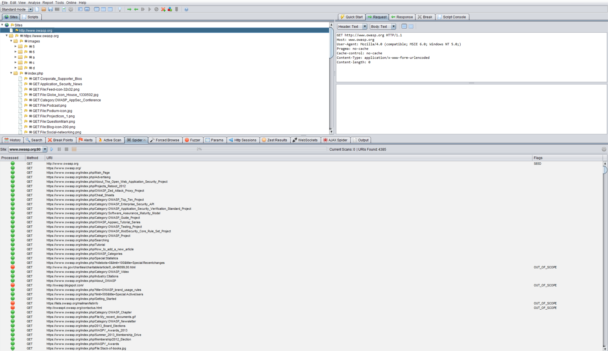

# Построение карты путей выполнения в приложении

| ID |
| --- |
| WSTG-INFO-07 |

## Резюме

Перед началом тестирования безопасности первостепенное значение имеет понимание структуры приложения. Без всестороннего представления об архитектуре и структуре приложения проведение полноценного тестирования маловероятно.

## Цели тестирования

- Составить карту целевого приложения и изучить основные рабочие процессы (workflows).

## Методика тестирования

При тестировании методом «черного ящика» (black-box testing) крайне сложно протестировать всю кодовую базу целиком. Это связано не только с тем, что тестировщик не видит путей выполнения кода в приложении, но и с тем, что проверка всех возможных ветвлений кода потребовала бы колоссальных временных затрат. Один из способов решения этой проблемы — документирование всех обнаруженных и протестированных путей выполнения.

Существует несколько подходов к тестированию и оценке покрытия кода (code coverage):

- **Пути (Path)** — тестирование каждого пути выполнения в приложении, включая комбинаторное тестирование и анализ граничных значений для каждого логического ветвления. Хотя этот подход обеспечивает максимальную полноту, число тестируемых путей растет экспоненциально с каждой новой точкой ветвления.
- **Поток данных (Data Flow или Taint Analysis)** — тестирование присваивания переменных через внешнее взаимодействие (как правило, действия пользователей). Фокусируется на отслеживании потоков, преобразовании и использовании данных внутри приложения.
- **Состояние гонки (Race)** — тестирование работы нескольких параллельных экземпляров приложения, манипулирующих одними и теми же данными.

Выбор метода и глубина его применения должны согласовываться с владельцем приложения. Кроме того, можно применять и более простые подходы. Например, тестировщик может напрямую уточнить у владельца приложения, какие конкретные функции или участки кода вызывают у него наибольшие опасения, и обсудить, какими путями можно достичь этих сегментов кода.

Чтобы продемонстрировать покрытие кода владельцу приложения, тестировщик может начать с документирования в электронной таблице всех ссылок, найденных в ходе краулинга приложения (как в ручном, так и в автоматическом режиме). Затем тестировщик может более детально изучить точки принятия решений в приложении и определить, сколько значимых путей выполнения кода удалось обнаружить. Далее эти пути следует задокументировать в таблице с указанием URL-адресов, текстовых описаний и скриншотов обнаруженных маршрутов.

### Автоматический краулинг (Spidering)

Автоматический краулер/паук (spider) — это инструмент, применяемый для автоматического обнаружения новых ресурсов (URL) на определенном сайте. Он начинает работу со списка начальных URL-адресов (называемых «затравкой» / seeds), состав которого зависит от того, как именно запущен краулер. Несмотря на наличие множества инструментов для веб-краулинга, в следующем примере используется [Zed Attack Proxy (ZAP)](https://www.zaproxy.org):

*Рисунок 4.1.7-1: Окно программы Zed Attack Proxy*

ZAP предлагает различные варианты автоматического обхода, которые можно выбирать в зависимости от задач тестировщика:

- [Spider](https://www.zaproxy.org/docs/desktop/start/features/spider/)
- [Client Spider](https://www.zaproxy.org/docs/desktop/addons/client-side-integration/spider/)
- [OpenAPI Support](https://www.zaproxy.org/docs/desktop/addons/openapi-support/)
- [GraphQL Support](https://www.zaproxy.org/docs/desktop/addons/graphql-support/)

### Сканирование современных приложений с интенсивным использованием JavaScript

Примитивный краулинг часто обеспечивает недостаточное покрытие современных приложений, поскольку многие маршруты и пути принятия решений доступны исключительно через клиентскую маршрутизацию (client-side routing), динамически рендеримый контент или вызовы API, инициируемые действиями пользователя, а не простым переходом по ссылкам `<a href>`. Это означает, что значительная часть путей выполнения приложения может никогда не быть обнаружена краулером, который парсит только статический HTML.

Чтобы улучшить покрытие таких приложений, используйте краулеры, способные выполнять JavaScript и поддерживать клиентскую навигацию — такие как [katana](https://github.com/projectdiscovery/katana) (поддерживающая headless-режим для этих целей), ZAP [Client Spider](https://www.zaproxy.org/docs/desktop/addons/client-side-integration/spider/) или встроенный краулер Burp Suite. Ручное прохождение рабочих процессов приложения через перехватывающий прокси, как описано в разделе [Identify Application Entry Points](06.%20Identify%20Application%20Entry%20Points.md), остается важнейшей задачей для достижения путей, скрытых за многошаговыми сценариями, определенными состояниями аутентификации или условной логикой, которую автоматизированные сканеры не могут активировать самостоятельно.

## Инструменты

- [Zed Attack Proxy (ZAP)](https://www.zaproxy.org)
- [Программы для построения диаграмм и интеллект-карт](https://en.wikipedia.org/wiki/List_of_concept-_and_mind-mapping_software) (Diagramming software)

## Ссылки и материалы

- [Code Coverage](https://en.wikipedia.org/wiki/Code_coverage)
