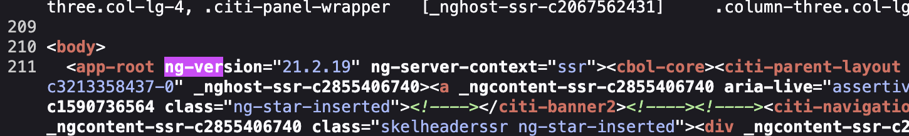
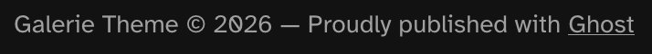
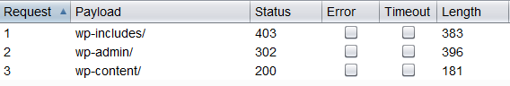
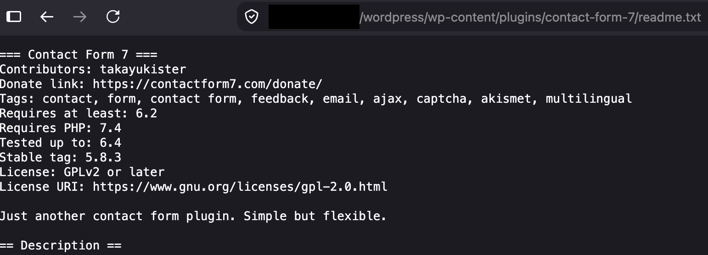
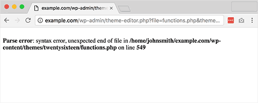
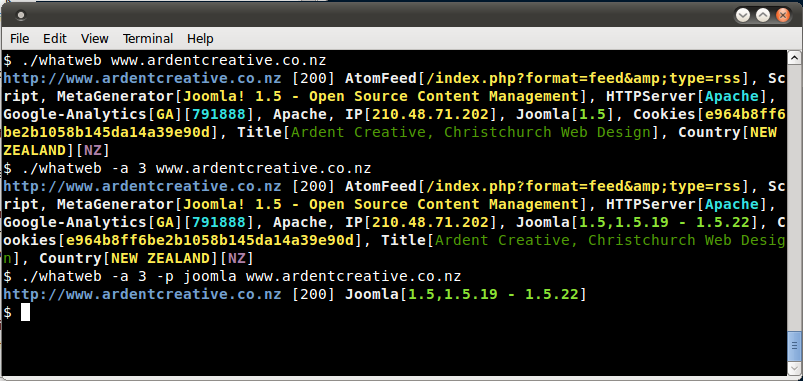

# Определение отпечатка фреймворка веб-приложения

| ID |
| --- |
| WSTG-INFO-08 |

## Резюме

Не будет преувеличением сказать, что практически любая мыслимая идея для веб-приложения уже была кем-то реализована. С учетом огромного количества бесплатных проектов с открытым исходным кодом, которые активно разрабатываются и развертываются по всему миру, крайне высока вероятность того, что при тестировании безопасности приложения целью окажется ресурс, полностью или частично зависящий от этих хорошо известных приложений или фреймворков (например, WordPress, phpBB, MediaWiki и т. д.). Знание компонентов веб-приложения, проходящих тестирование, существенно упрощает процесс оценки и значительно снижает трудозатраты. Такие популярные веб-приложения имеют характерные HTTP-заголовки, cookie-файлы и структуру каталогов, которые можно перечислить для однозначной идентификации приложения. Большинство веб-фреймворков оставляют в этих местах характерные маркеры, помогающие злоумышленнику или тестировщику распознать их. По сути, именно так функционируют все автоматизированные инструменты: они ищут маркер в предопределенном месте, а затем сравнивают его с базой данных известных сигнатур. Для повышения точности обычно используется сразу несколько маркеров.

## Цели тестирования

- Снять цифровые отпечатки (fingerprint) компонентов, используемых веб-приложениями.
- Определить версии этих компонентов и выяснить, являются ли какие-либо из них устаревшими, неподдерживаемыми или подверженными известным уязвимостям.

## Методика тестирования

### Тестирование методом «черного ящика»

Существует несколько типичных мест, анализ которых позволяет идентифицировать используемые фреймворки или компоненты:

- HTTP-заголовки
- Cookie-файлы
- Исходный код HTML
- Специфические файлы и каталоги
- Расширения файлов
- Сообщения об ошибках

#### HTTP-заголовки

Наиболее элементарный способ идентификации веб-фреймворка — анализ поля `X-Powered-By` в заголовке ответа HTTP. Для снятия отпечатков цели можно применять множество инструментов, самым простым из которых является netcat.

Рассмотрим следующий пример цикла «HTTP-запрос — ответ»:

```html
$ nc 127.0.0.1 80
HEAD / HTTP/1.0

HTTP/1.1 200 OK
Server: nginx/1.0.14
[...]
X-Powered-By: Mono
```

Из поля `X-Powered-By` становится понятно, что в качестве фреймворка веб-приложения, вероятнее всего, используется `Mono`. Однако, несмотря на простоту и скорость, данный подход работает далеко не во всех случаях. Заголовок `X-Powered-By` можно легко отключить с помощью соответствующей конфигурации. Существует также ряд методов, позволяющих веб-сайту обфусцировать HTTP-заголовки (см. пример в разделе [Remediation](#рекомендации-по-устранению)). В приведенном выше примере также можно отметить, что для отдачи контента используется конкретная версия веб-сервера `nginx`.

В том же сценарии тестировщик мог бы вообще не обнаружить заголовок `X-Powered-By` либо получить ответ следующего вида:

```html
HTTP/1.1 200 OK
Server: nginx/1.0.14
Date: Sat, 07 Sep 2013 08:19:15 GMT
Content-Type: text/html;charset=ISO-8859-1
Connection: close
Vary: Accept-Encoding
X-Powered-By: Blood, sweat and tears
```

Иногда встречаются дополнительные HTTP-заголовки, прямо указывающие на определенный фреймворк. В следующем примере, согласно информации из ответа HTTP, видно, что заголовок `X-Powered-By` содержит версию PHP. При этом заголовок `X-Generator` свидетельствует о том, что фактически используется фреймворк `Swiftlet`, что позволяет тестировщику расширить векторы атак. При выполнении фингерпринтинга тщательно анализируйте каждый HTTP-заголовок на предмет подобных утечек.

```html
HTTP/1.1 200 OK
Server: nginx/1.4.1
Date: Sat, 07 Sep 2013 09:22:52 GMT
Content-Type: text/html
Connection: keep-alive
Vary: Accept-Encoding
X-Powered-By: PHP/5.4.16-1~dotdeb.1
Expires: Thu, 19 Nov 1981 08:52:00 GMT
Cache-Control: no-store, no-cache, must-revalidate, post-check=0, pre-check=0
Pragma: no-cache
X-Generator: Swiftlet
```

#### Файлы cookie

Другим аналогичным и в некоторой степени более надежным способом определения текущего веб-фреймворка являются специфические для фреймворка cookie-файлы.

Рассмотрим следующие заголовки HTTP-ответа приложения на базе Laravel:

```http
HTTP/1.1 200 OK
Server: nginx
Content-Type: text/html; charset=utf-8
Cache-Control: no-cache, private
Date: Sun, 13 Sep 2026 12:10:25 GMT
Set-Cookie: XSRF-TOKEN=eyJpdiI6IkpyQWZUUUFjVXBPWWpkSjF3cHlJZnc9PSIsInZhbHVlIjoiZzZlVm1QWlMxRDlqVGpDVHlwdVVPa3BpWDhYd0F2NXlodm1jTmRSU2pFaUh1VUxvL3cyLzhNU2o1blBJSUpQS2srNnBQQUVpUlJJeW9wMkRvZXhqejBySnpGUVVzclllendrQzZDWDBUa0ZiVmVnNlRidDFwVExrdGRZekJyd1ciLCJtYWMiOiJjMjcyN2FjOThlNjEyMGY0YjZkYjEwNWJjZGI2YWE4MzJiNDZjZDg1NDQxN2U0YzcxMDg5NTJhOTVjODE5YzY2IiwidGFnIjoiIn0%3D; expires=Sun, 13 Sep 2026 14:10:26 GMT; Max-Age=7200; path=/; samesite=lax
Set-Cookie: laravel_session=eyJpdiI6IlV4QkdjeWE2dGpzU2EyWEd4cDRHbXc9PSIsInZhbHVlIjoiMnlFWS9CcW9ncEFKODQzMFFxK0F6ekN4dStJbnF2b2NhaUlmRWVuRU81WFo2OHZwQTlYZ2owdGZlUVVLY29ScWRsZDllTTVVTXBuaE1SanBSak5JeU5NZFJnNFdZUmtOZnUwVTBUYndRbmpJdVRKdW9mZUtrMnRwRXg3TUxiM2MiLCJtYWMiOiI5NDU1ODY2Y2Q5NjhjMGI4NWZkNmZjNjI1NTI1ZDNiNTJjMDU3MTc3ZjAyZDc2YjlmZGE4OTM5NjFhNTY3ZTE3IiwidGFnIjoiIn0%3D; expires=Sun, 13 Sep 2026 14:10:26 GMT; Max-Age=7200; path=/; httponly; samesite=lax
content-length: 88805
```

Cookie-файл `laravel_session`, наряду с сопутствующим файлом `XSRF-TOKEN`, используемым для защиты от подделки межсайтовых запросов (Cross-Site Request Forgery, CSRF), устанавливается автоматически, что однозначно раскрывает используемый фреймворк. Список типичных имен cookie приведен в подразделе [Cookies](#файлы-cookie_1). Однако и для этого механизма идентификации существуют ограничения — имя cookie можно изменить. Например, в Laravel это делается через параметр `cookie` в файле `config/session.php`:

```php
/*
|--------------------------------------------------------------------------
| Session Cookie Name
|--------------------------------------------------------------------------
|
| Here you may change the name of the cookie used to identify a session
| instance by ID. The name specified here will get used every time a
| new session cookie is created by the framework for every driver.
|
*/

'cookie' => env(
    'SESSION_COOKIE',
    Str::slug(env('APP_NAME', 'laravel'), '_').'_session'
),
```

Тем не менее такие изменения вносятся разработчиками значительно реже, чем отключение заголовка `X-Powered-By`, что делает данный метод идентификации более надежным.

#### Исходный код HTML

Этот метод основан на поиске определенных паттернов в исходном коде HTML-страницы. Зачастую в нем можно обнаружить много полезной информации, помогающей тестировщику распознать конкретный компонент. Одним из частых маркеров выступают HTML-комментарии, напрямую раскрывающие фреймворк. Еще чаще встречаются пути к файлам и каталогам, специфичным для конкретного фреймворка — например, ссылки на папки со стилями CSS или скриптами JS. Наконец, специфические переменные сценариев также могут указывать на конкретный фреймворк.

По приведенному ниже скриншоту можно легко определить используемый фреймворк и его версию по указанным маркерам. Приложения Angular, например, добавляют атрибут `ng-version` непосредственно в корневой элемент страницы, явно раскрывая точную версию фреймворка.


*Рисунок 4.1.8-1: Пример HTML-кода приложения на Angular*

Часто подобная информация располагается в секции `<head>` ответов HTTP, в тегах `<meta>` или в подвале (footer) страницы. Тем не менее следует анализировать ответ целиком, так как это может пригодиться и для других целей — например, для обнаружения скрытых полей или полезных комментариев разработчиков. Иногда разработчики не уделяют должного внимания скрытию информации об используемых фреймворках или компонентах. В подвале страницы все еще можно натолкнуться на надписи вроде «Proudly published with Ghost», прямо указывающие на работу платформы публикации [Ghost](https://ghost.org/):


*Рисунок 4.1.8-2: Подвал страницы на платформе Ghost*

### Конкретные файлы и каталоги

Существует еще один подход, который позволяет атакующему или тестировщику с высокой точностью идентифицировать приложения или компоненты. Каждый компонент веб-приложения имеет уникальную структуру файлов и папок на сервере. Как отмечалось, пути к ресурсам нередко видны в исходном коде страницы HTML, однако порой они не представлены там явно, но физически присутствуют на сервере.

Для их выявления применяется метод принудительного просмотра директорий (forced browsing) или «дирбастинга» (dirbusting). Дирбастинг представляет собой перебор (brute force) известных имен каталогов и файлов на целевом ресурсе с анализом HTTP-ответов сервера для перечисления его содержимого. Полученная информация может использоваться как для обнаружения файлов по умолчанию и их последующей атаки, так и для снятия отпечатков веб-приложения. Перебор каталогов может выполняться различными способами; приведенный ниже пример демонстрирует успешную атаку на сайт под управлением WordPress с помощью предопределенного списка и функционала Intruder в Burp Suite.


*Рисунок 4.1.8-3: Перебор каталогов с помощью Burp Suite*

Мы видим, что для некоторых папок, специфичных для WordPress (например, `/wp-includes/`, `/wp-admin/` и `/wp-content/`), ответы HTTP возвращают коды 403 (Forbidden), 302 (Found, перенаправление на `wp-login.php`) и 200 (OK) соответственно. Это надежный признак того, что цель работает на WordPress. Аналогичным образом можно подбирать каталоги плагинов приложений и определять их версии. На скриншоте ниже показан типичный файл `readme.txt` плагина WordPress, доступный по адресу `/wp-content/plugins/<plugin-name>/readme.txt`, который предоставляет информацию об используемом плагине и раскрывает его точную, потенциально уязвимую версию через поле `Stable tag`.


*Рисунок 4.1.8-4: Раскрытие информации в файле readme плагина WordPress*

Совет: перед началом брутфорса каталогов обязательно проверьте файл `robots.txt`. Иногда там содержатся специфические для приложения папки и другая чувствительная информация. Пример такого файла `robots.txt` приведен ниже:

```text
User-agent: *
Disallow: /wp-admin/
Allow: /wp-admin/admin-ajax.php
```

Наборы файлов и каталогов различаются для каждого конкретного приложения. Если идентифицированное приложение или компонент распространяется с открытым исходным кодом, в процессе тестирования на проникновение имеет смысл развернуть его локальную копию, чтобы лучше понять структуру каталогов, логику работы и файлы, которые могли остаться на боевом сервере. Кроме того, существует множество готовых словарей файлов, ярким примером которых являются [словари предсказуемых файлов и папок FuzzDB](https://github.com/fuzzdb-project/fuzzdb).

#### Расширения файлов

URL-адреса могут содержать расширения файлов, которые также помогают определить веб-платформу или технологический стек.

Например, старая вики OWASP использовала PHP:

```text
https://example.owasp.org/index.php?title=Fingerprint_Web_Application_Framework&action=edit&section=4
```

Ниже перечислены распространенные расширения веб-файлов и связанные с ними технологии:

- `.php` — PHP
- `.aspx` — Microsoft ASP.NET
- `.jsp` — Java Server Pages

#### Сообщения об ошибках

Как видно на следующем скриншоте, указанный путь к файлу в файловой системе свидетельствует об использовании WordPress (`wp-content`). Кроме того, тестировщикам следует учитывать, что WordPress написан на языке PHP (`functions.php`).


*Рисунок 4.1.8-5: Ошибка парсинга WordPress*

## Распространенные идентификаторы

### Файлы cookie

| Framework          | Cookie name                                   |
|--------------------|-----------------------------------------------|
| WordPress          | `wordpress_logged_in_*`, `wp-settings-*`      |
| Laravel            | `laravel_session`                             |
| Django             | `sessionid`, `csrftoken`                      |
| Express.js (Node)  | `connect.sid`                                 |
| ASP.NET Core       | `.AspNetCore.Session`, `.AspNetCore.Antiforgery.*` |
| phpBB              | `phpbb3_*`                                    |
| Drupal             | `SESS*` / `SSESS*` (имя представляет собой хеш, фиксированный префикс только `SESS`/`SSESS`) |
| CakePHP            | `CAKEPHP` (настраиваемое, указано значение по умолчанию) |
| TYPO3              | `fe_typo_user`                                |
| DNN Platform (DotNetNuke) | `DotNetNukeAnonymous`                  |

### Исходный код HTML

| Application | Keyword                                                                        |
|-------------|--------------------------------------------------------------------------------|
| WordPress   | `<meta name="generator" content="WordPress X.X" />`                            |
| phpBB       | `<body id="phpbb"`                                                             |
| MediaWiki   | `<meta name="generator" content="MediaWiki X.X" />`                            |
| Joomla      | `<meta name="generator" content="Joomla! - Open Source Content Management" />` |
| Drupal      | `<meta name="Generator" content="Drupal X (https://drupal.org)" />`            |
| Ghost       | `<meta name="generator" content="Ghost X.X" />`                                |
| DotNetNuke  | `DNN Platform - [https://www.dnnsoftware.com](https://www.dnnsoftware.com)`    |
| Angular     | Атрибут `ng-version="X.X.X"` в корневом элементе приложения                    |
| Next.js     | `<script id="__NEXT_DATA__" type="application/json">`                          |

#### Общие маркеры

- `%framework_name%`
- `powered by`
- `built upon`
- `running`

#### Специфические маркеры

| Framework         | Keyword                                   |
|-------------------|-------------------------------------------|
| Adobe ColdFusion  | `<!-- START headerTags.cfm`               |
| Microsoft ASP.NET | `__VIEWSTATE`                             |
| ZK                | `<!-- ZK [.\d\s]+-->`, скрипты в `zkau/`  |
| Indexhibit        | `ndxz-studio` (в `<link>`/`<a href>` или как `<meta name="generator" content="Indexhibit">`) |
| Next.js           | `<script id="__NEXT_DATA__" type="application/json">`, `x-powered-by: Next.js` |
| Nuxt              | `<div id="__nuxt"`, инлайн `window.__NUXT__`, пути к скриптам в `/_nuxt/` |
| htmx              | Глобальный JS-объект `htmx`, `src` скрипта, соответствующий `htmx.org@X.X.X` |

### WhatWeb

Сайт: [https://github.com/urbanadventurer/WhatWeb](https://github.com/urbanadventurer/WhatWeb)

WhatWeb — один из лучших инструментов с открытым исходным кодом для снятия отпечатков, доступных в настоящее время на рынке; он включен в стандартную сборку [Kali Linux](https://www.kali.org/). Язык разработки: Ruby. Сопоставление сигнатур для идентификации выполняется на основе:

- Текстовых строк (с учетом регистра)
- Регулярных выражений
- Запросов Google Hack Database (ограниченный набор ключевых слов)
- Хешей MD5
- Распознавания URL
- Шаблонов HTML-тегов
- Пользовательского Ruby-кода для пассивных и агрессивных операций

Пример вывода инструмента представлен на скриншоте ниже:


*Рисунок 4.1.8-6: Пример вывода утилиты WhatWeb*

### Устаревшие и уязвимые компоненты

После того как компонент и его версия идентифицированы, проверьте, поддерживается ли данная версия производителем и имеются ли в ней известные уязвимости. Версии часто раскрываются с помощью описанных выше маркеров, а также через:

- Баннеры комментариев в начале файлов JavaScript и CSS, например `/*! jQuery v3.4.1 | (c) JS Foundation and other contributors | jquery.org/license */`.
- Номера версий в именах файлов или строках запросов, например `bootstrap-4.3.1.min.js` или `style.css?ver=6.2.1`.
- Общедоступные файлы, поставляемые вместе с компонентом, такие как `readme.html`, `CHANGELOG.md` или `package.json`.

Выполните поиск каждой идентифицированной версии в базах данных уязвимостей, таких как [NVD](https://nvd.nist.gov/), [GitHub Advisory Database](https://github.com/advisories) и [OSV](https://osv.dev/), а также в официальных бюллетенях безопасности поставщиков программного обеспечения. Ознакомьтесь с политикой поддержки разработчика или воспользуйтесь трекером, таким как [endoflife.date](https://endoflife.date/), чтобы определить, выпускаются ли еще исправления безопасности для данной версии.

Инструменты могут автоматизировать часть этой работы. Например, [Retire.js](https://retirejs.github.io/retire.js/) обнаруживает библиотеки JavaScript с известными уязвимостями, а [WPScan](https://github.com/wpscanteam/wpscan) выявляет уязвимые версии ядра WordPress, плагинов и тем.

Совпадение только по номеру версии не является доказательством наличия уязвимости. Вендоры и дистрибутивы Linux часто выполняют бэкпортирование (backporting) исправлений без изменения номера версии, а уязвимый функционал может вовсе не использоваться в приложении. Подробнее об анализе известных уязвимостей и неподдерживаемого ПО см. в разделе [Network Infrastructure Configuration](../02.%20Configuration%20and%20Deployment%20Management%20Testing/01.%20Network%20Infrastructure%20Configuration.md); всегда верифицируйте находки перед включением их в отчет.

## Рекомендации по устранению

Хотя можно предпринять усилия по использованию нестандартных имен cookie (через изменение конфигурации), сокрытию или изменению путей к файлам/каталогам (путем перезаписи URL или правок в коде), удалению известных заголовков и т. д., подобные действия сводятся к концепции «безопасности за счет неясности» (security through obscurity). Владельцы систем и администраторы должны осознавать, что такие меры лишь незначительно замедляют наименее квалифицированных злоумышленников. Время и ресурсы гораздо продуктивнее направить на повышение осведомленности заинтересованных сторон и регулярное обновление решений.

Своевременно обновляйте фреймворки, библиотеки и другие компоненты, а также заменяйте компоненты, для которых больше не выпускаются патчи безопасности. Ведение учета компонентов и их версий — например, с использованием спецификации программных компонентов (Software Bill of Materials, SBOM) и инструментов анализа состава ПО (Software Composition Analysis, SCA) — существенно упрощает поиск уязвимых компонентов при публикации новых бюллетеней безопасности.

## Инструменты

Ниже представлен перечень популярных и широко известных инструментов. Существует также множество других утилит, в том числе специализированных сканеров для конкретных фреймворков:

- [WhatWeb](https://github.com/urbanadventurer/WhatWeb)
- [Wappalyzer](https://www.wappalyzer.com/)
- [Retire.js](https://retirejs.github.io/retire.js/)
- [WPScan](https://github.com/wpscanteam/wpscan)

## Ссылки и материалы

### Технические документы (Whitepapers)

- [Saumil Shah: "An Introduction to HTTP fingerprinting"](https://web.archive.org/web/20190526182734/https://net-square.com/httprint_paper.html)
- [Anant Shrivastava : "Web Application Finger Printing"](https://anantshri.info/articles/web_app_finger_printing.html)
