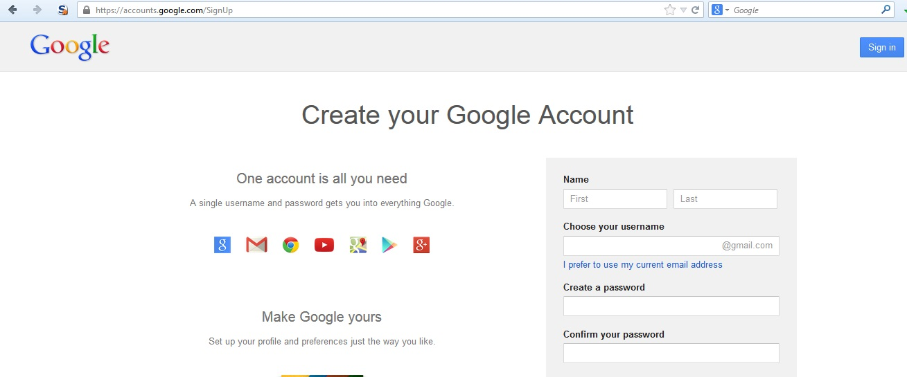

# Процесс регистрации пользователей

| ID |
| --- |
| WSTG-IDNT-02 |

## Резюме

Некоторые веб-сайты предлагают процесс регистрации пользователей, который автоматизирует (или полуавтоматизирует) предоставление доступа к системе (provisioning). Требования к подтверждению личности варьируются от обязательной достоверной идентификации до полного ее отсутствия в зависимости от требований безопасности системы. Многие публичные приложения полностью автоматизируют процессы регистрации и предоставления учетных записей, поскольку масштаб пользовательской базы делает ручное управление невозможным. Однако многие корпоративные приложения инициализируют учетные записи пользователей вручную, поэтому данный тестовый сценарий может быть к ним неприменим.

## Цели тестирования

- Проверить соответствие требований к подтверждению личности при регистрации пользователей бизнес-требованиям и требованиям безопасности.
- Провести валидацию процесса регистрации.

## Методика тестирования

Проверить соответствие требований к подтверждению личности при регистрации пользователей бизнес-требованиям и требованиям безопасности:

1. Может ли любой желающий зарегистрироваться для получения доступа?
2. Проверяются ли заявки на регистрацию человеком перед предоставлением доступа, или доступ предоставляется автоматически при соблюдении критериев?
3. Может ли один и тот же человек или субъект регистрироваться несколько раз?
4. Могут ли пользователи выбирать различные роли или разрешения при регистрации?
5. Какое подтверждение личности требуется для успешного прохождения регистрации?
6. Проверяется ли подлинность зарегистрированных идентификационных данных?

Провести валидацию процесса регистрации:

1. Можно ли легко сфабриковать или подделать идентификационные данные?
2. Можно ли манипулировать процессом обмена идентификационными данными в ходе регистрации?

### Пример

В приведенном ниже примере с WordPress единственным требованием к идентификации является адрес электронной почты, доступ к которому имеет регистрирующийся пользователь.

*Figure 4.3.2-1: WordPress Registration Page*

В отличие от этого, в приведенном ниже примере с Google требования к идентификации включают имя, дату рождения, страну, номер мобильного телефона, адрес электронной почты и ответ на проверку CAPTCHA. Хотя верифицировать можно только два из этих параметров (адрес электронной почты и номер мобильного телефона), требования к идентификации здесь значительно строже, чем в WordPress.

*Figure 4.3.2-2: Google Registration Page*

Некоторые приложения также могут автоматически присваивать привилегированные роли пользователям при регистрации учетной записи с адресом электронной почты из доверенного домена. Если проверка владения адресом электронной почты не выполняется в рамках процесса регистрации, это может позволить злоумышленнику получить доступ к привилегированной учетной записи путем регистрации нового пользователя в этом домене.

Кроме того, если приложение выполняет лишь частичное сопоставление домена, может появиться возможность зарегистрировать привилегированную учетную запись с использованием похожих доменов. Например, если приложение проверяет адреса электронной почты, оканчивающиеся на `example.org`, может сработать домен `notexample.org`; а если оно проверяет лишь наличие подстроки `@example.org` в адресе электронной почты, злоумышленник может использовать адрес `@example.org.attacker.com`.

## Рекомендации по устранению

Внедрите требования к идентификации и верификации, соответствующие требованиям безопасности информации, которую защищают данные учетные данные.

## Инструменты

В качестве эффективного инструмента для тестирования этого механизма контроля может использоваться HTTP-прокси (HTTP proxy).

## Ссылки и материалы

[User Registration Design](https://mashable.com/2011/06/09/user-registration-design/)
