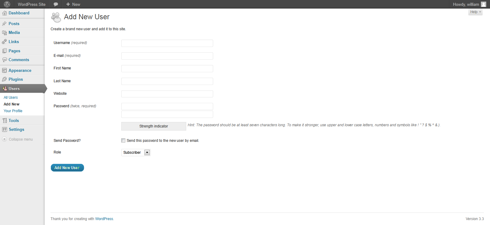
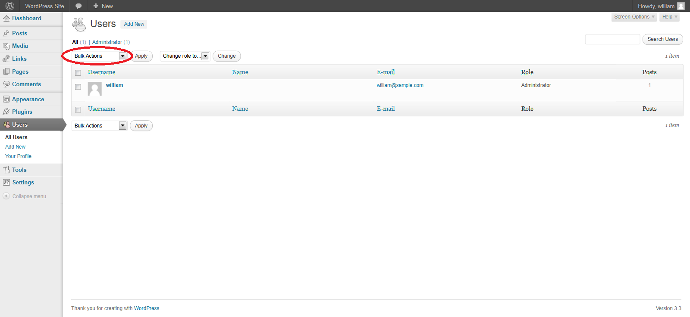

# Процесс выделения учетных записей

| ID |
| --- |
| WSTG-IDNT-03 |

## Резюме

Процесс предоставления учетных записей (Account Provisioning) создает для злоумышленника возможность создать легитимную учетную запись в обход надлежащих процедур идентификации и авторизации.

## Цели тестирования

- Определить, какие учетные записи могут создавать (provision) другие учетные записи и какого типа.

## Методика тестирования

Определите, какие роли обладают правами на создание учетных записей пользователей и какие типы аккаунтов они могут инициализировать.

- Существует ли процедура верификации, проверки и авторизации запросов на создание учетных записей (provisioning)?
- Существует ли процедура верификации, проверки и авторизации запросов на отзыв/удаление учетных записей (de-provisioning)?
- Может ли администратор создавать учетные записи других администраторов или только обычных пользователей?
- Может ли администратор или другой пользователь создавать учетные записи с привилегиями, превышающими их собственные?
- Может ли администратор или пользователь отозвать/удалить собственную учетную запись?
- Как обрабатываются файлы или ресурсы, принадлежащие удаленному пользователю? Удаляются ли они? Передаются ли права доступа другому лицу?

### Пример

В WordPress для создания пользователя требуются только имя пользователя и адрес электронной почты, как показано ниже:

*Figure 4.3.3-1: WordPress User Add*

Для удаления (de-provisioning) пользователей администратору необходимо выбрать целевых пользователей, выбрать пункт Delete («Удалить») в выпадающем меню (обведено) и применить данное действие. Затем администратору отображается диалоговое окно с вопросом о том, как поступить с публикациями пользователя (удалить их или переназначить другому автору).

*Figure 4.3.3-2: WordPress Auth and Users*

## Инструменты

Хотя наиболее тщательным и точным подходом к выполнению данного теста является ручное тестирование, инструменты класса HTTP-прокси (HTTP proxy) также могут быть полезны.
