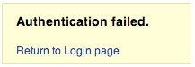
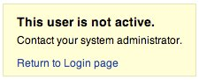

# Перечисление учетных записей и угадываемые имена пользователей

| ID |
| --- |
| WSTG-IDNT-04 |

## Резюме

Цель данного тестирования — проверить возможность сбора списка действительных имен пользователей путем взаимодействия с механизмом аутентификации приложения. Этот тест полезен для подготовки к атакам методом подбора паролей (Brute Force), в ходе которых тестировщик проверяет, возможно ли подобрать пароль к известному валидному имени пользователя.

Зачастую веб-приложения раскрывают факт существования имени пользователя в системе — либо вследствие ошибок конфигурации, либо в силу архитектурных решений. Например, иногда при отправке неверных учетных данных возвращается сообщение о том, что имя пользователя найдено в системе, но введен неверный пароль. Полученная информация может быть использована злоумышленником для формирования списка учетных записей в системе. В дальнейшем эти данные могут применяться для атак на веб-приложение, например путем перебора паролей или использования стандартных учетных записей по умолчанию.

Тестировщик должен проанализировать реакцию механизма аутентификации приложения, чтобы понять, приводят ли специфические запросы к формированию различающихся ответов. Эта проблема возникает в тех случаях, когда информация, возвращаемая веб-приложением или веб-сервером при вводе действительного имени пользователя, отличается от информации, возвращаемой при вводе несуществующего.

В ряде случаев в сообщении об ошибке прямо раскрывается причина сбоя — неверное имя пользователя или неверный пароль. Иногда тестировщики могут перечислить существующих пользователей, отправляя имя пользователя с пустым паролем.

> Примечание: Некоторые приложения не классифицируют имена пользователей как конфиденциальные данные и могут содержать функционал прямого просмотра или вывода списка пользователей. Перед тем как сообщать о наличии уязвимости перечисления учетных записей (Account Enumeration), убедитесь, что вы полностью понимаете требования безопасности конкретного приложения.

## Цели тестирования

- Проанализировать процессы, связанные с идентификацией пользователей (*например*, регистрация, вход в систему и т. д.).
- Произвести перечисление пользователей везде, где это возможно, на основе анализа ответов сервера.

## Методика тестирования

При тестировании методом «черного ящика» (Black-Box Testing) тестировщику изначально неизвестны особенности приложения, имена пользователей, бизнес-логика, формат сообщений об ошибках на странице входа или механизмы восстановления пароля. Если приложение уязвимо, тестировщик получает ответ, прямо или косвенно раскрывающий информацию, полезную для перечисления пользователей.

### Сообщение HTTP-ответа

#### Валидные учетные данные

Зафиксируйте ответ сервера при отправке корректного идентификатора пользователя (User ID) и правильного пароля.

> С помощью веб-прокси зафиксируйте параметры, полученные в результате успешной аутентификации (HTTP-ответ 200, длина ответа).

#### Существующий пользователь с неверным паролем

Теперь тестировщику следует попытаться ввести корректный User ID и заведомо неверный пароль, зафиксировав сообщение об ошибке, сгенерированное приложением.

> Браузер должен отобразить сообщение, подобное следующему:
>
> \
> *Figure 4.3.4-1: Authentication Failed*
>
> В отличие от сообщений, раскрывающих существование пользователя, таких как:
>
> `Login for User foo: invalid password`
>
> Используя веб-прокси, обратите внимание на параметры, полученные при этой неудачной попытке аутентификации (HTTP-ответ 200, длина ответа).

#### Несуществующее имя пользователя

Теперь тестировщику следует попытаться ввести несуществующий User ID и неверный пароль, зафиксировав ответ сервера (тестировщик должен быть уверен, что такое имя пользователя отсутствует в приложении). Зафиксируйте сообщение об ошибке и ответ сервера.

> Если тестировщик вводит несуществующий идентификатор пользователя, он может получить сообщение, подобное:
>
> \
> *Figure 4.3.4-3: This User is Not Active*
>
> или следующее сообщение:
>
> `Login failed for User foo: invalid Account`
>
> Как правило, приложение должно возвращать идентичное сообщение об ошибке и одинаковую длину ответа на различные некорректные запросы. Если ответы различаются, тестировщику необходимо выявить признак, создающий разницу между двумя ответами. Например:
>
> 1. Запрос клиента: Корректный пользователь / неверный пароль
> 2. Ответ сервера: Пароль неверен (The password is not correct)
> 3. Запрос клиента: Несуществующий пользователь / неверный пароль
> 4. Ответ сервера: Пользователь не распознан (User not recognized)
>
> Приведенные выше ответы позволяют клиенту понять, что в первом запросе было указано валидное имя пользователя. Таким образом, отправляя в приложение набор возможных User ID и анализируя ответы, можно собрать список учетных записей.
>
> Анализируя второй ответ сервера, тестировщик точно так же понимает, что такого имени пользователя нет в системе. Это позволяет составить базу валидных идентификаторов пользователей на основе различий в ответах сервера.

### Другие способы перечисления пользователей

Тестировщики могут выполнять перечисление пользователей различными способами, например:

#### Анализ кода ошибки, получаемого на страницах входа

Некоторые веб-приложения возвращают специфические коды или сообщения об ошибках, поддающиеся анализу.

#### Анализ URL и URL-перенаправлений

Например:

- `https://www.foo.com/err.jsp?User=baduser&Error=0`
- `https://www.foo.com/err.jsp?User=gooduser&Error=2`

Как видно выше, при отправке в веб-приложение идентификатора пользователя и пароля в URL появляется индикация возникшей ошибки. В первом случае были переданы несуществующий User ID и неверный пароль. Во втором — существующий User ID и неверный пароль, что позволяет выявить валидный идентификатор.

#### Зондирование URI

Иногда веб-сервер отвечает по-разному в зависимости от того, существует ли запрошенная директория. Например, на некоторых порталах с каждым пользователем сопоставлена отдельная директория. При попытке доступа к существующей директории тестировщик может получить ошибку сервера.

Распространенные ошибки, возвращаемые веб-серверами:

- Код ошибки 403 Forbidden
- Код ошибки 404 Not Found

Пример:

- `https://www.foo.com/account1` — ответ веб-сервера: 403 Forbidden
- `https://www.foo.com/account2` — ответ веб-сервера: 404 File Not Found

В первом случае пользователь существует, но у тестировщика нет прав на просмотр страницы; во втором же случае пользователя «account2» не существует. На основе этих признаков тестировщики могут перечислить пользователей.

#### Анализ заголовков веб-страниц

Полезную информацию можно извлечь из заголовка веб-страницы (`<title>`), где могут выводиться специфические коды или сообщения об ошибках, указывающие на проблему именно с именем пользователя либо с паролем.

Например, если пользователь не может аутентифицироваться в приложении и получает страницу с заголовком:

- `Invalid user`
- `Invalid authentication`

#### Анализ сообщения, полученного от службы восстановления

При использовании механизмов восстановления (например, функции сброса забытого пароля) уязвимое приложение может возвращать сообщение, раскрывающее факт существования имени пользователя.

Например, сообщения следующего вида:

- `Invalid username: email address is not valid or the specified user was not found.`
- `Valid username: Your password has been successfully sent to the email address you registered with.`

#### Дружественное сообщение об ошибке 404

При запросе каталога несуществующего пользователя сервер не всегда возвращает код 404. Вместо этого он может вернуть статус «200 OK» с изображением-заглушкой. В таком случае можно сделать вывод, что получение данного конкретного изображения свидетельствует об отсутствии пользователя. Эту логику можно распространить и на другие ответы веб-сервера; ключевым моментом является детальный анализ сообщений веб-сервера и веб-приложения.

#### Анализ времени отклика

Наряду с анализом содержимого ответов следует учитывать время формирования ответа сервера (тайминг-атаки). Особенно в ситуациях, когда запрос инициирует взаимодействие с внешним сервисом (например, отправку письма для сброса пароля), это может добавить несколько сотен миллисекунд к общему времени ответа, что позволяет определить валидность запрошенного пользователя.

### Подбор имен пользователей

#### Предсказуемая структура имен пользователей

Во многих организациях имена пользователей формируются по единым шаблонам (например, первая буква имени + фамилия: `jbloggs`, либо структурированные идентификаторы вида `CN000100`). Если соглашение об именовании определено, валидные имена пользователей зачастую можно вывести систематически.

Тестировщикам следует:

- Определить, соответствуют ли имена пользователей предсказуемой структуре.
- Попытаться сгенерировать дополнительные имена пользователей на основе выявленных шаблонов.
- Использовать словари имен пользователей, составленные на основе данных организации (например, списки сотрудников, корпоративные форматы email).
- Анализировать ответы приложения, чтобы определить, являются ли сгенерированные имена пользователей валидными.

Предсказуемые структуры имен пользователей значительно снижают трудозатраты на перечисление существующих учетных записей и могут способствовать проведению дальнейших атак, таких как подбор паролей (brute force).

В некоторых случаях идентификаторы пользователей создаются в соответствии со строгими корпоративными политиками администраторов. Например, User ID могут генерироваться в последовательном порядке:

```text
CN000100
CN000101
...
```

Иногда имена пользователей формируются из псевдонима области аутентификации (REALM) и порядкового номера:

- R1001 — пользователь 001 для REALM1
- R2001 — пользователь 001 для REALM2

В приведенном примере можно создать простые скрипты командной оболочки, генерирующие идентификаторы пользователей и отправляющие запросы с помощью утилит вроде `wget` для автоматизации запросов и выявления действительных учетных записей. Для написания скриптов также можно использовать Perl и `curl`.

Другие варианты: идентификаторы пользователей, связанные с номерами банковских карт или числовыми последовательностями, построенными по определенным шаблонам; идентификаторы пользователей, образованные от реальных имен (например, если у Фредди Меркьюри логин `fmercury`, логично предположить, что у Роджера Тейлора логин будет `rtaylor`).

Кроме того, имена пользователей можно извлечь из результатов LDAP-запросов или с помощью сбора информации в Google (Google Dorking) по конкретному домену компании. Поисковые запросы в Google помогают находить доменных пользователей напрямую либо с помощью специализированных утилит и bash-скриптов.

> При перечислении учетных записей существует риск блокировки аккаунтов после достижения заданного политиками приложения лимита неудачных попыток. Кроме того, ваш IP-адрес может быть заблокирован динамическими правилами межсетевого экрана (WAF) или системы предотвращения вторжений (Intrusion Prevention System, IPS).

### Имперсонация сотрудников

Убедитесь, что незарегистрированные пользователи не могут выбирать зарезервированные имена пользователей (например, `admin`, `administrator`, `moderator`) в процессе регистрации. Кроме того, проверьте, что пользователи не могут сменить свое текущее имя пользователя на зарезервированное на странице редактирования профиля.

Если веб-приложение содержит функции регистрации и редактирования профиля, необходимо протестировать следующие сценарии взаимодействия:

- Процесс регистрации:
    - Откройте страницу регистрации в качестве незарегистрированного пользователя, заполните форму регистрации, указав одно из зарезервированных имен (например, `admin`, `administrator`, `moderator`), отправьте форму и проанализируйте ответ.
    - Процесс регистрации должен отклонить отправку формы и отобразить сообщение об ошибке, указывающее, что выбранное имя пользователя недоступно для регистрации.
- Страница редактирования профиля:
    - Авторизуйтесь в веб-приложении с валидными учетными данными и перейдите на страницу редактирования профиля. Попробуйте изменить текущее имя пользователя на одно из зарезервированных (например, `admin`, `administrator`, `moderator`) и сохраните изменения для проверки реакции приложения.
    - Процедура редактирования профиля должна отклонить запрос на смену имени пользователя и вывести сообщение о том, что выбранное имя недоступно.
- Проверка вариаций и схожих написаний:
    - Повторите указанные шаги для различных вариантов написания зарезервированных имен (например, `Admin`, `ADMIN`, `Administrator`), а также проведите тесты с различными комбинациями строчных и прописных букв, чтобы убедиться в корректной регистронезависимой обработке.
    - Веб-приложение должно расценивать эти варианты как эквивалентные зарезервированным именам пользователей, блокируя их выбор или изменение.

### Тестирование методом «серого ящика»

#### Сообщения об ошибках аутентификации

Убедитесь, что приложение отвечает единообразно на любые запросы клиентов, приводящие к ошибке аутентификации. Для решения этой задачи концепция тестирования методом «черного ящика» совпадает с тестированием методом «серого ящика» (Gray-Box Testing) и базируется на анализе сообщений и кодов ошибок, возвращаемых веб-приложением.

> Приложение должно отвечать одинаково на любую неудачную попытку аутентификации.
>
> Например: *Credentials submitted are not valid* (Введенные учетные данные недействительны)

## Рекомендации по устранению

Обеспечьте, чтобы приложение возвращало стандартные унифицированные сообщения об ошибках в ответ на ввод неверного имени пользователя, пароля или других учетных данных в процессе входа в систему.

Убедитесь, что стандартные системные и тестовые учетные записи удалены до развертывания системы в продуктивной среде (или перед предоставлением доступа к ней из недоверенной сети).

## Инструменты

- [Zed Attack Proxy (ZAP)](https://www.zaproxy.org)
- [curl](https://curl.se/)
- [PERL](https://www.perl.org)

## Ссылки и материалы

- [Username Enumeration Vulnerabilities](https://www.gnucitizen.org/blog/username-enumeration-vulnerabilities/)
- [Prevent WordPress Username Enumeration](https://www.jinsonvarghese.com/prevent-wordpress-username-enumeration/)
- [Marco Mella, Sun Java Access & Identity Manager Users enumeration](https://www.exploit-db.com/exploits/32762)
