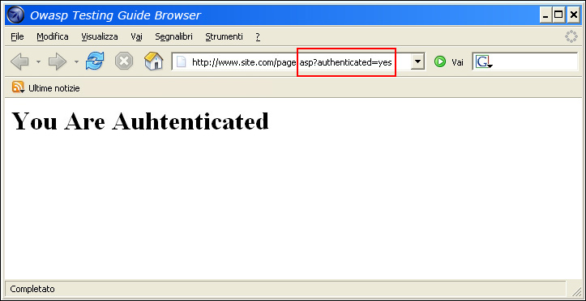
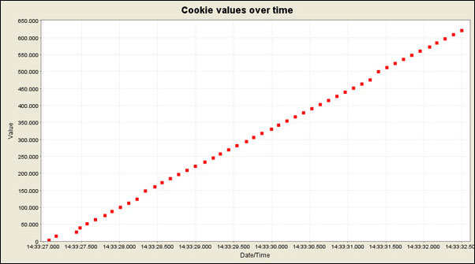
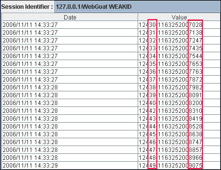
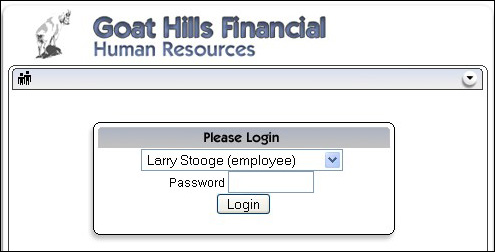
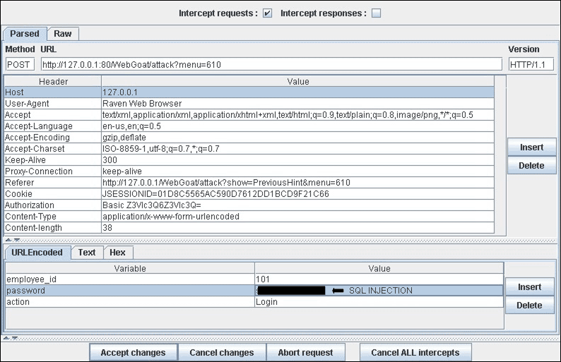

# Обход схемы аутентификации

| ID |
| --- |
| WSTG-ATHN-04 |

## Резюме

В информационной безопасности аутентификация представляет собой процесс проверки цифровой подлинности (digital identity) отправителя сообщения или запроса. Классическим примером такого процесса является процедура входа в систему. Тестирование схемы аутентификации заключается в понимании механизмов работы процесса аутентификации и использовании этой информации для обхода механизма проверки подлинности.

Хотя большинство приложений требуют прохождения аутентификации для получения доступа к конфиденциальным данным или для выполнения операций, далеко не каждый метод аутентификации обеспечивает адекватный уровень безопасности. Невнимательность, недостаток знаний или недооценка угроз безопасности часто приводят к появлению схем аутентификации, которые можно обойти, просто пропустив страницу авторизации и напрямую обратившись к внутренней странице, доступ к которой должен предоставляться исключительно после успешного входа.

Кроме того, зачастую механизмы аутентификации удается обойти путем модификации запросов (tampering) и введения приложения в заблуждение относительно того, что пользователь уже аутентифицирован. Этого можно достичь изменением параметров в URL, манипуляцией с полями веб-формы или подделкой сессий.

Проблемы, связанные со схемой аутентификации, могут возникать на различных этапах жизненного цикла разработки программного обеспечения (Software Development Life Cycle, SDLC), включая проектирование, разработку и развертывание:

- На этапе проектирования (design) ошибки могут включать некорректное определение защищаемых разделов приложения, отказ от применения стойких криптографических протоколов для защиты передачи учетных данных и многое другое.
- На этапе разработки (development) ошибки могут заключаться в некорректной реализации валидации входных данных или несоблюдении рекомендаций по безопасной разработке для конкретного языка программирования.
- На этапе развертывания приложения (deployment) проблемы могут возникать в процессе установки и настройки из-за недостатка необходимой технической квалификации персонала или отсутствия качественной документации.

## Цели тестирования

- Убедиться, что аутентификация применяется ко всем сервисам, которые в ней нуждаются.

## Методика тестирования

Существует несколько методов обхода схемы аутентификации, используемой веб-приложением:

- Модификация параметров (Parameter modification)
- Предсказание идентификатора сессии (Session ID prediction)
- Внедрение SQL-кода (SQL injection)

### Модификация параметров

Еще одна проблема, связанная с проектированием аутентификации, возникает, когда приложение проверяет факт успешного входа на основе параметров с фиксированными значениями. Пользователь может изменить эти параметры, чтобы получить доступ к защищенным областям без ввода валидных учетных данных. В приведенном ниже примере параметр `authenticated` изменяется на значение `yes`, что позволяет пользователю получить доступ. В этом примере параметр передается в URL, однако для его изменения можно также использовать прокси-сервер, особенно когда параметры передаются как элементы формы в теле POST-запроса или сохраняются в cookie.

```html
https://www.site.com/page.asp?authenticated=no

raven@blackbox /home $nc www.site.com 80
GET /page.asp?authenticated=yes HTTP/1.0

HTTP/1.1 200 OK
Date: Sat, 11 Nov 2006 10:22:44 GMT
Server: Apache
Connection: close
Content-Type: text/html; charset=iso-8859-1

<!DOCTYPE HTML PUBLIC "-//IETF//DTD HTML 2.0//EN">
<HTML><HEAD>
</HEAD><BODY>
<H1>You Are Authenticated</H1>
</BODY></HTML>
```


*Рисунок 4.4.4-1: Запрос с модифицированным параметром*

### Предсказание идентификатора сессии

Многие веб-приложения управляют аутентификацией с помощью идентификаторов сессий (session IDs). Следовательно, если генерация идентификаторов сессий предсказуема, злоумышленник может подобрать валидный идентификатор сессии и получить несанкционированный доступ к приложению, выдав себя за ранее аутентифицированного пользователя.

На следующем рисунке значения в cookie линейно возрастают со временем, поэтому злоумышленнику не составит труда угадать валидный Session ID.


*Рисунок 4.4.4-2: Изменение значений cookie со временем*

На следующем рисунке значения внутри cookie изменяются лишь частично, что позволяет сузить диапазон атаки методом перебора до конкретных полей, показанных ниже.


*Рисунок 4.4.4-3: Частично изменяющиеся значения cookie*

### SQL-инъекция (аутентификация через HTML-форму)

Внедрение SQL-кода (SQL Injection) — широко известная техника атаки. В данном подразделе эта техника подробно рассматриваться не будет, так как в руководстве есть несколько других разделов, посвященных техникам инъекций, выходящим за рамки этой темы.


*Рисунок 4.4.4-4: Внедрение SQL-кода*

Следующий рисунок демонстрирует, как с помощью простой SQL-инъекции иногда удается обойти форму аутентификации.


*Рисунок 4.4.4-5: Простая атака внедрения SQL-кода*

### Нестрогое сравнение в PHP

Если злоумышленник смог получить исходный код приложения путем эксплуатации ранее обнаруженной уязвимости (например, обхода каталогов — directory traversal) или из публичного репозитория (в случае приложений с открытым исходным кодом — Open Source Applications), появляется возможность проведения точечных атак на реализацию процесса аутентификации.

В приведенном ниже примере (уязвимость обхода аутентификации в PHPBB 2.0.12) во 2-й строке функция `unserialize()` парсит переданный пользователем cookie и помещает значения в массив `$sessiondata`. В строке 7 MD5-хеш пароля пользователя, хранящийся в базе данных (`$auto_login_key`), сравнивается с хешем, предоставленным пользователем (`$sessiondata['autologinid']`).

```php
1. if (isset($HTTP_COOKIE_VARS[$cookiename . '_sid'])) {
2.     $sessiondata = isset($HTTP_COOKIE_VARS[$cookiename . '_data']) ? unserialize(stripslashes($HTTP_COOKIE_VARS[$cookiename . '_data'])) : array();
3.     $sessionmethod = SESSION_METHOD_COOKIE;
4. }
5. $auto_login_key = $userdata['user_password'];
6. // We have to login automagically
7. if( $sessiondata['autologinid'] == $auto_login_key )
8. {
9.     // autologinid matches password
10.     $login = 1;
11.     $enable_autologin = 1;
12. }

```

В PHP нестрогое сравнение строки с логическим значением `true` всегда возвращает `true` (поскольку непустая строка преобразуется в истину). Таким образом, передав следующую строку в функцию `unserialize()`, можно обойти проверку подлинности и войти в систему под учетной записью администратора с `userid`, равным 2:

```php
a:2:{s:11:"autologinid";b:1;s:6:"userid";s:1:"2";}  // original value: a:2:{s:11:"autologinid";s:32:"8b8e9715d12e4ca12c4c3eb4865aaf6a";s:6:"userid";s:4:"1337";}
```

Разберем, что именно было сделано в этой сериализованной строке:

1. Полю `autologinid` теперь присвоено логическое значение `true`: это видно по замене MD5-хеша пароля (`s:32:"8b8e9715d12e4ca12c4c3eb4865aaf6a"`) на `b:1`.
2. Полю `userid` теперь присвоен идентификатор администратора: это видно в последней части строки, где наш исходный ID обычного пользователя (`s:4:"1337"`) заменен на `s:1:"2"`.

### Магические хеши в PHP

Аналогичная проблема может возникать в PHP, когда хеши сравниваются нестрого (`==`) и в итоге интерпретируются как числа.

PHP поддерживает использование [экспоненциальной записи (научной нотации, scientific notation)](https://en.wikipedia.org/wiki/Scientific_notation) для чисел, поэтому строка `2e4` обрабатывается как «2 умножить на 10 в четвертой степени», что равно 20 000. Аналогично, значение вида `0e4` интерпретируется как «ноль, умноженный на 10 в четвертой степени», то есть ноль. Поскольку ноль, умноженный на любое число, равен нулю, сравнение вида `0e2 == 0e3` вернет true, так как обе стороны равны нулю.

Это может эксплуатироваться в случаях, когда сравниваются два хеша паролей, и оба они начинаются с нуля, за которым следует буква `e`, а затем строка цифр. Рассмотрим следующий код:

```php
<?php
{
    if (md5('240610708') == md5('QLTHNDT')) {
        print("Passwords match");
    } else {
        print("Passwords are different");
    }                                                                           
}
```

Очевидно, что эти два пароля различны, однако поскольку MD5-хеши обоих представляют собой строки, эквивалентные нулю в экспоненциальной записи ("0e462097431906509019562988736854" и "0e405967825401955372549139051580" соответственно), оператор сравнения вернет true, и пользователь будет успешно авторизован.

Чтобы проверить наличие этой уязвимости, сначала необходимо определить алгоритм хеширования, используемый приложением. Затем можно задать учетной записи пользователя пароль, который дает подобный хеш («magic hash»), после чего попытаться войти с другим паролем, формирующим иной хеш, также оценивающийся как ноль. Наборы строк для различных алгоритмов хеширования доступны в GitHub-репозитории [spaze/hashes](https://github.com/spaze/hashes).

Успешная эксплуатация свидетельствует не только о том, что приложение небезопасно сравнивает хеши паролей, но и о том, что к паролям не применяется соль (salt), и, вероятнее всего, используется устаревший алгоритм хеширования.

### Срабатывание паролей одинаковой длины

Иногда в приложениях встречается ситуация, когда пользователям разрешается войти в систему путем ввода любого пароля, длина которого совпадает с длиной настоящего пароля. Это достаточно редкая проблема, которая свидетельствует о грубых дефектах в механизмах хранения и обработки паролей.

Одной из возможных причин может быть несоответствие кодировок символов между различными компонентами приложения, когда неизвестные или недопустимые символы заменяются знаком `?`, который в ряде языков и СУБД (например, в SQL) трактуется как подстановочный знак (wildcard) для одного символа. Таким образом, сравнение строки `password` и `????????` может вернуть true, если подстановочные знаки интерпретируются, например, в SQL-операторе `LIKE`.

> Примечание: Это также означает, что пароли хранятся либо в открытом виде (plain text), либо с использованием обратимого шифрования.

Тестирование предельно просто: попытайтесь войти в учетную запись с заведомо неверным паролем, длина которого в точности совпадает с длиной валидного пароля.

## Инструменты

- [WebGoat](https://owasp.org/www-project-webgoat/)
- [Zed Attack Proxy (ZAP)](https://www.zaproxy.org)

## Ссылки и материалы

- [Niels Teusink: phpBB 2.0.12 authentication bypass](http://blog.teusink.net/2008/12/classic-bug-phpbb-2012-authentication.html)
- [David Endler: "Session ID Brute Force Exploitation and Prediction"](https://web.archive.org/web/20250711045439/https://www.cgisecurity.com/lib/SessionIDs.pdf)
