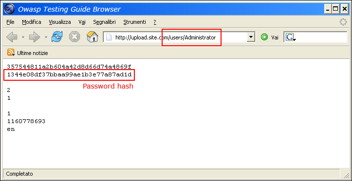

# Обход схемы авторизации

| ID |
| --- |
| WSTG-ATHZ-02 |

## Резюме

Данный тестовый сценарий направлен на выявление недостатков авторизации, при которых аутентифицированный пользователь получает возможность обращаться к ресурсам или выполнять действия, выходящие за рамки назначенных ему прав, включая горизонтальное и вертикальное повышение привилегий (Horizontal and Vertical Privilege Escalation).

Хотя некоторые проверки могут включать такие сценарии, как прямой доступ к защищенным ресурсам без активной сессии или после выхода из системы (logout), основная цель этого теста — подтвердить, что механизмы контроля авторизации строго соблюдаются для аутентифицированных пользователей и ролей.

Подробные сценарии неаутентифицированного доступа и проверок после аутентификации рассмотрены в разделе How to Test.

## Цели тестирования

- Оценить возможность неаутентифицированного, горизонтального или вертикального доступа.

## Методика тестирования

- Доступ к ресурсам и выполнение операций без авторизации. — Прямой запрос страниц ([принудительный просмотр, forced browsing](https://owasp.org/www-community/attacks/Forced_browsing))
- Горизонтальный доступ к ресурсам и операциям.
- Вертикальный доступ к ресурсам и операциям.

### Базовый неаутентифицированный доступ

#### Ручное тестирование с помощью браузера

Если веб-приложение не обеспечивает надлежащего применения механизмов контроля доступа, конфиденциальные ресурсы оказываются открытыми, позволяя неаутентифицированным пользователям просматривать их. Например, если пользователь запрашивает защищенную страницу напрямую с помощью принудительного просмотра (forced browsing), эта страница может не проверить авторизацию анонимного пользователя перед предоставлением доступа. Попробуйте обратиться к защищенной странице напрямую через адресную строку браузера для проверки этим методом.


*Figure 4.5.2-1: Direct Request to Protected Page*

#### Использование автоматизации

Данный процесс можно автоматизировать при наличии списка всех эндпоинтов с помощью таких инструментов, как ffuf, gobuster, OWASP ZAP и Burp Suite Intruder.

В OWASP ZAP использование аддона [Access Control Testing](https://www.zaproxy.org/docs/desktop/addons/access-control-testing/) позволяет тестировщикам определять, какие части приложения доступны анонимным пользователям, и выявлять потенциальные проблемы контроля доступа.

В Burp Suite встроенные инструменты (такие как Intruder) и набор плагинов, включая Autorize, помогают тестировщику автоматизировать тестирование авторизации.

### Горизонтальный обход

Для каждой функции, конкретной роли или запроса, выполняемого приложением, необходимо проверить:

- Возможно ли получить доступ к ресурсам, которые должны быть доступны пользователю с другой идентичностью, обладающему той же ролью или уровнем привилегий?
- Возможно ли выполнять операции над ресурсами, которые должны быть доступны пользователю с другой идентичностью?

Для каждой роли:

1. Зарегистрируйте или создайте двух пользователей с идентичными привилегиями.
2. Установите и поддерживайте две активные сессии (по одной для каждого пользователя).
3. Для каждого запроса замените релевантные параметры и идентификатор сессии (токен первого пользователя на токен второго пользователя) и проанализируйте ответы для каждого токена.
4. Приложение считается уязвимым, если ответы совпадают, содержат одинаковые приватные данные либо указывают на успешное выполнение операции над ресурсами или данными другого пользователя.

Например, предположим, что функция `viewSettings` входит в меню учетной записи приложения для одной и той же роли, и доступ к ней осуществляется по URL-адресу: `https://www.example.com/account/viewSettings`. При вызове функции `viewSettings` генерируется следующий HTTP-запрос:

```http
POST /account/viewSettings HTTP/1.1
Host: www.example.com
[other HTTP headers]
Cookie: SessionID=USER_SESSION

username=example_user
```

Легитимный и корректный ответ:

```http
HTTP1.1 200 OK
[other HTTP headers]

{
  "username": "example_user",
  "email": "example@email.com",
  "address": "Example Address"
}
```

Злоумышленник может попытаться выполнить этот запрос со своим сессионным идентификатором, изменив параметр `username` на другого пользователя:

```http
POST /account/viewSettings HTTP/1.1
Host: www.example.com
[other HTTP headers]
Cookie: SessionID=ATTACKER_SESSION

username=victim_user
```

Если ответ злоумышленнику содержит данные `victim_user`, значит приложение уязвимо к атакам горизонтального перемещения (lateral movement), при которых один пользователь может читать или изменять данные другого пользователя.

Шаги 3 и 4 можно автоматизировать. Вкладка Authorize в инструменте Gori повторяет перехваченный запрос под несколькими учетными записями и сравнивает каждый ответ с эталонным (baseline). Идентичность (identity) представляет собой именованный набор изменений заголовков: сохранение перехваченной сессии жертвы, подстановка токена второго пользователя или удаление сессионных заголовков для проверки от имени анонимного клиента.

Команда `gori run authorize` выполняет аналогичное воспроизведение для автоматизации в скриптах, считывая идентичности из файла:

```json
[
  { "name": "victim (baseline)", "baseline": true },
  { "name": "other-user", "set": [{ "name": "Authorization", "value": "Bearer <other-user-jwt>" }] },
  { "name": "anonymous", "remove": ["Authorization"] }
]
```

Запуск проверки для запроса корзины покупок одного из пользователей в OWASP Juice Shop:

```bash
$ gori run authorize --query "path:/rest/basket/6" --identities identities.json
authorizing 1 request × 3 identities (victim (baseline), other-user, anonymous) = 3 requests
[!&#93; BYPASS    #1     GET    http://localhost:3000/rest/basket/6  · 1 of 2 identities matched the baseline
      victim (baseline)   baseline  200  154B     -
      other-user          same      200  154B     Δ status 200 · size same · time -11 ms
      anonymous           different 401  984B     Δ status 200 → 401 · size +830 B · time -22 ms
done · 1 request replayed · 3 sends · 1 possible bypass
```

Идентичность `other-user` получает точно такой же ответ `200`, как и жертва, то есть эндпоинт не проверяет, принадлежит ли корзина вызывающему пользователю. При этом идентичность `anonymous` корректно отклоняется с кодом `401`.

### Доступ к административным функциям

Например, предположим, что функция `addUser` является частью административного меню приложения и доступ к ней возможен по адресу: `https://www.example.com/admin/addUser`.

В таком случае при вызове функции `addUser` формируется следующий HTTP-запрос:

```http
POST /admin/addUser HTTP/1.1
Host: www.example.com
[...]

userID=fakeuser&role=3&group=grp001
```

Дальнейший анализ и вопросы строятся в следующем направлении:

- Что произойдет, если непривилегированный пользователь попытается выполнить этот запрос?
- Будет ли создан пользователь?
- Если да, сможет ли новый пользователь применить полученные привилегии?

### Доступ к ресурсам, назначенным другой роли

Многие приложения разграничивают доступ к ресурсам на основе ролей пользователей. Рассмотрим пример с резюме (CV), загружаемыми через форму вакансий в S3-бакет.

Попробуйте получить доступ к расположению этих файлов под учетной записью обычного пользователя. Если вам удается прочитать, изменить или удалить их, значит, приложение уязвимо.

### Обработка специальных заголовков запросов

Некоторые приложения поддерживают нестандартные заголовки, такие как `X-Original-URL` или `X-Rewrite-URL`, позволяющие перезаписать целевой URL запроса значением, указанным в заголовке.

Эту особенность можно поэксплуатировать в ситуациях, когда приложение расположено за промежуточным компонентом (reverse proxy, WAF), применяющим ограничения контроля доступа на основе URL запроса.

Типичным ограничением контроля доступа на основе URL может быть, например, блокировка доступа из сети Интернет к административной консоли, доступной по путям `/console` или `/admin`.

Для проверки поддержки заголовков `X-Original-URL` или `X-Rewrite-URL` выполняются следующие шаги.

#### 1. Отправка обычного запроса без заголовков X-Original-Url и X-Rewrite-Url

```http
GET / HTTP/1.1
Host: www.example.com
[...]
```

#### 2. Отправка запроса с заголовком X-Original-Url, указывающим на несуществующий ресурс

```http
GET / HTTP/1.1
Host: www.example.com
X-Original-URL: /donotexist1
[...]
```

#### 3. Отправка запроса с заголовком X-Rewrite-Url, указывающим на несуществующий ресурс

```http
GET / HTTP/1.1
Host: www.example.com
X-Rewrite-URL: /donotexist2
[...]
```

Если ответ на любой из этих запросов содержит признаки того, что ресурс не найден, это указывает на то, что приложение обрабатывает специальные заголовки запросов. Такими признаками могут быть HTTP-статус 404 или сообщение «resource not found» в теле ответа.

После подтверждения поддержки заголовков `X-Original-URL` или `X-Rewrite-URL` попытку обхода ограничений контроля доступа можно реализовать следующим образом: отправить требуемый запрос в приложение, указав «разрешенный» фронтенд-компонентом URL в качестве основного пути запроса, а реальный целевой URL передать в заголовке `X-Original-URL` или `X-Rewrite-URL` (в зависимости от того, какой из них поддерживается). Если поддерживаются оба, протестируйте их поочередно, чтобы выяснить, для какого из заголовков обход оказывается эффективным.

#### 4. Другие заголовки, на которые следует обратить внимание

Зачастую панели администратора или административный функционал доступны только клиентам из локальных сетей, поэтому злоумышленник может использовать различные HTTP-заголовки проксирования и перенаправления для получения доступа. Заголовки и значения для тестирования включают:

- Заголовки:
    - `X-Forwarded-For`
    - `X-Forward-For`
    - `X-Remote-IP`
    - `X-Originating-IP`
    - `X-Remote-Addr`
    - `X-Client-IP`
- Значения:
    - `127.0.0.1` (или любой адрес из подсети `127.0.0.0/8`)
    - `::1` (единственный официальный loopback-адрес в IPv6)
    - `localhost`
    - Любые адреса согласно [RFC1918](https://tools.ietf.org/html/rfc1918):
        - `10.0.0.0/8`
        - `172.16.0.0/12`
        - `192.168.0.0/16`
    - Link-local адреса: `169.254.0.0/16`
    - IPv4-сопоставленные IPv6-адреса (`::ffff:0:0/96`) в точечно-десятичном или шестнадцатеричном формате, например `::ffff:127.0.0.1` или `::ffff:7f00:1` (оба эквивалентны `127.0.0.1`)
    - Реже — префикс NAT64 `64:ff9b::/96`, например `64:ff9b::7f00:1` (`127.0.0.1`), если приложение извлекает встроенный IPv4-адрес

> Примечание: Указание порта вместе с адресом или именем хоста также может помочь обойти пограничные средства защиты, такие как межсетевые экраны веб-приложений (WAF) и т. д.
> Например: `127.0.0.4:80`, `127.0.0.4:443`, `127.0.0.4:43982`

## Рекомендации по устранению

Применяйте принцип наименьших привилегий (Principle of Least Privilege) к пользователям, ролям и ресурсам, чтобы исключить возможность несанкционированного доступа.

## Инструменты

- [Zed Attack Proxy (ZAP)](https://www.zaproxy.org/)
    - [Аддон ZAP: Access Control Testing](https://www.zaproxy.org/docs/desktop/addons/access-control-testing/)
- [PortSwigger Burp Suite](https://portswigger.net/burp)
    - [Расширение Burp: AuthMatrix](https://github.com/SecurityInnovation/AuthMatrix/)
    - [Расширение Burp: Autorize](https://github.com/Quitten/Autorize)
- [Gori](https://github.com/hahwul/gori)
    - Вкладка Authorize воспроизводит запрос под различными идентичностями для обнаружения обхода контроля доступа; поддерживает запуск через CLI: `gori run authorize`.

## Ссылки и материалы

[OWASP Application Security Verification Standard 4.0.1](https://github.com/OWASP/ASVS/tree/master/4.0), v4.0.1-1, v4.0.1-4, v4.0.1-9, v4.0.1-16
