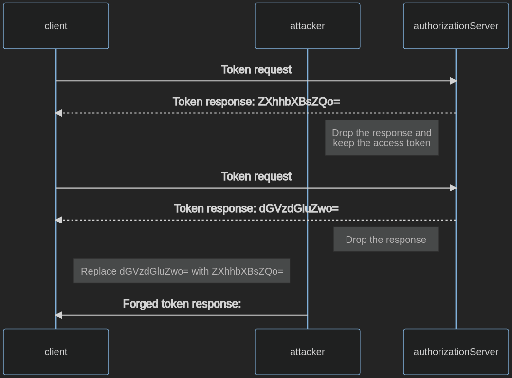

# Уязвимости клиента OAuth

## Резюме

OAuth делегирует права доступа к ресурсам клиентам. Это позволяет им действовать от лица владельца ресурса (resource owner). Клиент получает код авторизации и токен обновления в процессе обмена токенами и сохраняет их.

Неспособность защитить процесс обмена токенами и учетные данные может привести к несанкционированному доступу к ресурсам и повышению привилегий.

## Цели тестирования

- Выявить недостатки и уязвимости в клиенте OAuth.

## Методика тестирования

При тестировании клиента на наличие уязвимостей преследуются следующие цели:

1. Извлечь учетные данные, используемые для авторизации.
2. Предоставить себе доступ к произвольным ресурсам с помощью принудительного перехода (forced browsing).
3. Обойти механизмы авторизации.

### Раскрытый секрет клиента (Client Secret)

Секрет клиента (`client_secret`) используется для аутентификации клиента на сервере авторизации (Authorization Server, AS), подтверждая, что клиент исходит из доверенного источника.

Публичные клиенты (Public clients), как правило, не способны хранить клиентский секрет в тайне.

Для обнаружения клиентского секрета в коде клиентской части выполните анализ клиентского исходного кода:

1. Откройте приложение в браузере.
2. Откройте инструменты разработчика браузера (Developer Tools).
3. Перейдите на вкладку «Отладчик» (Debugger).
4. Нажмите Ctrl+Shift+F для открытия глобального поиска по коду.
5. Выполните поиск по ключевым словам, похожим на `client-secret`, и проверьте результаты.

Если поиск не принес результатов, можно также:

1. Выполнить процесс авторизации по шагам через перехватывающий HTTP-прокси, например ZAP.
2. Извлечь клиентский секрет из URI в параметре `client-secret`.
3. Заменить поисковый запрос в вышеописанном поиске на найденное значение клиентского секрета и проверить, не раскрывается ли оно в открытом виде.

### Небезопасное хранение токенов

Клиент получает токены доступа и должен сохранять их в месте, защищенном от доступа злоумышленников.

Конфиденциальные клиенты должны хранить токены в оперативной памяти (volatile memory), чтобы исключить доступ к ним через другие векторы атак, такие как внедрение локальных файлов (Local File Inclusion, LFI), прямой доступ к окружению или атаки внедрения SQL-кода (SQL Injection).

Публичные клиенты, такие как одностраничные приложения (SPA), не имеют возможности абсолютно безопасного хранения токенов. Например, атака межсайтового скриптинга (Cross-Site Scripting, XSS) позволяет злоумышленникам похищать любые учетные данные, хранящиеся в браузере.

Публичные клиенты могут сохранять токены в `sessionStorage` браузера или в файлах cookie, но не в `localStorage`. Чтобы определить, хранятся ли токены ненадлежащим образом:

1. Откройте приложение в браузере.
2. Получите токен доступа.
3. Откройте инструменты разработчика браузера.
4. Перейдите на вкладку «Приложение» (Application / Storage).
5. Откройте раздел Local Storage и просмотрите сохраненные данные.
6. Откройте раздел Session Storage и просмотрите сохраненные данные.
7. Откройте раздел Cookies и просмотрите сохраненные данные.

### Инъекция токена доступа

Данная атака возможна только в том случае, когда клиент использует тип ответа, при котором токен доступа выдается клиенту напрямую. Это происходит в потоках Implicit Flow, Resource Owner Password Credentials и в сценариях machine-to-machine. См. подробное описание в разделе [OAuth Weaknesses](05.%20OAuth%20Weaknesses.md).

Внедрение токена доступа (Access token injection) считается успешным, когда перехваченный злоумышленником токен доступа используется для аутентификации в легитимном клиенте.

Для проверки уязвимости к внедрению токена доступа выполните следующие действия. В данном примере предполагается, что токен авторизации (`ZXhhbXBsZQo=`) был скомпрометирован:

1. Перехватите трафик между клиентом и сервером авторизации.
2. Запустите поток OAuth с клиентом, использующим тип предоставления Implicit Flow.
3. Внедрите украденный токен доступа:
    - Отправьте клиенту поддельный ответ авторизации с украденным токеном доступа (`ZXhhbXBsZQo=`).
    - Перехватите валидный ответ авторизации и замените легитимный токен доступа (`dGVzdGluZwo=`) на скомпрометированный (`ZXhhbXBsZQo=`).

*Figure 4.5.5.2-: Access Token Injection Flow*

## Связанные тест-кейсы

- [Cross Site Request Forgery](../06.%20Session%20Management%20Testing/05.%20Cross%20Site%20Request%20Forgery.md)
- [Client-side URL Redirect](../11.%20Client-side%20Testing/04.%20Client-side%20URL%20Redirect.md)
- [JSON Web Tokens](../06.%20Session%20Management%20Testing/10.%20JSON%20Web%20Tokens.md)
- [Clickjacking](../11.%20Client-side%20Testing/09.%20Clickjacking.md)
- [Cross Origin Resource Sharing](../11.%20Client-side%20Testing/07.%20Cross%20Origin%20Resource%20Sharing.md)

## Рекомендации по устранению

- Используйте секрет клиента (`client_secret`) только в том случае, если клиент способен обеспечить его безопасное хранение.
- Следуйте лучшим практикам безопасного хранения токенов. Применяйте к ним те же требования безопасности, что и к другим конфиденциальным учетным данным.
- Избегайте использования устаревших типов предоставления OAuth. Подробное описание см. в разделе [OAuth Weaknesses](05.%20OAuth%20Weaknesses.md).

## Инструменты

- [BurpSuite](https://portswigger.net/burp/releases)
- [EsPReSSO](https://github.com/portswigger/espresso)
- [ZAP](https://www.zaproxy.org/)

## Ссылки и материалы

- [User Authentication with OAuth 2.0](https://oauth.net/articles/authentication/)
- [The OAuth 2.0 Authorization Framework](https://datatracker.ietf.org/doc/html/rfc6749)
- [The OAuth 2.0 Authorization Framework: Bearer Token Usage](https://datatracker.ietf.org/doc/html/rfc6750)
- [OAuth 2.0 Threat Model and Security Considerations](https://datatracker.ietf.org/doc/html/rfc6819)
- [OAuth 2.0 Security Best Current Practice](https://datatracker.ietf.org/doc/html/rfc9700)
- [Authorization Code Flow with Proof Key for Code Exchange](https://auth0.com/docs/get-started/authentication-and-authorization-flow/authorization-code-flow-with-pkce)
