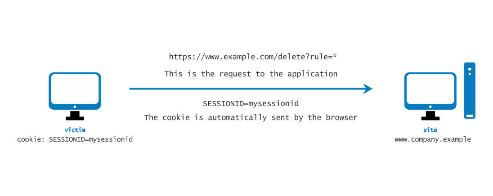
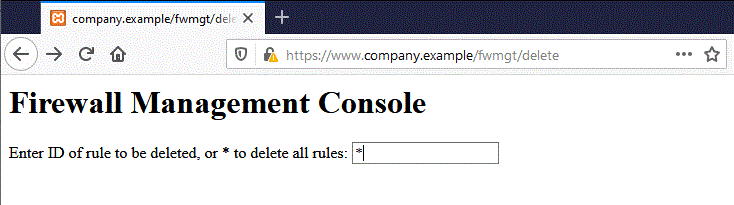
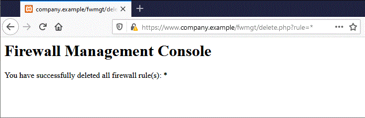

# Подделка межсайтовых запросов (CSRF)

| ID |
| --- |
| WSTG-SESS-05 |

## Резюме

Подделка межсайтовых запросов (Cross-Site Request Forgery, [CSRF](https://owasp.org/www-community/attacks/csrf)) — это атака, которая принуждает конечного пользователя выполнять непреднамеренные действия в веб-приложении, в котором он в данный момент аутентифицирован. С помощью небольших манипуляций социальной инженерии (например, отправки ссылки по электронной почте или в мессенджере) атакующий может заставить пользователей веб-приложения выполнять действия по выбору злоумышленника. Успешная эксплуатация CSRF может скомпрометировать данные и действия конечного пользователя при атаке на обычного пользователя. Если же целью атаки является учетная запись администратора, атака CSRF способна скомпрометировать все веб-приложение целиком.

CSRF опирается на:

1. Поведение веб-браузера в отношении обработки связанной с сессией информации, такой как cookie и учетные данные аутентификации HTTP.
2. Знание злоумышленником валидных URL-адресов, структуры запросов или функционала веб-приложения.
3. Управление сессиями приложения, опирающееся исключительно на информацию, известную браузеру.
4. Наличие HTML-тегов, присутствие которых вызывает немедленное обращение к ресурсу HTTP`[S]`, например тега изображения `img`.

Пункты 1, 2 и 3 являются обязательными условиями для наличия уязвимости, в то время как пункт 4 облегчает непосредственную эксплуатацию, но не является строго обязательным.

1. Браузеры автоматически отправляют информацию, используемую для идентификации сессии пользователя. Предположим, что *site* — это сайт, на котором размещено веб-приложение, а пользователь *victim* только что прошел аутентификацию на *site*. В ответ *site* отправляет пользователю *victim* cookie, идентифицирующий запросы, отправляемые *victim*, как принадлежащие аутентифицированной сессии *victim*. Как только браузер получает cookie, установленный *site*, он автоматически отправляет его вместе со всеми дальнейшими запросами, направленными к *site*.
2. Если приложение не использует связанную с сессией информацию в URL-адресах, то URL приложения, их параметры и легитимные значения могут быть идентифицированы. Этого можно достичь путем анализа кода или обращения к приложению с фиксацией форм и URL, встроенных в HTML или JavaScript.
3. Под понятием «известно браузеру» подразумевается информация, такая как cookie или данные HTTP-аутентификации (например, Basic Authentication, в отличие от аутентификации на основе веб-форм), которые сохраняются браузером и впоследствии присутствуют в каждом запросе к разделу приложения, требующему данной аутентификации. Рассматриваемые далее уязвимости относятся к приложениям, которые целиком полагаются на такого рода информацию для идентификации пользовательской сессии.

Для простоты рассмотрим URL-адреса, доступные через GET (хотя эти рассуждения применимы и к запросам POST). Если жертва (*victim*) уже аутентифицировалась, отправка другого запроса приводит к тому, что cookie отправляется вместе с ним автоматически. На рисунке ниже проиллюстрировано обращение пользователя к приложению на `www.example.com`.


*Figure 4.6.5-1: Session Riding*

GET-запрос может быть отправлен пользователем несколькими различными способами:

- При взаимодействии с веб-приложением
- При вводе URL непосредственно в адресную строку браузера
- При переходе по внешней ссылке, указывающей на данный URL

Эти вызовы неотличимы для приложения. В частности, третий вариант может быть весьма опасным. Существует ряд техник и уязвимостей, позволяющих скрыть истинные свойства ссылки. Ссылка может быть внедрена в сообщение электронной почты, размещена на вредоносном сайте, куда заманивают пользователя, или находиться в контенте, размещенном третьей стороной (например, на другом сайте или в HTML-письме), и указывать на ресурс приложения. Если пользователь нажимает на ссылку, то, поскольку он уже аутентифицирован веб-приложением на *site*, браузер отправляет GET-запрос к веб-приложению вместе с информацией об аутентификации (cookie с идентификатором сессии). Это приводит к выполнению в веб-приложении валидной операции, которой пользователь не ожидал, — например, к переводу денежных средств в системе интернет-банкинга.

При использовании такого тега, как `img`, как указано в пункте 4 выше, пользователю даже не обязательно переходить по конкретной ссылке. Предположим, злоумышленник отправляет пользователю электронное письмо, побуждающее его посетить URL, ведущий на страницу со следующим (упрощенным) HTML-кодом:

```html
<html>
    <body>
...

...
    </body>
</html>
```

Когда браузер отображает эту страницу, он попытается также загрузить указанное невидимое изображение нулевого размера с `https://www.company.example`. Это приводит к автоматической отправке запроса к веб-приложению, размещенному на *site*. Не имеет значения, что URL изображения не указывает на настоящее изображение, так как само его присутствие в любом случае инициирует запрос к действию `action`, указанному в поле `src`. Это происходит при условии, что загрузка изображений не отключена в браузере. В большинстве браузеров загрузка изображений включена, поскольку ее отключение сделало бы большинство веб-приложений практически непригодными для использования.

Данная проблема является следствием следующих факторов:

- HTML-теги на странице вызывают автоматическое выполнение HTTP-запросов (и `img` является одним из них).
- У браузера нет возможности определить, что ресурс, на который ссылается тег `img`, не является легитимным изображением.
- Загрузка изображения происходит независимо от расположения предполагаемого источника изображения, то есть форма и само изображение не обязаны находиться на одном хосте или даже в одном домене.

Тот факт, что несвязанный с веб-приложением HTML-контент может ссылаться на компоненты приложения, а также то, что браузер автоматически формирует валидный запрос к приложению, делает возможным проведение подобной атаки. Запретить такое поведение невозможно, если только не лишить атакующего возможности взаимодействовать с функционалом приложения.

В интегрированных почтово-браузерных клиентах простое отображение письма, содержащего ссылку на изображение, приведет к выполнению запроса к веб-приложению с передачей ассоциированного cookie браузера. В сообщениях электронной почты могут использоваться ссылки на кажущиеся валидными URL изображений, например:

```html

```

В этом примере `[attacker]` — сайт, контролируемый злоумышленником. Используя механизм перенаправления (редиректа), вредоносный сайт может использовать `https://[attacker]/picture.gif` для направления жертвы на `https://[thirdparty]/action` и инициирования целевого действия (`action`).

Cookie — не единственный компонент, подверженный подобной уязвимости. Веб-приложения, чья информация о сессии полностью предоставляется браузером, также уязвимы. Сюда входят приложения, полагающиеся исключительно на механизмы HTTP-аутентификации, поскольку учетные данные аутентификации известны браузеру и отправляются автоматически при каждом запросе. Сюда не относится аутентификация на основе веб-форм, которая происходит единожды и генерирует некую форму информации о сессии, как правило cookie.

Предположим, что жертва вошла в веб-консоль управления сетевым экраном (firewall web management console). Для входа пользователю необходимо пройти аутентификацию, а информация о сессии сохраняется в cookie.

Предположим, что в веб-консоли управления сетевым экраном есть функция, позволяющая аутентифицированному пользователю удалить правило по его числовому идентификатору (ID) или вообще все правила в конфигурации, если пользователь укажет символ `*` (опасная функция в реальности, но делающая пример более наглядным). Страница удаления показана далее. Предположим для простоты, что форма отправляет GET-запрос. Для удаления правила номер один:

```text
https://[target]/fwmgt/delete?rule=1
```

Для удаления всех правил:

```text
https://[target]/fwmgt/delete?rule=*
```

Этот пример намеренно упрощен, но он наглядно демонстрирует опасность CSRF.


*Figure 4.6.5-2: Session Riding Firewall Management*

При использовании формы, изображенной на рисунке выше, ввод значения `*` и нажатие кнопки «Delete» приведут к отправке следующего GET-запроса:

```text
https://www.company.example/fwmgt/delete?rule=*
```

Это приведет к удалению всех правил сетевого экрана.


*Figure 4.6.5-3: Session Riding Firewall Management 2*

Пользователь мог бы достичь того же результата, вручную перейдя по URL:

```text
https://[target]/fwmgt/delete?rule=*
```

Либо перейдя по ссылке, ведущей (напрямую или через редирект) на указанный URL. Либо открыв HTML-страницу со встроенным тегом `img`, указывающим на этот URL.

Во всех этих случаях, если пользователь в данный момент авторизован в приложении управления сетевым экраном, запрос завершится успешно и изменит конфигурацию сетевого экрана. Можно представить подобные атаки на критически важные приложения с автоматическим размещением ставок на аукционах, денежными переводами, заказами, изменением конфигурации критических программных компонентов и т. д.

Интересно то, что эти уязвимости могут эксплуатироваться за пределами сетевого экрана (внутри защищенного периметра): достаточно, чтобы атакуемый ресурс был доступен жертве, при этом ему не обязательно быть напрямую доступным злоумышленнику. В частности, это может быть любой интранет-веб-сервер — например, в описанном выше сценарии управления сетевым экраном, который вряд ли выставлен наружу в интернет.

Ситуация усугубляется приложениями со взаимной уязвимостью (self-vulnerable applications), которые одновременно выступают и вектором атаки, и ее целью (например, приложения веб-почты). Поскольку пользователи авторизованы во время чтения своих писем, уязвимое приложение такого типа может позволить злоумышленникам выполнять такие действия, как удаление писем или отправка сообщений от лица жертвы.

## Цели тестирования

- Определить возможность отправки от имени пользователя запросов, которые не были им инициированы.

## Методика тестирования

### Особенности использования атрибута SameSite для cookie

Сработают ли описанные выше PoC-сценарии, зависит от атрибута [`SameSite`](02.%20Cookies%20Attributes.md#атрибут-samesite) сессионного cookie и настроек браузера по умолчанию. См. указанный раздел относительно того, как `SameSite=Lax` обрабатывает переходы верхнего уровня (top-level navigations) по сравнению с запросами подресурсов (subresource requests).

Вкратце: PoC с тегом `img` представляет собой запрос подресурса, а PoC с автоматически отправляемой формой использует метод `POST` — ни один из них не подпадает под исключение `Lax` для переходов верхнего уровня с безопасным методом, поэтому в браузере, использующем `Lax` по умолчанию (браузеры на базе Chromium с 2020 года), сессионный cookie прикреплен не будет, и PoC в исходном виде не сработает. Форма с атрибутом `method="GET"` при этом успешно сработает под действием `Lax`, так как это переход верхнего уровня с методом `GET`. Обратите также внимание, что при применении `Lax` по умолчанию браузеры на базе Chromium по-прежнему отправляют cookie в межсайтовых `POST`-запросах верхнего уровня в течение двух минут после его установки (см. [Lax Value](02.%20Cookies%20Attributes.md#значение-lax)), поэтому PoC на базе POST, сработавший сразу после аутентификации, все еще может оказаться успешным.

Не делайте вывод о защищенности приложения от CSRF только потому, что PoC не сработал в одном браузере, — проверьте фактический заголовок `Set-Cookie` для сессионного cookie. Если PoC с автоматически отправляемой формой не срабатывает, вы можете повторить тест в браузере, который не использует `Lax` по умолчанию (например, Firefox), поскольку отправка формы является переходом верхнего уровня. Повторное тестирование PoC с тегом `img` таким способом не поможет: запрос изображения является сторонним запросом подресурса (third-party subresource request), а браузер Firefox по умолчанию изолирует (партиционирует), а Safari блокирует сторонние cookie, в связи с чем сессионный cookie отправлен не будет.

### Управление сессиями

Проведите аудит приложения, чтобы установить, уязвима ли его система управления сессиями. Если управление сессиями опирается исключительно на значения на стороне клиента (информацию, доступную браузеру), то приложение уязвимо. Под «значениями на стороне клиента» понимаются cookie и учетные данные аутентификации HTTP (Basic Authentication и другие формы аутентификации HTTP, но не аутентификация на основе веб-форм, являющаяся аутентификацией на уровне приложения).

Ресурсы, доступные через запросы HTTP GET, уязвимы в наибольшей степени, однако POST-запросы могут быть автоматизированы через JavaScript и также уязвимы; следовательно, одного лишь использования метода POST недостаточно для устранения уязвимостей CSRF.

В случае с POST можно использовать следующий пример:

1. Создать HTML-страницу, аналогичную приведенной ниже
2. Разместить HTML-код на вредоносном или стороннем сайте
3. Отправить ссылку на страницу жертве (или жертвам) и побудить ее перейти по ней.

```html
<html>
<body onload='document.CSRF.submit()'>

<form action='https://targetWebsite/Authenticate.jsp' method='POST' name='CSRF'>
    <input type='hidden' name='name' value='Hacked'>
    <input type='hidden' name='password' value='Hacked'>
</form>

</body>
</html>
```

В веб-приложениях, где разработчики используют формат JSON для связи между браузером и сервером, может возникнуть сложность из-за того, что в формате JSON нет параметров строки запроса, которые обязательны для автоматически отправляемых форм. Для обхода этого ограничения мы можем использовать автоматически отправляемую форму с JSON-пейлоадом, содержащую скрытое поле ввода, для эксплуатации CSRF. Нам потребуется изменить тип кодирования (`enctype`) на `text/plain`, чтобы пейлоад был доставлен в исходном виде. Код эксплойта будет выглядеть следующим образом:

```html
<html>
 <body>
  <script>history.pushState('', '', '/')</script>
   <form action='https://victimsite.com' method='POST' enctype='text/plain'>
     <input type='hidden' name='{"name":"hacked","password":"hacked","padding":"'value='something"}' />
     <input type='submit' value='Submit request' />
   </form>
 </body>
</html>
```

POST-запрос примет следующий вид:

```http
POST / HTTP/1.1
Host: victimsite.com
Content-Type: text/plain

{"name":"hacked","password":"hacked","padding":"=something"}
```

Когда эти данные будут отправлены в виде POST-запроса, сервер успешно примет поля `name` и `password` и проигнорирует поле с именем `padding`, так как оно ему не требуется.

## Рекомендации по устранению

- Меры по предотвращению см. в [OWASP CSRF Prevention Cheat Sheet](https://cheatsheetseries.owasp.org/cheatsheets/Cross-Site_Request_Forgery_Prevention_Cheat_Sheet.html).

## Инструменты

- [ZAP](https://www.zaproxy.org/)
- [CSRFShark](https://csrfshark.github.io/) — генерация Proof-of-Concept для атак Cross-Site Request Forgery с возможностью делиться результатами.

## Ссылки и материалы

- [Peter W: "Cross-Site Request Forgeries"](https://web.archive.org/web/20160303230910/http://www.tux.org/~peterw/csrf.txt)
- [Thomas Schreiber: "Session Riding"](https://web.archive.org/web/20160304001446/https://www.securenet.de/papers/Session_Riding.pdf)
- [Oldest known post](https://web.archive.org/web/20000622042229/https://www.zope.org/Members/jim/ZopeSecurity/ClientSideTrojan)
- [Cross-site Request Forgery FAQ](https://www.cgisecurity.com/csrf-faq.html)
- [A Most-Neglected Fact About Cross Site Request Forgery (CSRF)](https://yehg.net/lab/pr0js/view.php/A_Most-Neglected_Fact_About_CSRF.pdf)
- [Multi-POST CSRF](https://www.lanmaster53.com/blog/2013/07/17/multi-post-csrf/)
- [SANS Pen Test Webcast: Complete Application pwnage via Multi POST XSRF](https://www.youtube.com/watch?v=EOs5PZiiwug)
