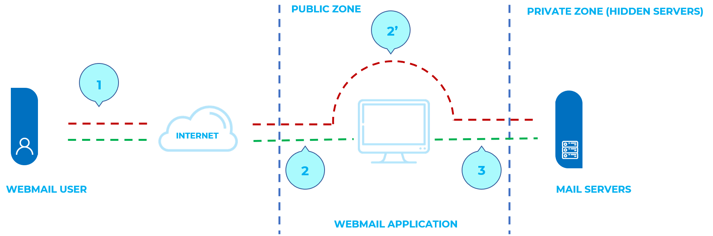

# Инъекция IMAP/SMTP

| ID |
| --- |
| WSTG-INJT-10 |

## Резюме

Данная угроза затрагивает все приложения, взаимодействующие с почтовыми серверами (IMAP/SMTP), в первую очередь почтовые веб-клиенты (webmail). Цель тестирования заключается в проверке возможности внедрения произвольных команд протоколов IMAP/SMTP на почтовые серверы из-за недостаточной санитизации и валидации входных данных.

Методика внедрения команд IMAP/SMTP (IMAP/SMTP Injection) особенно эффективна в случаях, когда почтовый сервер недоступен напрямую из сети Интернет. Если же с внутренним почтовым сервером возможно прямое сетевое взаимодействие, рекомендуется проводить непосредственное тестирование.

Внедрение IMAP/SMTP-команд открывает доступ к почтовому серверу, прямое обращение к которому из интернета иначе было бы заблокировано. Зачастую такие внутренние серверы не обладают тем же уровнем защищенности и харденинга инфраструктуры, что и фронтенд-серверы веб-приложений. Вследствие этого почтовые сервисы могут оказаться более уязвимыми перед атаками со стороны конечных пользователей (см. схему на Рисунке 1).


*Рисунок 4.7.10-1: Взаимодействие с почтовыми серверами с использованием техники IMAP/SMTP Injection*

На Рисунке 1 показан типовой маршрут трафика при использовании веб-почты. Шаги 1 и 2 отражают стандартное взаимодействие пользователя с веб-клиентом, тогда как на шаге 2 тестировщик обходит логику клиента и обращается к почтовому бэкенду напрямую.

Данная методика позволяет реализовать широкий спектр действий и векторов атак. Возможности злоумышленника зависят от типа и контекста инъекции, а также архитектуры целевого почтового сервера.

Примеры атак с использованием техники IMAP/SMTP Injection:

- Эксплуатация уязвимостей реализации протоколов IMAP/SMTP
- Обход ограничений и бизнес-логики приложения
- Обход систем защиты от автоматизации (Anti-automation)
- Несанкционированная утечка конфиденциальной информации
- Нелегитимная ретрансляция почты и спам (Relay/SPAM)

## Цели тестирования

- Идентифицировать точки внедрения команд IMAP/SMTP.
- Понять потоки данных и архитектуру развертывания системы.
- Оценить последствия и уровень критичности инъекции.

## Методика тестирования

### Выявление уязвимых параметров

Для выявления уязвимых параметров тестировщику необходимо проанализировать логику обработки входных данных приложением. Тестирование валидации входных данных предполагает отправку серверу искаженных или вредоносных запросов с последующим анализом полученных ответов. В защищенном приложении ответом сервера должна стать ошибка с соответствующим уведомлением клиента о сбое операции. В уязвимом приложении вредоносный запрос может быть передан на исполнение бэкенд-серверу, который вернет сообщение с кодом ответа `HTTP 200 OK`.

Важно подчеркнуть, что отправляемые запросы должны строго соответствовать тестируемой технологии. Отправка пейлоадов SQL-инъекций для Microsoft SQL Server при использовании MySQL приведет к ложноположительным выводам. В данном сценарии отправка специфичных вредоносных команд IMAP является стандартным подходом (modus operandi), поскольку базовым тестируемым протоколом выступает именно IMAP.

Специальные параметры IMAP, подлежащие проверке:

| На сервере IMAP        | На сервере SMTP    |
|------------------------|--------------------|
| Аутентификация         | Email отправителя  |
| Операции с почтовыми ящиками (list, read, create, delete, rename) | Email получателя |
| Операции с сообщениями (read, copy, move, delete) | Тема письма (Subject) |
| Отключение сессии (Disconnection) | Тело сообщения     |
|                        | Вложенные файлы    |

В данном примере параметр mailbox проверяется путем манипуляции значениями во всех запросах, содержащих данный параметр:

`https://<webmail>/src/read_body.php?mailbox=INBOX&passed_id=46106&startMessage=1`

Могут быть использованы следующие тестовые векторы:

- Передача пустого (null) значения параметра:

`https://<webmail>/src/read_body.php?mailbox=&passed_id=46106&startMessage=1`

- Замена значения на произвольную несуществующую строку:

`https://<webmail>/src/read_body.php?mailbox=NOTEXIST&passed_id=46106&startMessage=1`

- Добавление дополнительных значений к параметру:

`https://<webmail>/src/read_body.php?mailbox=INBOX PARAMETER2&passed_id=46106&startMessage=1`

- Внедрение нестандартных специальных символов (например: `\`, `'`, `"`, `@`, `#`, `!`, `|`):

`https://<webmail>/src/read_body.php?mailbox=INBOX"&passed_id=46106&startMessage=1`

- Полное удаление параметра из запроса:

`https://<webmail>/src/read_body.php?passed_id=46106&startMessage=1`

Итогом описанного тестирования является попадание в одну из трех ситуаций:

1. Приложение возвращает код/сообщение об ошибке
2. Приложение не возвращает код/сообщение об ошибке, но запрошенная операция не выполняется
3. Приложение не возвращает ошибку и выполняет запрошенную операцию в штатном режиме

Ситуации S1 и S2 свидетельствуют об успешном проведении IMAP/SMTP-инъекции.

Главной целью атакующего является получение ответа типа S1, так как это служит явным индикатором уязвимости приложения к инъекции и потенциалу дальнейшей эксплуатации.

Предположим, что почтовые заголовки запрашиваются следующим HTTP-запросом:

`https://<webmail>/src/view_header.php?mailbox=INBOX&passed_id=46105&passed_ent_id=0`

Атакующий может модифицировать значение параметра `INBOX`, внедрив символ кавычки `"` (`%22` в URL-кодировке):

`https://<webmail>/src/view_header.php?mailbox=INBOX%22&passed_id=46105&passed_ent_id=0`

В этом случае ответ приложения может выглядеть так:

```txt
ERROR: Bad or malformed request.
Query: SELECT "INBOX""
Server responded: Unexpected extra arguments to Select
```

Ситуацию S2 протестировать значительно сложнее. Тестировщику потребуется применить методику слепого внедрения команд (blind command injection), чтобы определить наличие уязвимости на сервере.

С другой стороны, последняя ситуация (S3) в рамках данного раздела практического интереса не представляет.

> Список уязвимых параметров
>
> - Затронутая функциональность
> - Тип возможной инъекции (IMAP/SMTP)

### Изучение потоков данных и структуры развертывания клиентской части

После идентификации уязвимых параметров (например, `passed_id`) тестировщику необходимо определить глубину доступной инъекции и составить план дальнейшей эксплуатации приложения.

В данном тест-кейсе обнаружено, что параметр `passed_id` уязвим и используется в следующем запросе:

`https://<webmail>/src/read_body.php?mailbox=INBOX&passed_id=46225&startMessage=1`

Отправка следующего тестового запроса (передача буквенного значения вместо ожидаемого числового):

`https://<webmail>/src/read_body.php?mailbox=INBOX&passed_id=test&startMessage=1`

приведет к генерации сообщения об ошибке:

```txt
ERROR : Bad or malformed request.
Query: FETCH test:test BODY[HEADER]
Server responded: Error in IMAP command received by server.
```

В приведенном примере сообщение об ошибке раскрыло имя выполненной команды и переданные аргументы.

В других случаях сообщение об ошибке (не контролируемое приложением) содержит лишь имя выполненной команды, однако изучение соответствующих [RFC](#ссылки-и-материалы) позволяет тестировщику определить, какие еще команды могут быть выполнены.

Если приложение не возвращает детальных диагностических сообщений, тестировщику необходимо проанализировать затронутый функционал, чтобы логически восстановить все возможные команды (и параметры), связанные с данной операцией. Например, если уязвимый параметр обнаружен в интерфейсе создания почтового ящика, логично предположить, что вызывается IMAP-команда `CREATE`. Согласно RFC, команда `CREATE` принимает один параметр, задающий имя создаваемого почтового ящика.

> Список затронутых команд IMAP/SMTP
>
> - Тип, значение и количество параметров, ожидаемых затронутыми командами IMAP/SMTP

### Инъекция команд IMAP/SMTP

После того как тестировщик определил уязвимые параметры и проанализировал контекст их выполнения, следующим этапом является непосредственная эксплуатация функционала.

Данный этап имеет два варианта развития:

1. Инъекция возможна без прохождения аутентификации: затронутый функционал не требует аутентифицированной сессии пользователя. Список доступных для внедрения команд (IMAP) ограничен: `CAPABILITY`, `NOOP`, `AUTHENTICATE`, `LOGIN` и `LOGOUT`.
2. Инъекция возможна только в аутентифицированном состоянии: для успешной эксплуатации требуется предварительная аутентификация в приложении.

В любом случае типовая структура внедрения IMAP/SMTP-команд состоит из следующих элементов:

- Header (заголовок): завершение ожидаемой исходной команды;
- Body (тело): внедрение новой команды;
- Footer (подвал): начало следующей штатной команды.

Важно помнить, что для выполнения команды в протоколах IMAP/SMTP предыдущая команда должна быть завершена управляющей последовательностью CRLF (`%0d%0a`).

Предположим, что на этапе [выявления уязвимых параметров](#выявление-уязвимых-параметров) тестировщик обнаружил уязвимость в параметре `message_id` следующего запроса:

`https://<webmail>/read_email.php?message_id=4791`

Предположим также, что в ходе анализа на этапе 2 («Определение потоков данных и структуры развертывания клиента») было установлено, что с этим параметром связана следующая команда с аргументами:

`FETCH 4791 BODY[HEADER]`

В данном сценарии структура внедряемого IMAP-пейлоада примет следующий вид:

`https://<webmail>/read_email.php?message_id=4791 BODY[HEADER]%0d%0aV100 CAPABILITY%0d%0aV101 FETCH 4791`

Это приведет к формированию и исполнению следующей последовательности команд:

```sql
???? FETCH 4791 BODY[HEADER]
V100 CAPABILITY
V101 FETCH 4791 BODY[HEADER]
```

где:

```sql
Header = 4791 BODY[HEADER]
Body   = %0d%0aV100 CAPABILITY%0d%0a
Footer = V101 FETCH 4791
```

> Список затронутых команд IMAP/SMTP
>
> - Внедрение произвольных команд IMAP/SMTP

## Ссылки и материалы

### Технические документы (Whitepapers)

- [RFC 0821 "Simple Mail Transfer Protocol"](https://tools.ietf.org/html/rfc821)
- [RFC 3501 "Internet Message Access Protocol - Version 4rev1"](https://tools.ietf.org/html/rfc3501)
