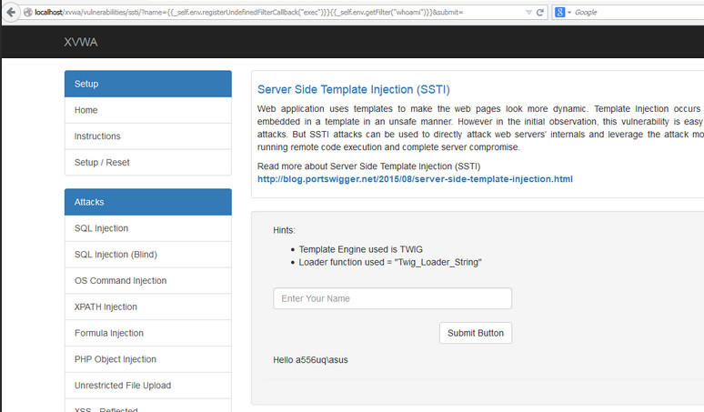

# Внедрение серверных шаблонов (SSTI)

| ID |
| --- |
| WSTG-INJT-18 |

## Резюме

Веб-приложения часто используют серверные шаблонизаторы (Jinja2, Twig, FreeMarker и др.) для динамической генерации HTML-ответов. Уязвимости внедрения шаблонов на стороне сервера (Server-Side Template Injection, SSTI) возникают в тех случаях, когда пользовательский ввод небезопасно встраивается в шаблон, приводя к удаленному выполнению кода (Remote Code Execution, RCE) на сервере. Любая функциональность, поддерживающая расширенную пользовательскую разметку, потенциально подвержена SSTI: вики-страницы, отзывы, маркетинговые приложения, CMS-системы и др. Некоторые шаблонизаторы реализуют специализированные защитные механизмы (например, песочницы — sandboxes, списки разрешений и др.) для защиты от эксплуатации SSTI.

### Пример — Twig

Следующий пример взят из проекта [Extreme Vulnerable Web Application (XVWA)](https://github.com/s4n7h0/xvwa).

```php
public function getFilter($name)
{
        [snip]
        foreach ($this->filterCallbacks as $callback) {
        if (false !== $filter = call_user_func($callback, $name)) {
            return $filter;
        }
    }
    return false;
}
```

В методе `getFilter` вызов `call_user_func($callback, $name)` уязвим к SSTI: параметр `name` извлекается из HTTP GET-запроса и выполняется сервером:


*Рисунок 4.7.18-1: Пример SSTI в XVWA*

### Пример — Flask/Jinja2

В следующем примере используется связка фреймворка Flask и шаблонизатора Jinja2. Функция `page` принимает параметр `name` из HTTP GET-запроса и рендерит HTML-ответ, содержащий значение переменной `name`:

```python
@app.route("/page")
def page():
    name = request.values.get('name')
    output = Jinja2.from_string('Hello ' + name + '!').render()
    return output
```

Данный фрагмент кода уязвим как к XSS, так и к SSTI. Передача следующего пейлоада в параметре `name`:

```bash
$ curl -g 'https://www.target.com/page?name={{7*7}}'
Hello 49!
```

## Цели тестирования

- Обнаружить точки внедрения в шаблоны.
- Идентифицировать используемый шаблонизатор (шаблонный движок).
- Сконструировать рабочий эксплойт.

## Методика тестирования

Уязвимости SSTI проявляются либо в текстовом контексте (text context), либо в контексте кода (code context). В текстовом контексте пользователю разрешено использовать свободный текст с прямыми HTML-тегами. В контексте кода пользовательский ввод может внедряться непосредственно внутрь выражений шаблона (например, в имя переменной).

### Выявление уязвимости инъекции в шаблоны

Первым шагом при тестировании SSTI в текстовом контексте является отправка типовых шаблонных выражений (используемых различными шаблонизаторами) в качестве полезной нагрузки и последующий анализ ответов сервера для определения того, какое именно выражение было вычислено сервером.

Примеры распространенных шаблонных выражений:

```text
a{{bar}}b
a{{7*7}}
{var} ${var} {{var}} <%var%> [% var %]
```

Синтаксис выражений (expression syntax) — не единственная доступная поверхность атаки. Шаблонизаторы Apache Velocity и FreeMarker также поддерживают синтаксис *директив* (directive syntax), который не срабатывает при использовании приведенных выше тестовых проб. Директива присваивания сохраняет результат вычисления вместо его прямого вывода, поэтому ее следует комбинировать с интерполяцией, чтобы сделать результат наблюдаемым:

```text
#set($x=7*7)$x
<#assign x=7*7>${x}
```

Оба пейлоада отобразят `49` в месте вычисления директивы. При отправке без последующей интерполяции они вообще ничего не выводят в ответ, что критически важно учитывать при построении эксплойта: присваивание вида `<#assign result=runner("id")>`, где `runner` — объект, инстанцированный предыдущей директивой, вызывает метод, но не возвращает видимого вывода. Следовательно, неизменный ответ приложения не является доказательством того, что пейлоад не был выполнен. В случаях, когда вывод подавляется, подтверждайте выполнение через наблюдаемые побочные эффекты (side effects), например внеполосные DNS-запросы (OOB DNS) или измеримые задержки времени выполнения.

На данном этапе рекомендуется использовать детальный [список тестовых строк и пейлоадов для различных шаблонизаторов](https://github.com/swisskyrepo/PayloadsAllTheThings/tree/master/Server%20Side%20Template%20Injection).

Тестирование SSTI в контексте кода несколько отличается. Сначала тестировщик формирует запросы, вызывающие пустой ответ сервера либо ошибку. В приведенном ниже примере параметр HTTP GET вставляется в переменную `personal_greeting` внутри оператора шаблона:

```text
personal_greeting=username
Hello user01
```

При использовании следующего пейлоада сервер возвращает пустую строку приветствия «Hello»:

```text
personal_greeting=username<tag>
Hello
```

Следующим шагом является выход из оператора шаблона с последующим внедрением HTML-тега:

```text
personal_greeting=username}}<tag>
Hello user01 <tag>
```

### Определение шаблонизатора

На основе данных, полученных на предыдущем шаге, тестировщик должен идентифицировать конкретный шаблонизатор путем отправки специализированных выражений. Сопоставляя полученные ответы, специалист делает вывод об используемой технологии. Данный ручной подход подробно разобран в [статье PortSwigger](https://portswigger.net/blog/server-side-template-injection?#Identify). Для автоматизации обнаружения SSTI и идентификации движка доступны утилиты, такие как [SSTImap](https://github.com/vladko312/SSTImap) или [расширение Backslash Powered Scanner для Burp Suite](https://github.com/PortSwigger/backslash-powered-scanner).

### Создание RCE-эксплойта

Главная цель данного этапа — получить контроль над сервером с помощью RCE-эксплойта, опираясь на официальную документацию шаблонизатора и профильные исследования безопасности. Ключевые области внимания:

- Разделы **для авторов шаблонов** (For template authors), описывающие базовый синтаксис.
- Разделы, посвященные **вопросам безопасности** (Security considerations).
- Списки встроенных методов, функций, фильтров и переменных.
- Списки поддерживаемых расширений и плагинов.

Тестировщик также может исследовать доступные объекты, методы и свойства, анализируя объект `self`. Если объект `self` недоступен, а документация не раскрывает деталей внутренней архитектуры, рекомендуется выполнить перебор (брутфорс) имен переменных. После обнаружения объекта следующим шагом является обход его цепочек для поиска всех методов и атрибутов, доступных через шаблонизатор. Это может привести к обнаружению других критических дефектов безопасности, включая повышение привилегий, раскрытие паролей приложения, API-ключей, конфигурационных файлов и переменных окружения.

## Инструменты

- [SSTImap](https://github.com/vladko312/SSTImap)
- [Tplmap](https://github.com/epinna/tplmap) — проект более не поддерживается; активно развивается его форк SSTImap
- [Backslash Powered Scanner (расширение Burp Suite)](https://github.com/PortSwigger/backslash-powered-scanner)
- [Коллекция тестовых пейлоадов SSTI в PayloadsAllTheThings](https://github.com/swisskyrepo/PayloadsAllTheThings/tree/master/Server%20Side%20Template%20Injection)

## Ссылки и материалы

- [James Kettle: Server-Side Template Injection: RCE for the modern webapp (whitepaper)](https://portswigger.net/kb/papers/serversidetemplateinjection.pdf)
- [Server-Side Template Injection](https://portswigger.net/blog/server-side-template-injection)
- [Exploring SSTI in Flask/Jinja2](https://www.lanmaster53.com/blog/2016/03/09/exploring-ssti-flask-jinja2/)
- [Server-Side Template Injection: from detection to Remote shell](https://www.okiok.com/server-side-template-injection-from-detection-to-remote-shell/)
- [Extreme Vulnerable Web Application](https://github.com/s4n7h0/xvwa)
- [Exploiting SSTI in Thymeleaf](https://www.acunetix.com/blog/web-security-zone/exploiting-ssti-in-thymeleaf/)
