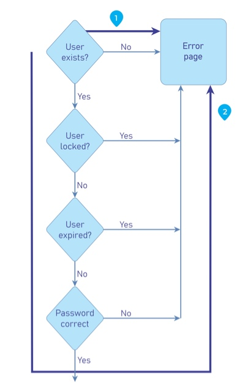

# Временные характеристики обработки

| ID |
| --- |
| WSTG-BUSL-04 |

## Резюме

Злоумышленники могут собирать информацию о приложении путем мониторинга времени, необходимого для выполнения задачи или формирования ответа. Кроме того, атакующие способны манипулировать и нарушать заложенные сценарии бизнес-процессов, просто удерживая сессии активными и не завершая транзакции в пределах «ожидаемого» временного интервала.

Логические уязвимости, связанные с временными характеристиками процессов (process timing), уникальны тем, что ручные сценарии злоупотребления (misuse cases) должны создаваться с учетом специфики времени выполнения и длительности транзакций конкретного приложения или системы.

Время обработки операций может раскрывать информацию о том, какие фоновые действия происходят в приложении или системе. Если приложение позволяет пользователям предугадывать конкретный результат на основе различий во времени ответа, пользователи могут скорректировать свои действия и изменить поведение, чтобы обойти правила или обыграть систему («game the system»).

### Пример 1

Электронные игровые автоматы (слот-машины) могут дольше обрабатывать транзакцию непосредственно перед крупной выплатой. Это позволяет внимательным игрокам делать минимальные ставки до тех пор, пока они не зафиксируют увеличенное время обработки, после чего перейти к максимальным ставкам.

### Пример 2

Процесс входа во многих системах запрашивает имя пользователя и пароль. При детальном анализе можно заметить, что ввод невалидного логина и невалидного пароля занимает больше времени для возврата ошибки, чем ввод валидного логина и невалидного пароля. Это позволяет атакующему определить существование валидной учетной записи без необходимости ориентироваться на сообщения в графическом интерфейсе.

Аналогичная проблема может присутствовать в функциональности сброса пароля, отправляющей пользователю электронное письмо со ссылкой или кодом восстановления, поскольку отправка писем обычно занимает значительно больше времени, чем простой возврат HTTP-ответа.

*Figure 4.10.4-1: Example Control Flow of Login Form*

### Пример 3

Большинство стадионов и сервисов продажи билетов используют приложения, позволяющие пользователям приобретать билеты и бронировать места. Когда пользователь запрашивает билеты, выбранные места блокируются или резервируются до момента завершения оплаты. Что произойдет, если злоумышленник будет непрерывно бронировать места, не доходя до этапа оплаты? Будут ли места освобождены, или продажи билетов окажутся парализованы? Некоторые сервисы бронирования сейчас отводят пользователю строго 5 минут на завершение покупки, после чего транзакция аннулируется.

### Пример 4

Предположим, интернет-магазин драгоценных металлов позволяет пользователям совершать покупки с фиксацией котировки на момент входа в систему. Что произойдет, если злоумышленник войдет в систему и оформит заказ, но не завершит транзакцию, выжидая динамику цен в течение дня, и оплатит заказ только в том случае, если стоимость металлов пойдет вверх? Получит ли злоумышленник товар по изначально зафиксированной более низкой цене?

## Цели тестирования

- Изучить проектную документацию на предмет функциональности системы, зависящей от времени выполнения.
- Разработать и выполнить сценарии неправомерного использования (misuse cases).

## Методика тестирования

Тестировщик должен определить, какие процессы зависят от фактора времени — будь то временное окно, отведенное на выполнение задачи, или интервал выполнения между двумя подпроцессами, позволяющий обойти механизмы контроля.

После этого целесообразно автоматизировать запросы для эксплуатации выявленных уязвимых процессов, поскольку специализированные инструменты точнее фиксируют временные интервалы по сравнению с ручным тестированием. При невозможности автоматизации проверку можно провести вручную.

Тестировщику следует составить схему протекания бизнес-процесса, определить точки внедрения данных и предварительно подготовить последовательность запросов для отправки к уязвимым компонентам. После выполнения тестов необходимо провести детальный анализ различий во времени выполнения процессов и зафиксировать отклонения в поведении системы от регламентированной бизнес-логики.

## Связанные тест-кейсы

- [Cookies Attributes](../06.%20Session%20Management%20Testing/02.%20Cookies%20Attributes.md)
- [Session Timeout](../06.%20Session%20Management%20Testing/07.%20Session%20Timeout.md)

## Рекомендации по устранению

Проектируйте приложения с учетом фактора времени обработки. Если злоумышленники могут получить преимущество, анализируя вариации во времени выполнения и получаемые результаты, добавьте дополнительные шаги или задержки обработки, чтобы вне зависимости от исхода ответ отдавался за одинаковое время.

Кроме того, в приложении/системе должны присутствовать механизмы, не позволяющие злоумышленникам растягивать транзакции сверх «допустимого» интервала времени. Это достигается отменой или сбросом транзакций по истечении заданного периода неактивности, как это реализовано в современных сервисах продажи билетов.
