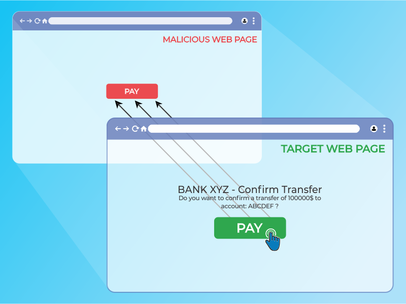
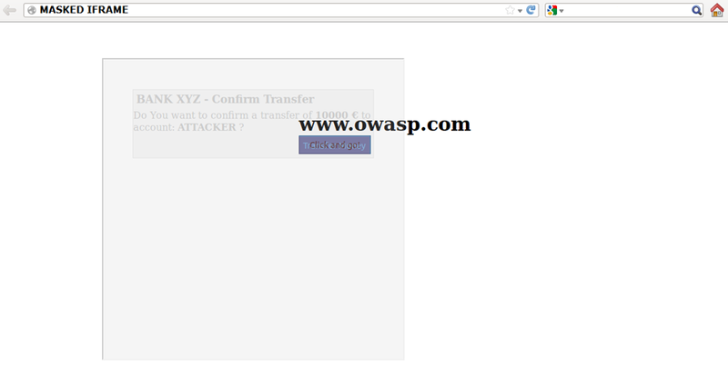

# Кликджекинг

| ID |
| --- |
| WSTG-CLNT-09 |

## Резюме

Кликджекинг (Clickjacking), подмножество атак подмены пользовательского интерфейса (UI Redressing), представляет собой вредоносную технику, при которой веб-пользователя обманным путем склоняют к взаимодействию (в большинстве случаев — к клику мышью) с элементом, отличным от того, с которым, по мнению пользователя, он взаимодействует. Данный тип атаки, как самостоятельно, так и в сочетании с другими векторами, потенциально позволяет отправлять несанкционированные команды или раскрывать конфиденциальную информацию в тот момент, когда жертва взаимодействует с внешне безобидными веб-страницами. Термин «кликджекинг» был введен Джереми Гроссманом (Jeremiah Grossman) и Робертом Хансеном (Robert Hansen) в 2008 году.

Атака типа clickjacking использует стандартные возможности HTML и JavaScript, вынуждая жертву выполнять непреднамеренные действия — например, нажимать на невидимую кнопку, запускающую нежелательную операцию. Это клиентская проблема безопасности, затрагивающая широкий спектр браузеров и платформ.

Для проведения атаки злоумышленник создает безобидную на вид веб-страницу, которая загружает целевое приложение внутри встроенного фрейма (inline frame, iframe), скрытого с помощью правил CSS. После этого атакующий склоняет жертву к взаимодействию со страницей сторонними методами (например, посредством социальной инженерии / social engineering). Как и во многих других атаках, частым предварительным условием является наличие активной сессии аутентификации жертвы в целевом приложении атакующего.


*Figure 4.11.9-1: Clickjacking inline frame illustration*

Жертва просматривает страницу атакующего с намерением взаимодействовать с видимым пользовательским интерфейсом, однако непреднамеренно совершает действия на скрытой целевой веб-странице. Размещая скрытые элементы поверх интерфейса, злоумышленник может обманом заставить пользователей выполнять операции, которые они совершать не собирались.


*Figure 4.11.9-2: Masked inline frame illustration*

Сила данного метода заключается в том, что выполняемые жертвой действия исходят от скрытой, но подлинной целевой веб-страницы. В результате некоторые механизмы защиты от CSRF (anti-CSRF), внедренные разработчиками для предотвращения атак подделки межсайтовых запросов, могут быть успешно обойдены.

## Цели тестирования

- Оценить уязвимость приложения к атакам кликджекинга (Clickjacking).

## Методика тестирования

Как отмечалось выше, этот тип атаки часто проектируется с целью заставить пользователя совершить действия на целевом сайте, даже если в приложении применяются anti-CSRF токены.

### Загрузка целевой веб-страницы в HTML-интерпретаторе с помощью тега iframe

Если веб-страница `https://www.target.site` успешно загружается внутрь фрейма, сайт уязвим к кликджекингу. Пример HTML-кода для создания тестовой веб-страницы приведен в следующем фрагменте:

```html
    <html>
        <head>
            <title>Clickjack test web page</title>
        </head>
        <body>
            <iframe src="https://www.target.site" width="400" height="400"></iframe>
        </body>
    </html>
```

### Тестирование приложения при отключенном JavaScript

Поскольку клиентские механизмы защиты от кликджекинга опираются на код противодействия фреймингу на JavaScript (frame busting code), при отключенном у жертвы JavaScript или при возможности его блокировки атакующим веб-страница лишается какой-либо защиты от кликджекинга.

Существует несколько техник нейтрализации защитных сценариев при работе с фреймами. Более детальные методы рассмотрены в документе [Clickjacking Defense Cheat Sheet](https://cheatsheetseries.owasp.org/cheatsheets/Clickjacking_Defense_Cheat_Sheet.html).

### Атрибут Sandbox

В HTML5 появился атрибут «sandbox». Он задает набор ограничений для содержимого, загружаемого в iframe.

Пример:

```html
<iframe src="https://example.org" sandbox></iframe>
```

### Тестирование приложения в режимах совместимости и специальных возможностей

Мобильные версии веб-страниц обычно компактнее и быстрее настольных версий, а также имеют менее сложную логику по сравнению с основным приложением. Мобильные варианты зачастую содержат меньше уровней защиты. Однако атакующий может подделать данные клиента, передаваемые веб-браузером, позволив десктопной жертве загрузить версию, предназначенную для мобильных пользователей. Данный сценарий может предоставить возможность скомпрометировать мобильную версию страницы.
Приложения, работающие в режиме специальных возможностей (accessibility mode), также должны тестироваться на кликджекинг, поскольку механизмы отображения во фреймах могут быть затронуты.

### Серверная защита: использование директивы frame-ancestors политики безопасности контента (CSP)

HTTP-заголовок ответа Content-Security-Policy (CSP) позволяет администраторам веб-страницы контролировать ресурсы, которые браузеру разрешено загружать для конкретной страницы. Директива `frame-ancestors` в заголовке CSP определяет допустимых родителей, которым разрешено встраивать веб-страницу с использованием тегов `<frame>`, `<iframe>`, `<object>` или `<embed>`.

#### Заголовок ответа Content-Security-Policy

- С помощью браузера откройте инструменты разработчика и перейдите на целевую веб-страницу. Откройте вкладку Network.
- Найдите запрос, загружающий саму веб-страницу. Он должен относиться к тому же домену, что и страница, и обычно располагается первой строкой на вкладке Network.
- При клике на файл отобразятся подробные сведения. Убедитесь в наличии кода ответа 200 OK.
- Прокрутите страницу до раздела Response Headers. Раздел Content-Security-Policy отражает уровень применяемой защиты.

Также можно просмотреть исходный код веб-страницы, чтобы найти Content-Security-Policy в мета-теге. Руководство WSTG содержит детальную информацию о [политике защиты контента (Content Security Policy)](../02.%20Configuration%20and%20Deployment%20Management%20Testing/12.%20Content%20Security%20Policy.md).

##### Прокси-серверы

Веб-прокси известны тем, что могут модифицировать заголовки, добавляя или удаляя их. В случае если промежуточный веб-прокси удаляет заголовок `X-FRAME-OPTIONS`, сайт полностью теряет защиту от встраивания во фреймы.

##### Мобильная версия приложения

Поскольку HTTP-заголовок `X-FRAME-OPTIONS` должен быть внедрен на каждой странице приложения, разработчики могли упустить его реализацию на некоторых страницах мобильной версии.

### Рекомендации по устранению

- Меры по предотвращению кликджекинга изложены в шпаргалке [Clickjacking Defense Cheat Sheet](https://cheatsheetseries.owasp.org/cheatsheets/Clickjacking_Defense_Cheat_Sheet.html).
- Интерактивные лаборатории по кликджекингу доступны на веб-сайте [PortSwigger Web Security Academy](https://portswigger.net/web-security/clickjacking).
- Дополнительные материалы по теме представлены в сообществе [OWASP community](https://owasp.org/www-community/attacks/Clickjacking).

## Ссылки и материалы

- [OWASP Clickjacking](https://owasp.org/www-community/attacks/Clickjacking)
- [Wikipedia Clickjacking](https://en.wikipedia.org/wiki/Clickjacking)
- [Gustav Rydstedt, Elie Bursztein, Dan Boneh, and Collin Jackson: "Busting Frame Busting: a Study of Clickjacking Vulnerabilities on Popular Sites"](https://seclab.stanford.edu/websec/framebusting/framebust.pdf)
