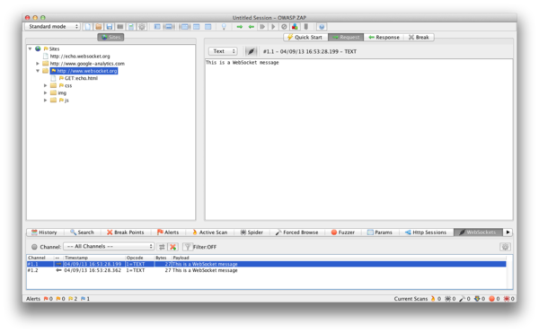
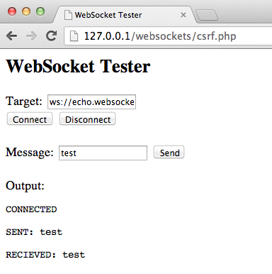

# WebSockets

| ID |
| --- |
| WSTG-CLNT-10 |

## Резюме

Традиционно протокол HTTP допускает только один цикл «запрос/ответ» в рамках одного TCP-соединения. Технология асинхронного JavaScript и XML (AJAX) позволяет клиентам передавать и принимать данные от сервера асинхронно (в фоновом режиме без перезагрузки всей страницы), однако AJAX требует, чтобы инициатором запросов выступал именно клиент, ожидая последующего ответа сервера (полудуплексный режим / half-duplex).

[WebSockets](https://websockets.spec.whatwg.org/#network-intro) предоставляют клиенту и серверу возможность создания полнодуплексного (двунаправленного / full-duplex) канала связи, обеспечивая полноценный асинхронный обмен данными между ними. Протокол WebSockets выполняет первичное рукопожатие обновления протокола (*upgrade* handshake) поверх HTTP, после чего все дальнейшее взаимодействие происходит по постоянным TCP-каналам с использованием фреймов (frames). Подробности см. в спецификации [WebSocket Protocol](https://tools.ietf.org/html/rfc6455).

### Источник (Origin)

Сервер несет прямую ответственность за валидацию [заголовка `Origin`](https://developer.mozilla.org/en-US/docs/Web/HTTP/Reference/Headers/Origin) в процессе первичного HTTP-рукопожатия WebSocket. Если сервер не проверяет заголовок Origin при начальном рукопожатии, WebSocket-сервер может принимать подключения от любых внешних доменов. Это способно позволить злоумышленникам взаимодействовать с сервером WebSocket в междоменном контексте, что приводит к уязвимостям, аналогичным CSRF. См. также [A01:2025 Нарушение контроля доступа (Broken Access Control)](https://owasp.org/Top10/2025/A01_2025-Broken_Access_Control/). Эксплойт для данной уязвимости называется межсайтовым перехватом WebSocket (Cross-Site WebSocket Hijacking, CSWH / CSWSH).

### Конфиденциальность и целостность

WebSockets могут функционировать поверх незашифрованного TCP или поверх шифрованного соединения TLS. Для использования незашифрованного протокола WebSockets применяется схема URI `ws://` (порт по умолчанию: 80); для защищенного соединения (TLS) задействуется схема `wss://` (порт по умолчанию: 443). См. также раздел [A04:2025 Сбои криптографии (Cryptographic Failures)](https://owasp.org/Top10/2025/A04_2025-Cryptographic_Failures/).

### Санитизация входных данных

Как и в случае с любыми данными, поступающими из недоверенных источников, содержимое сообщений должно проходить обязательную очистку (sanitization) и экранирование (encoding). См. также раздел [A05:2025 Инъекции (Injection)](https://owasp.org/Top10/2025/A05_2025-Injection/) (включая XSS).

## Цели тестирования

- Идентифицировать использование протокола WebSockets в приложении.
- Оценить корректность его реализации, применяя те же методики тестирования, что и для стандартных HTTP-каналов.

## Методика тестирования

### Тестирование методом «черного ящика»

1. Идентифицировать факт использования WebSockets в приложении:
   - Проанализировать клиентский исходный код на предмет схем URI `ws://` или `wss://`.
   - Использовать инструменты разработчика Google Chrome (Developer Tools) для анализа сетевого трафика WebSockets во вкладке Network.
   - Использовать специализированную вкладку WebSocket в инструменте [ZAP](https://www.zaproxy.org).
2. Проверка заголовка Origin:
   - С помощью клиента WebSocket (один из примеров доступен в разделе «Инструменты» ниже) попытайтесь подключиться к удаленному серверу WebSocket. Если соединение успешно установлено, сервер, вероятнее всего, не проверяет заголовок Origin при WebSocket-рукопожатии.
3. Конфиденциальность и целостность:
   - Убедитесь, что для передачи конфиденциальной информации используется соединение поверх TLS (`wss://`).
   - Проверьте реализацию HTTPS на предмет проблем безопасности (валидность сертификатов, уязвимости BEAST, CRIME, использование шифра RC4 и т. д.). Обратитесь к разделу руководства [Слабая безопасность транспортного уровня](../09.%20Weak%20Cryptography%20Testing/01.%20Weak%20Transport%20Layer%20Security.md).
4. Аутентификация:
   - Протокол WebSockets не содержит встроенных механизмов аутентификации; необходимо провести стандартные тесты аутентификации методом «черного ящика». Обратитесь к разделам руководства [Тестирование аутентификации](../04.%20Authentication%20Testing/README.md).
5. Авторизация:
   - WebSockets не управляет авторизацией; следует провести стандартные проверки авторизации методом «черного ящика». Обратитесь к разделу [Тестирование авторизации](../05.%20Authorization%20Testing/README.md).
6. Очистка входных данных:
   - Используйте вкладку WebSocket в [ZAP](https://www.zaproxy.org) для повторной отправки (replay) и фаззинга (fuzzing) запросов и ответов WebSocket. Обратитесь к разделу [Тестирование на инъекции](../07.%20Injection%20Testing/README.md).

#### Пример 1

После того как использование WebSockets в приложении подтверждено (как описано выше), можно задействовать [Zed Attack Proxy (ZAP)](https://www.zaproxy.org) для перехвата сообщений WebSocket. Затем ZAP можно использовать для фаззинга и повторной отправки запросов и ответов WebSocket.

*Figure 4.11.10-1: ZAP WebSockets*

#### Пример 2

С помощью клиента WebSocket (доступного в разделе Tools ниже) попытайтесь подключиться к удаленному WebSocket-серверу. Если подключение разрешено, сервер может не валидировать заголовок Origin в WebSocket-рукопожатии. Попробуйте повторить ранее перехваченные запросы, чтобы убедиться в возможности междоменного взаимодействия через WebSockets.

*Figure 4.11.10-2: WebSocket Client*

### Тестирование методом «серого ящика»

Тестирование методом «серого ящика» во многом аналогично тестированию «черного ящика». При тестировании методом «серого ящика» пентестер обладает частичными знаниями о внутреннем устройстве приложения. Основное отличие заключается в возможном доступе к API-документации тестируемого приложения, содержащей форматы ожидаемых запросов и ответов WebSocket.

## Инструменты

- [Zed Attack Proxy (ZAP)](https://www.zaproxy.org)
- [WebSocket Client](https://github.com/ethicalhack3r/scripts/blob/master/WebSockets.html)

## Ссылки и материалы

- [HTML5 Rocks - Introducing WebSockets: Bringing Sockets to the Web](https://web.dev/articles/websockets-basics)
- [WHATWG - WebSockets Standard](https://websockets.spec.whatwg.org/#network-intro)
- [IETF - The WebSocket Protocol](https://tools.ietf.org/html/rfc6455)
- [CWE-1385: Missing Origin Validation in WebSockets](https://cwe.mitre.org/data/definitions/1385.html)
- [Christian Schneider - Cross-Site WebSocket Hijacking (CSWSH)](https://www.christian-schneider.net/blog/cross-site-websocket-hijacking/)
- [Robert Koch- On WebSockets in Penetration Testing](https://repositum.tuwien.at/retrieve/21955)
- [DigiNinja - ZAP and Web Sockets](https://digi.ninja/blog/zap_web_sockets.php)
