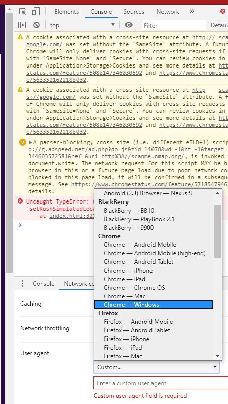
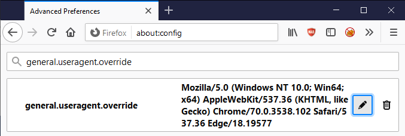
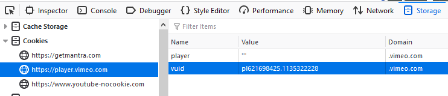
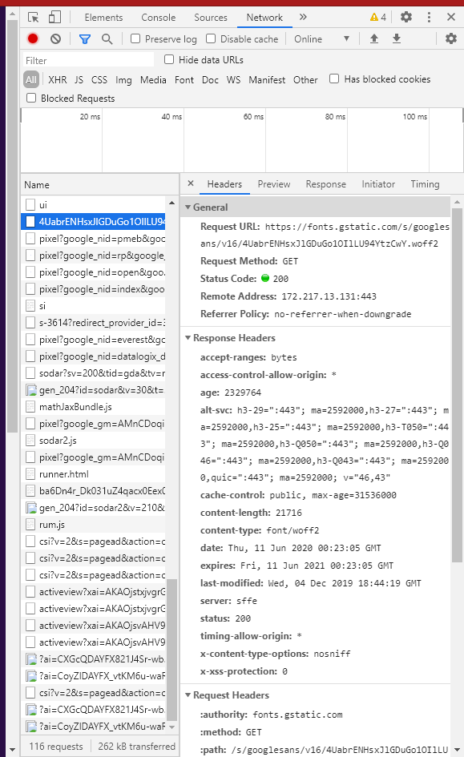
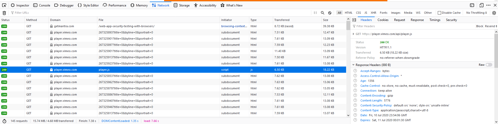
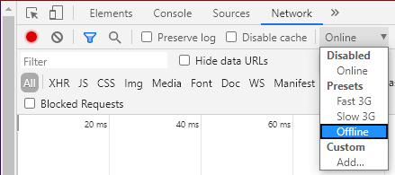
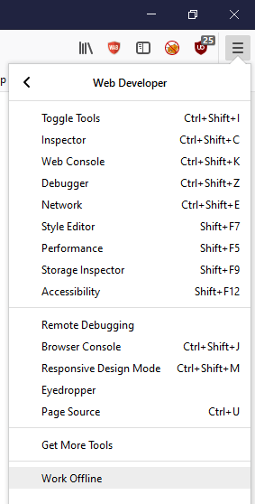
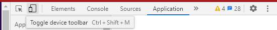
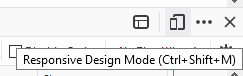

# F. Использование инструментов разработчика {#leveraging-dev-tools}

В данном приложении рассматриваются практические приемы использования встроенных инструментов разработчика (Developer Tools, DevTools) веб-браузеров для содействия процессам тестирования безопасности.

Очевидно, что встроенные функции браузера не заменяют специализированные инструменты динамического анализа безопасности приложений (DAST), инструменты статического анализа (SAST) или профессиональный опыт пентестера. Тем не менее их можно эффективно применять для решения отдельных задач тестирования и подготовки отчетных материалов.

## Доступ к инструментам разработчика (DevTools)

Открыть панель инструментов разработчика можно несколькими способами:

1. С помощью горячей клавиши `F12`.
2. С помощью сочетания клавиш `ctrl` + `shift` + `i` в Windows.
3. С помощью сочетания клавиш `cmd` + `option` + `i` в macOS.
4. Через контекстное меню правой кнопки мыши на веб-странице с выбором пункта `Просмотреть код` (`Inspect`) в Google Chrome.
5. Через контекстное меню правой кнопки мыши на веб-странице с выбором пункта `Исследовать` (`Inspect Element`) в Mozilla Firefox.
6. Через меню с тремя вертикальными точками в Google Chrome, выбрав `Дополнительные инструменты` (`More Tools`) -> `Инструменты разработчика` (`Developer Tools`).
7. Через меню-«гамбургер» с тремя горизонтальными линиями в Mozilla Firefox, выбрав `Веб-разработка` (`Web Developer`) -> `Инструменты разработчика` (`Toggle Tools`).

> ПРИМЕЧАНИЕ: Большинство приведенных ниже инструкций предполагают, что панель DevTools уже открыта и активна.

## Возможности

| Functionality         | Chrome* | Firefox | Safari |
|-----------------------|:-------:|:-------:|:------:|
| User-Agent Switching  | Y       | Y       | Y      |
| Edit/Resend Requests  | Y       | Y       | N      |
| Cookie Editing        | Y       | Y       | N      |
| Local Storage Editing | Y       | Y       | N      |
| Disable CSS           | Y       | Y       | Y      |
| Disable JavaScript    | Y       | Y       | Y      |
| View HTTP Headers     | Y       | Y       | Y      |
| Screenshots           | Y       | Y       | N      |
| Offline Mode          | Y       | Y       | N      |
| Encoding and Decoding | Y       | Y       | Y      |
| Responsive Design Mode| Y       | Y       | Y      |

`*` Все функциональные возможности Google Chrome применимы ко всем браузерам на базе движка Chromium (включая обновленный Microsoft Edge, перешедший на Chromium в 2019/2020 годах).

## Подмена заголовка User-Agent

### Связанное тестирование

- [Browser Cache Weaknesses](../04.%20Web%20Application%20Security%20Testing/04.%20Authentication%20Testing/06.%20Browser%20Cache%20Weaknesses.md)

### Google Chrome

1. Нажмите на меню из трех точек в правой верхней части панели DevTools, выберите `Больше инструментов` (`More tools`), затем откройте вкладку `Сетевые условия` (`Network conditions`).
2. Снимите флажок «Выбирать автоматически» (`Select automatically`).
3. Выберите нужный идентификатор User-Agent из выпадающего списка или введите собственную строку User-Agent вручную.

*Figure 6.F-1: Google Chrome Dev Tools User-Agent Switching Functionality*

### Mozilla Firefox

1. Перейдите на служебную страницу `about:config` в браузере Firefox и нажмите `Принять риск и продолжить` (`I accept the risk!`).
2. Введите параметр `general.useragent.override` в строку поиска.
3. Найдите параметр `general.useragent.override`; если данный параметр отсутствует, выберите переключатель типа `Строка` (`String`), затем нажмите кнопку с плюсом `Добавить` (`Add`).
4. Задайте требуемое значение строки [User-Agent](https://developers.whatismybrowser.com/useragents/explore/) в параметре `general.useragent.override`.

*Figure 6.F-2: Mozilla Firefox User-Agent Switching Functionality*

В дальнейшем нажмите на значок корзины `Удалить` (`Delete`) справа от параметра `general.useragent.override`, чтобы удалить переопределение и вернуться к стандартному идентификатору User-Agent браузера.

## Редактирование и повторная отправка запросов

### Связанное тестирование

- [Authentication Testing](../04.%20Web%20Application%20Security%20Testing/04.%20Authentication%20Testing/README.md)
- [Authorization Testing](../04.%20Web%20Application%20Security%20Testing/05.%20Authorization%20Testing/README.md)
- [Session Management Testing](../04.%20Web%20Application%20Security%20Testing/06.%20Session%20Management%20Testing/README.md)
- [Injection Testing](../04.%20Web%20Application%20Security%20Testing/07.%20Injection%20Testing/README.md)
- [Business Logic Testing](../04.%20Web%20Application%20Security%20Testing/10.%20Business%20Logic%20Testing/README.md)

### Mozilla Firefox

1. Откройте вкладку `Сеть` (`Network`).
2. Выполните любое действие в веб-приложении.
3. Нажмите правой кнопкой мыши по интересующему HTTP-запросу в списке и выберите пункт `Изменить и отправить заново` (`Edit and Resend`).
4. Внесите необходимые изменения в параметры запроса и нажмите кнопку `Отправить` (`Send`).
5. Нажмите правой кнопкой мыши по измененному запросу и выберите `Открыть в новой вкладке` (`Open in New Tab`).

### Google Chrome

1. Откройте вкладку `Сеть` (`Network`).
2. Выполните любое действие в веб-приложении.
3. Нажмите правой кнопкой мыши по интересующему HTTP-запросу в списке и выберите `Копировать` -> `Копировать как fetch` (`Copy > Copy as fetch`).
4. Вставьте скопированный фрагмент кода JavaScript во вкладку `Консоль` (`Console`).
5. Внесите необходимые изменения в параметры запроса и нажмите клавишу Enter для отправки.

## Редактирование cookie

### Связанное тестирование

- [Authentication Testing](../04.%20Web%20Application%20Security%20Testing/04.%20Authentication%20Testing/README.md)
- [Authorization Testing](../04.%20Web%20Application%20Security%20Testing/05.%20Authorization%20Testing/README.md)
- [Session Management Testing](../04.%20Web%20Application%20Security%20Testing/06.%20Session%20Management%20Testing/README.md)
- [Cookies Attributes](../04.%20Web%20Application%20Security%20Testing/06.%20Session%20Management%20Testing/02.%20Cookies%20Attributes.md)

### Google Chrome

1. Перейдите на вкладку `Приложение` (`Application`).
2. В блоке `Хранилище` (`Storage`) раскройте категорию `Файлы cookie` (`Cookies`).
3. Выберите соответствующее доменное имя.
4. Дважды щелкните по ячейке в столбце `Значение` (`Value`) для редактирования значения любого файла cookie.

> Примечание: Выбранные файлы cookie можно удалить нажатием клавиши `Delete` либо через контекстное меню правой кнопки мыши.

### Mozilla Firefox

1. Перейдите на вкладку `Хранилище` (`Storage`).
2. Раскройте секцию `Куки` (`Cookies`).
3. Выберите соответствующее доменное имя.
4. Дважды щелкните по ячейке в столбце `Значение` (`Value`) для редактирования любого файла cookie.

> Примечание: Файлы cookie можно удалить после выбора нажатием клавиши `Delete` либо с помощью команд контекстного меню правой кнопки мыши.

*Figure 6.F-3: Mozilla Firefox Cookie Editing Functionality*

## Редактирование Local Storage

### Связанное тестирование

- [Browser Storage](../04.%20Web%20Application%20Security%20Testing/11.%20Client-side%20Testing/12.%20Browser%20Storage.md)

### Google Chrome

1. Перейдите на вкладку `Приложение` (`Application`).
2. В блоке `Хранилище` (`Storage`) раскройте секцию `Локальное хранилище` (`Local Storage`).
3. Выберите соответствующее доменное имя.
4. Дважды щелкните по нужной ячейке для редактирования ключа (`Key`) или значения (`Value`).

> Примечание: Редактирование хранилищ `Session Storage` или `IndexedDB` выполняется аналогичным образом.
>
> Примечание: Новые элементы можно добавлять или удалять через контекстное меню правой кнопки мыши.

### Mozilla Firefox

1. Перейдите на вкладку `Хранилище` (`Storage`).
2. Раскройте секцию `Локальное хранилище` (`Local Storage`).
3. Выберите соответствующее доменное имя.
4. Дважды щелкните по нужной ячейке для редактирования ключа (`Key`) или значения (`Value`).

> Примечание: Редактирование хранилищ `Session Storage` или `IndexedDB` выполняется аналогичным образом.
>
> Примечание: Новые элементы можно добавлять или удалять через контекстное меню правой кнопки мыши.

## Отключение CSS

### Связанное тестирование

- [Client-side Resource Manipulation](../04.%20Web%20Application%20Security%20Testing/11.%20Client-side%20Testing/06.%20Client-side%20Resource%20Manipulation.md)

### Общие сведения

Все основные браузеры поддерживают манипулирование CSS с помощью консоли инструментов разработчика и функционала JavaScript:

- Для удаления всех внешних таблиц стилей: `$('style,link[rel="stylesheet"]').remove();`
- Для удаления всех внутренних таблиц стилей: `$('style').remove();`
- Для удаления всех встроенных (in-line) стилей элементов: `Array.prototype.forEach.call(document.querySelectorAll('*'),function(el){el.removeAttribute('style');});`
- Для полного удаления всех элементов из тега head: `$('head').remove();`

## Отключение JavaScript

### Google Chrome

1. Нажмите на меню из трех точек в правой части панели инструментов веб-разработчика и откройте `Настройки` (`Settings`).
2. На вкладке `Настройки` (`Preferences`) в секции `Отладчик` (`Debugger`) установите флажок `Отключить JavaScript` (`Disable JavaScript`).

### Mozilla Firefox

1. На вкладке DevTools `Отладчик` (`Debugger`) нажмите на значок шестеренки настроек в правом верхнем углу панели разработчика.
2. Выберите пункт `Отключить JavaScript` (`Disable JavaScript`) из выпадающего меню (это пункт-переключатель: при отключении JavaScript напротив него появляется галочка).

## Просмотр HTTP-заголовков

### Связанное тестирование

- [Information Gathering](../04.%20Web%20Application%20Security%20Testing/01.%20Information%20Gathering/README.md)

### Google Chrome

1. На вкладке `Сеть` (`Network`) в DevTools выберите любой URL или запрос.
2. В правой нижней панели перейдите на вкладку `Заголовки` (`Headers`).

*Figure 6.F-4: Google Chrome Headers View*

### Mozilla Firefox

1. На вкладке `Сеть` (`Network`) в DevTools выберите любой URL или запрос.
2. В правой нижней панели перейдите на вкладку `Заголовки` (`Headers`).

*Figure 6.F-5: Mozilla Firefox Headers View*

## Снимки экрана

### Связанное тестирование

- [Reporting](../05.%20Reporting/README.md)

### Google Chrome

1. Нажмите кнопку `Переключить панель устройства` (`Toggle Device Toolbar`) или нажмите сочетание клавиш `ctrl` + `shift` + `m`.
2. Нажмите на меню из трех точек на панели эмуляции устройств (Device Toolbar).
3. Выберите `Сделать скриншот` (`Capture screenshot`) или `Сделать полноразмерный скриншот` (`Capture full size screenshot`).

### Mozilla Firefox

1. Нажмите на меню из трех точек (многоточие) в адресной строке браузера.
2. Выберите пункт `Сделать снимок экрана` (`Take a Screenshot`).
3. Выберите вариант `Сохранить всю страницу` (`Save full page`) либо `Сохранить видимую часть` (`Save visible`).

## Автономный режим

### Google Chrome

1. Перейдите на вкладку `Сеть` (`Network`).
2. В выпадающем меню ограничения скорости (`Throttling`) выберите режим `Офлайн` (`Offline`).

*Figure 6.F-6: Google Chrome Offline Option*

### Mozilla Firefox

1. В меню-«гамбургере» браузера выберите `Веб-разработка` (`Web Developer`), затем выберите пункт `Работать автономно` (`Work Offline`).

*Figure 6.F-7: Mozilla Firefox Offline Option*

## Кодирование и декодирование

### Связанное тестирование

- Многим (возможно, даже большинству) видам [тестирования безопасности веб-приложений](../04.%20Web%20Application%20Security%20Testing/README.md) требуются различные схемы кодирования данных.

### Общие сведения

Все основные браузеры поддерживают кодирование и декодирование строк различными способами с использованием консоли DevTools и возможностей JavaScript:

- Кодирование base64: `btoa("string-to-encode")` и декодирование base64: `atob("string-to-decode")` — встроенные функции JavaScript для преобразования строки в формат Base64 и обратно.
- URL-кодирование: `encodeURIComponent("string-to-encode")` и URL-декодирование: `decodeURIComponent("string-to-decode")` — кодирует и декодирует предоставленные пользователем входные данные, используемые как часть URL; кодирует все символы со специальным значением в URL, включая зарезервированные символы.
- URI-кодирование: `encodeURI()` и URI-декодирование: `decodeURI()` — функции для кодирования и декодирования URI целиком (параметры запроса, сегменты пути или фрагменты), кодирующие специальные символы, но исключающие зарезервированные символы, такие как `:/?#[]@!$'()*+,;=`, имеющие фиксированное служебное назначение в структуре URL.

## Режим адаптивного дизайна

### Связанное тестирование

- [Browser Cache Weaknesses](../04.%20Web%20Application%20Security%20Testing/04.%20Authentication%20Testing/06.%20Browser%20Cache%20Weaknesses.md)
- [Weaker Authentication in Alternative Channel](../04.%20Web%20Application%20Security%20Testing/04.%20Authentication%20Testing/10.%20Weaker%20Authentication%20in%20Alternative%20Channel.md)
- [Clickjacking](../04.%20Web%20Application%20Security%20Testing/11.%20Client-side%20Testing/09.%20Clickjacking.md)

### Google Chrome

1. Нажмите кнопку `Переключить панель устройства` (`Toggle device toolbar`) или нажмите сочетание клавиш `ctrl` + `shift` + `m`.

*Figure 6.F-8: Google Chrome Responsive Design Mode*

### Mozilla Firefox

1. Нажмите кнопку `Режим адаптивного дизайна` (`Responsive Design Mode`) или нажмите сочетание клавиш `ctrl` + `shift` + `m`.

*Figure 6.F-9: Mozilla Firefox Responsive Design Mode*

## Ссылки и материалы

- [Web App Security Testing with Browsers](https://web.archive.org/web/20240228195355/https://getmantra.com/web-app-security-testing-with-browsers/)
- [Black Hills Information Security - Webcast: Free Tools! How to Use Developer Tools and JavaScript in Webapp Pentests](https://www.blackhillsinfosec.com/webcast-free-tools-how-to-use-developer-tools-and-javascript-in-webapp-pentests/)
- [Greg Malcolm - Chrome Developer Tools: Raiding the Armory](https://github.com/gregmalcolm/wacky-wandas-wicked-weapons-frontend/blob/fix-it/README.md)
- [List of UserAgent Strings](https://techblog.willshouse.com/2012/01/03/most-common-user-agents/)
